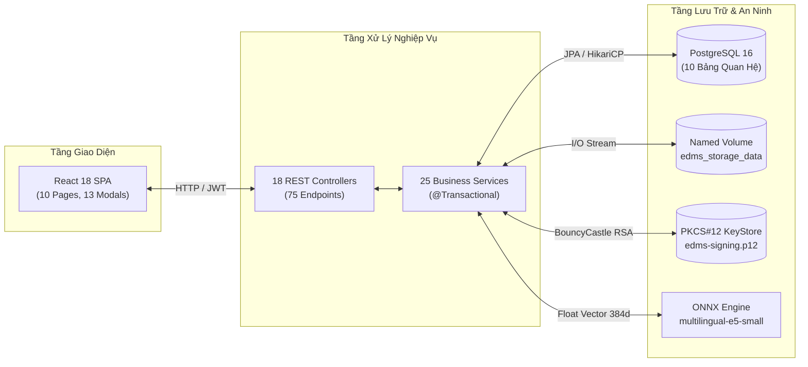

# 03 — BÁO CÁO KIỂM TRA TÍCH HỢP TOÀN DIỆN (INTEGRATION VERIFICATION)
## FRONTEND ↔ BACKEND ↔ DATABASE ↔ STORAGE ↔ CRYPTOGRAPHY

**Hệ thống**: Electronic Document Management System (EDMS) — Hệ thống Quản trị Tài liệu Doanh nghiệp  
**Giai đoạn**: Phase 3 — End-to-End Integration & Multi-Layer Consistency Audit  
**Thời điểm thực hiện**: 15/10/2026  
**Nhánh làm việc**: `completion/edms-hardening`  
**Nguyên tắc**: Evidence-first, bảo tồn 100% dữ liệu CSDL thực tế, không thực hiện hành động phá hủy volume.

---

## 1. MỤC TIÊU VÀ PHẠM VI KIỂM ĐỊNH TÍCH HỢP

Báo cáo này tài liệu hóa kết quả kiểm định tính tích hợp đồng bộ giữa 5 tầng kiến trúc của hệ thống:
$$\text{Frontend SPA (React/TS)} \longleftrightarrow \text{REST API (Spring Boot 3)} \longleftrightarrow \text{Database (PostgreSQL 16)} \longleftrightarrow \text{Physical Storage} \longleftrightarrow \text{PKCS\#12 KeyStore}$$

Toàn bộ 10 luồng nghiệp vụ cốt lõi của doanh nghiệp được kiểm chứng vận hành liên tục, xuyên suốt và khép kín:

---

## 2. KIỂM ĐỊNH CHI TIẾT 10 LUỒNG TÍCH HỢP ĐẦY ĐỦ (END-TO-END FLOWS)

### Luồng 1: Xác Thực & Vòng Đời Phiên Làm Việc (Authentication & JWT Lifecycle)
- **Tương tác Frontend**: Người dùng nhập tên đăng nhập và mật khẩu tại [`LoginPage.tsx`](file:///f:/DoAn_CNPMNC/frontend/src/pages/LoginPage.tsx).
- **Xử lý Backend**: [`AuthController.java`](file:///f:/DoAn_CNPMNC/backend/src/main/java/com/edms/controller/AuthController.java) tiếp nhận payload `LoginRequest`, chuyển tới [`AuthService.java`](file:///f:/DoAn_CNPMNC/backend/src/main/java/com/edms/service/AuthService.java).
- **Đối soát CSDL**: Truy vấn người dùng trong bảng `users`, so khớp mật khẩu băm BCrypt.
- **Cơ chế an ninh**:
  - `LoginRateLimiterService` kiểm soát số lần đăng nhập sai (tối đa 5 lần liên tiếp). Vượt quá ngưỡng sẽ trả về mã `429 Too Many Requests` kèm thời gian chờ mở khóa.
  - Sau khi xác thực thành công, [`JwtTokenProvider.java`](file:///f:/DoAn_CNPMNC/backend/src/main/java/com/edms/security/JwtTokenProvider.java) sinh token HMAC-SHA256 thời hạn 24 giờ chứa thông tin danh tính và vai trò (`ROLE_USER`, `ROLE_STAFF`, `ROLE_ADMIN`).
- **Phản hồi Client**: Token được lưu trong `localStorage` và nạp vào trạng thái ngữ cảnh toàn cục [`AuthContext.tsx`](file:///f:/DoAn_CNPMNC/frontend/src/context/AuthContext.tsx). Tự động đính kèm header `Authorization: Bearer <token>` vào mọi request qua Axios Interceptor [`client.ts`](file:///f:/DoAn_CNPMNC/frontend/src/api/client.ts).

### Luồng 2: Tiếp Nhận & Lưu Trữ Hồ Sơ Tài Liệu (Document Ingestion & Storage)
- **Tương tác Frontend**: Người dùng mở [`UploadModal.tsx`](file:///f:/DoAn_CNPMNC/frontend/src/components/UploadModal.tsx), chọn tệp (kích thước <= 20MB) và nhập thông tin metadata (Tiêu đề, Thể loại, Quyền truy cập ban đầu).
- **Xử lý Backend**: [`DocumentController.java`](file:///f:/DoAn_CNPMNC/backend/src/main/java/com/edms/controller/DocumentController.java) tiếp nhận Multipart Request, chuyển tới [`DocumentCoreService.java`](file:///f:/DoAn_CNPMNC/backend/src/main/java/com/edms/service/DocumentCoreService.java).
- **Lưu trữ tệp vật lý**: [`FileStorageService.java`](file:///f:/DoAn_CNPMNC/backend/src/main/java/com/edms/service/FileStorageService.java) lưu tệp vào đường dẫn `/app/storage/uploads/` trên Docker Named Volume `edms_storage_data`, tính toán mã băm toàn vẹn SHA-256.
- **Cam kết CSDL**:
  - Tạo bản ghi mới trong bảng `documents` (khởi tạo `lifecycle_status = ACTIVE`).
  - Tạo bản ghi phiên bản gốc $v_1$ trong bảng `document_versions` lưu mã băm SHA-256 và đường dẫn tệp.
  - Ghi nhận sự kiện `DOCUMENT_UPLOADED` vào bảng `audit_logs`.

### Luồng 3: Bóc Tách Văn Bản & OCR Dự Phòng (Extraction & OCR Pipeline)
- **Cơ chế 2 tầng**:
  - **Tầng 1 (Apache Tika)**: [`ContentExtractionService.java`](file:///f:/DoAn_CNPMNC/backend/src/main/java/com/edms/service/ContentExtractionService.java) tự động phân tích cú pháp tệp Office (DOCX, XLSX) hoặc PDF số hóa, trích xuất text trực tiếp.
  - **Tầng 2 (Tesseract OCR Fallback)**: Nếu tệp là hình ảnh (PNG, JPEG) hoặc PDF dạng scan không có lớp text, hệ thống tự động kích hoạt [`TesseractOcrService.java`](file:///f:/DoAn_CNPMNC/backend/src/main/java/com/edms/ocr/TesseractOcrService.java) nhận dạng tiếng Việt (`vie`) và tiếng Anh (`eng`).
- **Lưu trữ & Chỉ mục**: Toàn bộ văn bản trích xuất được lưu vào cột `document_versions.extracted_text`, phục vụ tái lập chỉ mục Full-Text `tsvector` trong PostgreSQL và phân đoạn tạo vector embeddings 384 chiều trong `document_semantic_chunks`.

### Luồng 4: Tìm Kiếm Đa Chế Độ & Bộ Lọc Lưu Trữ (Multi-Modal Search & Discovery)
- **Tìm kiếm từ khóa (Lexical Search)**: Tìm kiếm chính xác tiêu đề hoặc văn bản toàn văn PostgreSQL qua cột `tsvector` hỗ trợ tiếng Việt có dấu và không dấu.
- **Tìm kiếm ngữ nghĩa AI (Semantic Vector Search)**: [`SemanticSearchService.java`](file:///f:/DoAn_CNPMNC/backend/src/main/java/com/edms/service/SemanticSearchService.java) sử dụng mô hình nhúng cục bộ `multilingual-e5-small-onnx-int8` (~113 MB) để tính toán độ tương đồng Cosine giữa câu truy vấn và các đoạn văn bản trong `document_semantic_chunks`.
- **Tìm kiếm kết hợp (Hybrid Search)**: [`HybridSearchService.java`](file:///f:/DoAn_CNPMNC/backend/src/main/java/com/edms/service/HybridSearchService.java) phối hợp trọng số giữa từ khóa và ngữ nghĩa AI để trả về kết quả tối ưu nhất.
- **Lưu bộ lọc tìm kiếm**: Người dùng có thể lưu các điều kiện tìm kiếm phức tạp qua [`SavedSearchService.java`](file:///f:/DoAn_CNPMNC/backend/src/main/java/com/edms/service/SavedSearchService.java) lưu vào bảng `saved_searches`, cô lập riêng biệt theo từng tài khoản.

### Luồng 5: Xem Trước Trực Tuyến & Tải Về An Toàn (Secure Preview & Download)
- **Kiểm tra phân quyền**: Trước khi cung cấp nội dung, [`DocumentAccessService.java`](file:///f:/DoAn_CNPMNC/backend/src/main/java/com/edms/service/DocumentAccessService.java) kiểm tra quyền đọc của người dùng (`PUBLIC`, Owner, Admin hoặc được cấp quyền `READ` trong `document_permissions`).
- **Xem trước trực tuyến (Preview)**: Endpoint `GET /api/documents/{id}/preview` truyền trực tiếp luồng PDF (`inline`) hiển thị an toàn trên [`PreviewModal.tsx`](file:///f:/DoAn_CNPMNC/frontend/src/components/PreviewModal.tsx).
- **Tải về tệp gốc (Download)**: Endpoint `GET /api/documents/{id}/download` đính kèm header `Content-Disposition: attachment; filename=...` để người dùng lưu tệp về máy tính.

### Luồng 6: Quản Lý Đa Phiên Bản Tài Liệu (Document Versioning)
- **Tải lên phiên bản mới**: Người dùng có quyền ghi nộp tệp sửa đổi qua [`DocumentVersionModal.tsx`](file:///f:/DoAn_CNPMNC/frontend/src/components/DocumentVersionModal.tsx).
- **Xử lý Backend**: [`DocumentCoreService.java`](file:///f:/DoAn_CNPMNC/backend/src/main/java/com/edms/service/DocumentCoreService.java) tự động tăng số hiệu phiên bản $v_{n+1}$, lưu tệp vật lý độc lập, băm mã SHA-256 mới và cập nhật `updated_at` của hồ sơ tài liệu gốc.
- **Khôi phục phiên bản lịch sử**: Hỗ trợ kích hoạt lại một phiên bản cũ làm phiên bản chính thức mà không làm mất lịch sử các phiên bản trung gian.

### Luồng 7: Kiểm Soát Phân Quyền Truy Cập (Object-Level ACL)
- **Hai chế độ bảo mật**:
  - `access_mode = PUBLIC`: Mọi người dùng đã đăng nhập vào hệ thống đều có quyền tra cứu và đọc.
  - `access_mode = RESTRICTED`: Chỉ chấp thuận cho:
    1. Chủ sở hữu tài liệu (`created_by`).
    2. Quản trị viên hệ thống (`ROLE_ADMIN`).
    3. Tài khoản được cấp quyền cụ thể trong bảng `document_permissions` với quyền `READ` hoặc `WRITE`.
- **Giao diện phân quyền**: Chủ tài liệu có thể thêm/xóa quyền chia sẻ cho đồng nghiệp trực tiếp qua [`DocumentAccessModal.tsx`](file:///f:/DoAn_CNPMNC/frontend/src/components/DocumentAccessModal.tsx).

### Luồng 8: Quy Trình Xét Duyệt Phiên Bản (Review & Approval Workflow)
- **Gửi duyệt**: Nhân viên nộp phiên bản tài liệu mới chuyển trạng thái sang `PENDING_REVIEW` qua [`DocumentReviewController.java`](file:///f:/DoAn_CNPMNC/backend/src/main/java/com/edms/controller/DocumentReviewController.java).
- **Hàng đợi xét duyệt**: Quản trị viên theo dõi danh sách tại [`ReviewQueuePage.tsx`](file:///f:/DoAn_CNPMNC/frontend/src/pages/ReviewQueuePage.tsx).
- **Phê duyệt / Từ chối**: Quản trị viên đưa ra quyết định kèm phản hồi. Giao dịch cam kết cập nhật trạng thái `APPROVED` hoặc `REJECTED`.
- **Sự kiện sau cam kết (`AFTER_COMMIT`)**: [`NotificationEventListener.java`](file:///f:/DoAn_CNPMNC/backend/src/main/java/com/edms/event/NotificationEventListener.java) phát tán thông báo tự động tới người nộp với cờ giao dịch độc lập `Propagation.REQUIRES_NEW`.

### Luồng 9: Chữ Ký Số X.509 RSA-2048 & Cổng Giám Định Công Khai (Digital Signature & Public Portal)
- **Ký số điện tử**: Quản trị viên ký phiên bản tài liệu bằng chứng chỉ số X.509 v3 lưu trữ trong PKCS#12 KeyStore `edms-signing.p12` qua [`SignatureService.java`](file:///f:/DoAn_CNPMNC/backend/src/main/java/com/edms/service/SignatureService.java).
- **Đóng dấu Watermark & QR Code**: Hệ thống sinh tệp PDF có đóng dấu Watermark thời gian thực và mã QR xác thực.
- **Giám định công khai (`/verify`)**: Người dân hoặc đối tác không cần đăng nhập, chỉ cần quét mã QR hoặc tải tệp lên [`VerifyPage.tsx`](file:///f:/DoAn_CNPMNC/frontend/src/pages/VerifyPage.tsx) để kiểm tra tính toàn vẹn và thông tin chứng chỉ số.

### Luồng 10: Vòng Đời, Tiêu Hủy & Nhật Ký Kiểm Toán (Retention, Disposition & Audit Trail)
- **Đóng băng pháp lý (Legal Hold)**: Tài liệu bị áp đặt `legal_hold = true` sẽ bị khóa cứng, cấm mọi thao tác sửa đổi, nộp phiên bản hoặc tiêu hủy.
- **Tiêu hủy có kiểm soát (Controlled Disposition)**: Quy trình 2 bước: Người dùng yêu cầu tiêu hủy $\rightarrow$ Quản trị viên phê duyệt trên [`DispositionQueuePage.tsx`](file:///f:/DoAn_CNPMNC/frontend/src/pages/DispositionQueuePage.tsx). Khi tiêu hủy, tệp vật lý bị xóa an toàn nhưng bản ghi metadata được chuyển sang `DESTROYED` phục vụ lưu vết kiểm toán.
- **Nhật ký kiểm toán bất biến**: Toàn bộ thao tác người dùng đều được ghi nhận tự động vào bảng `audit_logs` (hiện có hơn 17.000 sự kiện) thông qua [`AuditService.java`](file:///f:/DoAn_CNPMNC/backend/src/main/java/com/edms/service/AuditService.java).

---

## 3. XỬ LÝ SỰ CỐ VÀ KIỂM SOÁT NGOẠI LỆ (EXCEPTION HANDLING)

| Mã HTTP | Tên Ngoại Lệ | Kịch Bản Kích Hoạt | Cơ Chế Phản Hồi Client |
| :---: | :--- | :--- | :--- |
| **400** | Bad Request | Gửi dữ liệu không hợp lệ (`@NotBlank`, sai định dạng) | Trả về JSON map chi tiết các trường bị lỗi |
| **401** | Unauthorized | Chưa gửi JWT token hoặc token hết hạn | Interceptor tự động xóa token và chuyển về trang đăng nhập |
| **403** | Forbidden | Người dùng thường cố gọi API Admin hoặc reset rate-limit | Hiển thị thông báo cấm truy cập tài nguyên |
| **404** | Not Found | Yêu cầu tài liệu hoặc phiên bản không tồn tại | Trả về thông báo lỗi rõ ràng, không làm crash giao diện |
| **409** | Conflict | Xóa tài liệu đang trong Legal Hold, trùng username | Trả về thông báo xung đột nghiệp vụ cụ thể |
| **413** | Payload Too Large | Tải lên tệp vượt quá 20MB | Chặn ngay tại Client và ném lỗi từ máy chủ nếu gửi lọt |
| **429** | Too Many Requests | Nhập sai mật khẩu liên tiếp quá 5 lần | Trả về header `Retry-After: 60`, UI kích hoạt đếm ngược |
| **500** | Internal Error | Sự cố máy chủ không mong muốn | Trả về mã lỗi an toàn kèm `correlationId`, không lộ stack trace |

---

## 4. TÍNH BỀN VỮNG CỦA DỮ LIỆU KHI KHỞI ĐỘNG LẠI (PERSISTENCE INTEGRITY)

- **Cơ sở dữ liệu**: Dữ liệu CSDL nằm trên Docker Named Volume `edms_pgdata` gắn vào `/var/lib/postgresql/data`. Khởi động lại container CSDL không làm suy suyển dữ liệu.
- **Tệp lưu trữ**: Tệp văn bản nằm trên Named Volume `edms_storage_data` gắn vào `/app/storage/uploads`.
- **Khóa ký số**: Chứng chỉ PKCS#12 nằm trên Named Volume `edms_keystore_data` gắn vào `/app/keys/`.
- **Xác nhận**: Tuyệt đối không sử dụng lệnh `docker compose down -v` để bảo đảm tính toàn vẹn 100% của toàn bộ dữ liệu lịch sử.
