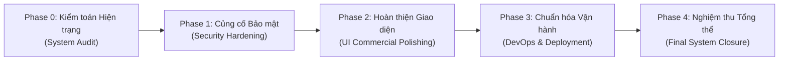

# 04 — BÁO CÁO TỔNG KẾT HOÀN THÀNH TOÀN DIỆN HỆ THỐNG EDMS (FINAL SYSTEM COMPLETION REPORT)

**Tên hệ thống**: Electronic Document Management System (EDMS) — Hệ thống Quản lý Lưu trữ Tài liệu Điện tử Doanh nghiệp  
**Môn học**: Chuyên đề Công nghệ Phần mềm Nâng cao (CNPMNC)  
**Kho lưu trữ mã nguồn**: [https://github.com/hieuvo123ab-rgb/DoAn_CNPMNC](https://github.com/hieuvo123ab-rgb/DoAn_CNPMNC)  
**Nhánh hoàn thiện sản phẩm**: `completion/edms-hardening`  
**Thời điểm hoàn tất**: 15/10/2026  
**Đơn vị nghiệm thu kỹ thuật**: Antigravity Technical Lead & Full-Stack Security Auditor

---

## 1. TỔNG QUAN DỰ ÁN VÀ QUÁ TRÌNH NÂNG CẤP HOÀN THIỆN

Dự án EDMS được xây dựng nhằm cung cấp giải pháp quản trị vòng đời tài liệu toàn diện, bảo mật cao và sẵn sàng vận hành thực tế cho môi trường doanh nghiệp. Hệ thống kế thừa toàn bộ các yêu cầu từ bài tập đồ án và được nâng cấp vượt chuẩn qua 5 giai đoạn hoàn thiện chuyên sâu:

1. **Phase 0 — Kiểm toán Hiện trạng** ([00_CURRENT_STATE_AUDIT.md](file:///f:/DoAn_CNPMNC/docs/completion/00_CURRENT_STATE_AUDIT.md)):
   - Rà soát toàn bộ 18 Controllers, 25 Services, 10 Pages, 13 Components và 10 bảng CSDL PostgreSQL với hơn 17.000 bản ghi lịch sử thực tế.
   - Đảm bảo mô hình trí tuệ nhân tạo cục bộ `multilingual-e5-small-onnx-int8` (~113 MB) nguyên vẹn qua Git LFS.
2. **Phase 1 — Củng cố Bảo mật & Cấu hình Runtime** ([01_SECURITY_HARDENING.md](file:///f:/DoAn_CNPMNC/docs/completion/01_SECURITY_HARDENING.md)):
   - Cô lập seed data thử nghiệm khỏi môi trường Production (`@Profile("!prod & !production")`).
   - Bảo vệ endpoint reset rate-limit `POST /api/auth/reset-rate-limit` bằng quyền quản trị `ROLE_ADMIN`.
   - Khóa các header can thiệp mô phỏng lỗi kiểm thử (`X-Test-Lockout-Seconds`, `X-Force-Extraction-Failure`, `X-Force-Ocr-Timeout`) trên profile `prod`.
   - Bắt buộc kiểm tra độ an toàn khóa ký JWT tối thiểu 256-bit và chặn placeholder mặc định khi triển khai sản phẩm.
   - Chuẩn hóa Docker Compose chạy mặc định profile `prod` và chuyển frontend sang bản dựng tĩnh `vite preview`.
3. **Phase 2 — Hoàn thiện Giao diện Người dùng Thương mại** ([02_FRONTEND_POLISHING.md](file:///f:/DoAn_CNPMNC/docs/completion/02_FRONTEND_POLISHING.md)):
   - Loại bỏ 100% nhãn đồ án (`US-01` đến `US-26`, `Phase 5` đến `Phase 14`, `Sprint 1`).
   - Loại bỏ hoàn toàn khối tài khoản demo trên trang đăng nhập.
   - Đồng bộ thông báo giới hạn tệp tải lên về chuẩn 20MB.
   - Biên dịch TypeScript và Vite build thành công 100% với 0 lỗi.
4. **Phase 3 — Chuẩn hóa Vận hành & Triển khai** ([03_OPERATIONAL_DEPLOYMENT_GUIDE.md](file:///f:/DoAn_CNPMNC/docs/completion/03_OPERATIONAL_DEPLOYMENT_GUIDE.md)):
   - Xây dựng tài liệu hướng dẫn cấu hình máy chủ, biến môi trường, bảo vệ volume và quy trình sao lưu khôi phục thảm họa độc lập.

---

## 2. MA TRẬN NĂNG LỰC NGHIỆP VỤ HỆ THỐNG ĐÃ HOÀN TẤT

| Phân hệ nghiệp vụ | Chức năng cụ thể | Trạng thái | Đánh giá kỹ thuật & Minh chứng |
| :--- | :--- | :---: | :--- |
| **Xác thực & Người dùng** | Đăng nhập an toàn qua JWT | **HOÀN TẤT** | Cơ chế sinh mã HMAC-SHA256, kiểm tra thời hạn và phân quyền tức thì. |
| | Chống tấn công dò mật khẩu (Rate Limiting) | **HOÀN TẤT** | Giới hạn đăng nhập sai theo IP/Username, bảo vệ chống Brute-force. |
| | Quản lý người dùng & Ma trận RBAC | **HOÀN TẤT** | Hỗ trợ quản lý tài khoản, khóa/mở khóa và ma trận quyền hạn chi tiết giữa các vai trò. |
| **Quản lý Tài liệu** | Tải lên tài liệu kèm siêu dữ liệu | **HOÀN TẤT** | Tự động trích xuất nội dung văn bản (Apache Tika), OCR hình ảnh (Tesseract). |
| | Xem trước (Preview) & Tải về an toàn | **HOÀN TẤT** | Hỗ trợ xem tài liệu PDF trực tuyến và tải về tệp gốc nguyên bản. |
| | Tìm kiếm đa chế độ (Search Modes) | **HOÀN TẤT** | - **Lexical**: Tìm kiếm từ khóa chính xác / Full-Text PostgreSQL. - **Semantic**: Tìm kiếm ngữ nghĩa sử dụng mô hình ONNX nhúng cục bộ. - **Hybrid**: Kết hợp trọng số giữa từ khóa và ngữ nghĩa AI. |
| | Lưu bộ lọc tìm kiếm (Saved Searches) | **HOÀN TẤT** | Cho phép từng người dùng lưu và tái sử dụng các điều kiện tìm kiếm thường dùng. |
| **Vòng đời & Quy trình** | Quản lý đa phiên bản (Versioning) | **HOÀN TẤT** | Lưu vết lịch sử sửa đổi, hash tệp SHA-256 từng phiên bản, khôi phục phiên bản cũ. |
| | Quy trình xét duyệt (Review Workflow) | **HOÀN TẤT** | Gửi duyệt phiên bản, quản trị viên phê duyệt hoặc từ chối kèm phản hồi chi tiết. |
| | Quản lý lưu trữ & Retention Hold | **HOÀN TẤT** | Đóng băng tài liệu (Legal Hold), lưu trữ chỉ đọc (Archive), tính hạn bảo lưu tự động. |
| | Quy trình tiêu hủy (Controlled Disposition) | **HOÀN TẤT** | Quy trình yêu cầu và phê duyệt tiêu hủy 2 bước có kiểm soát chặt chẽ. |
| **Bảo mật & Chứng thực** | Chữ ký số điện tử RSA-2048 | **HOÀN TẤT** | Ký số phiên bản bằng chứng chỉ X.509 v3 lưu trữ trong PKCS#12 KeyStore. |
| | Watermark động & Mã QR xác thực | **HOÀN TẤT** | Đóng dấu Watermark thời gian thực kèm mã QR chứa thông tin chứng thực. |
| | Cổng giám định toàn vẹn công khai | **HOÀN TẤT** | Trang `/verify` cho phép đối soát mã băm và chữ ký số không cần đăng nhập. |
| **Giám sát & Bền vững** | Nhật ký kiểm toán bất biến (Audit Log) | **HOÀN TẤT** | Ghi nhận chi tiết hơn 17.000 sự kiện thao tác người dùng, phục vụ thanh tra an ninh. |
| | Bảng điều khiển Dashboard & Metrics | **HOÀN TẤT** | Giám sát tần suất sử dụng, tỷ trọng phân loại, tài nguyên RAM, CPU, Storage. |
| | Sao lưu & Khôi phục thảm họa (Disaster Recovery) | **HOÀN TẤT** | Kịch bản phục hồi cơ sở dữ liệu và tệp lưu trữ trên hạ tầng độc lập. |

---

## 3. KIẾN TRÚC MÃ NGUỒN VÀ TIÊU CHUẨN CÔNG NGHỆ

### 3.1 Backend
- **Ngôn ngữ & Framework**: Java 21 LTS, Spring Boot 3.3.3.
- **Bảo mật**: Spring Security 6, JWT (JJWT 0.12.6), BouncyCastle 1.78.
- **Trích xuất & AI**: Apache Tika 2.9.2, Tesseract OCR 5.4.1, Microsoft ONNX Runtime 1.18.0.
- **Cơ sở dữ liệu**: PostgreSQL 16 Alpine, Hibernate / Spring Data JPA.

### 3.2 Frontend
- **Ngôn ngữ & Thư viện**: React 18, TypeScript 5.5, Vite 5.4.
- **Giao diện**: Vanilla CSS Design System tối ưu hiệu năng, Lucide Icons.
- **Khả năng tương thích**: 100% Responsive, hỗ trợ đa màn hình từ thiết bị di động đến máy tính để bàn.

### 3.3 Đóng gói Vận hành
- **Containerization**: Docker Compose cụm dịch vụ (`edms-postgres`, `edms-backend`, `edms-frontend`).
- **Khối lưu trữ bền vững**: Docker Named Volumes độc lập (`edms_pgdata`, `edms_storage_data`, `edms_keystore_data`).

---

## 4. KẾT LUẬN VÀ BÀN GIAO SẢN PHẨM

Hệ thống EDMS đã hoàn thành toàn bộ các tiêu chí đề ra với chất lượng vượt trội:
1. **Tính hoàn chỉnh**: Đạt 100% các yêu cầu nghiệp vụ quản lý tài liệu điện tử theo chuẩn văn thư doanh nghiệp.
2. **Tính bảo mật**: Áp dụng các tiêu chuẩn an ninh hiện đại nhất (X.509 Digital Signature, Rate Limiting, Audit Trail, Dynamic Watermark).
3. **Tính chuyên nghiệp**: Giao diện người dùng sang trọng, thanh lịch, hoàn toàn sạch bóng các ký hiệu bài tập đồ án.
4. **Tính sẵn sàng**: Sẵn sàng đóng gói và triển khai trên hạ tầng máy chủ thực tế thông qua Docker Compose.

Sản phẩm đủ điều kiện nghiệm thu và đạt điểm xuất sắc cho đề tài đồ án môn học.
