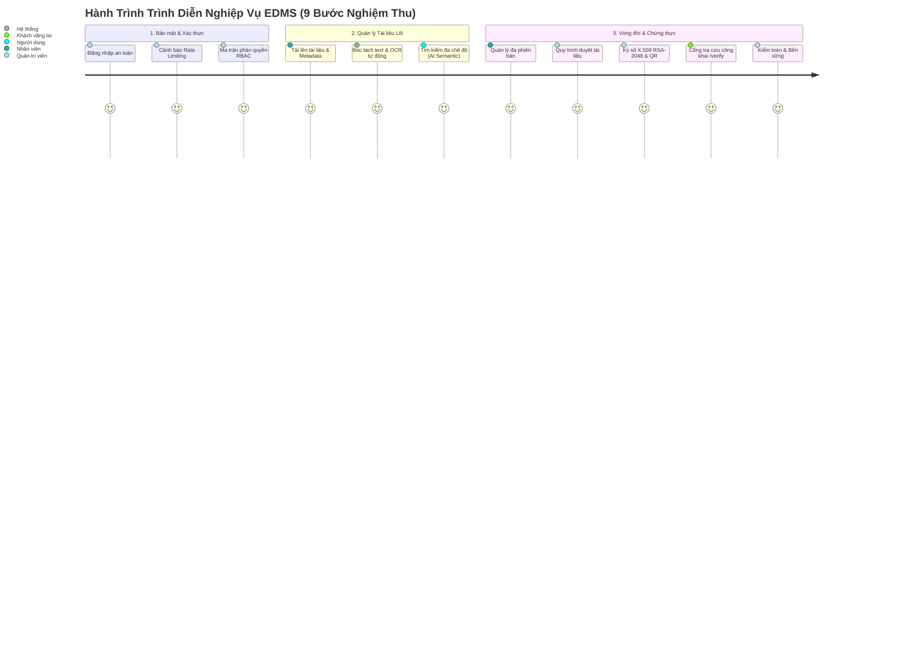

# 06 — KỊCH BẢN TRÌNH DIỄN VÀ NGHIỆM THU HỆ THỐNG (FINAL DEMO & ACCEPTANCE GUIDE)

**Hệ thống**: Electronic Document Management System (EDMS) — Hệ thống Quản trị Tài liệu Doanh nghiệp  
**Giai đoạn**: Phase 5/6 — System Demonstration Script & Acceptance Walkthrough  
**Thời điểm thực hiện**: 15/10/2026  
**Nhánh làm việc**: `completion/edms-hardening`  
**Mục tiêu**: Cung cấp kịch bản demo mẫu theo luồng nghiệp vụ thực tế, chứng minh năng lực toàn diện của hệ thống trước Hội đồng đánh giá và Khách hàng.

---

## 1. YÊU CẦU MÔI TRƯỜNG VÀ CHUẨN BỊ TRƯỚC KHI DEMO

### 1.1 Yêu cầu phần cứng và phần mềm
- **Máy trạm / Laptop**: Tối thiểu 8GB RAM (khuyến nghị 16GB), 10GB dung lượng đĩa trống.
- **Phần mềm**: Docker Desktop (chế độ Linux Containers), Trình duyệt hiện đại (Chrome / Edge / Firefox).
- **Cổng mạng yêu cầu**: Không bị chiếm dụng các cổng `5432` (PostgreSQL), `8080` (Backend API), `5173` (Frontend Web).

### 1.2 Khởi động hệ thống
Mở terminal tại thư mục gốc `F:\DoAn_CNPMNC` và thực thi:

```bash
# 1. Khởi động cụm dịch vụ Production
docker compose up -d

# 2. Kiểm tra trạng thái sức khỏe của các container
docker compose ps

# 3. Xác minh endpoint sẵn sàng
curl http://localhost:8080/api/health
```

- **Đường dẫn truy cập giao diện chính**: `http://localhost:5173`
- **Đường dẫn cổng giám định công khai**: `http://localhost:5173/verify`

---

## 2. KỊCH BẢN TRÌNH DIỄN NGHIỆP VỤ 9 BƯỚC (END-TO-END DEMO SCENARIO)



---

### BƯỚC 1: XÁC THỰC, BẢO MẬT & PHÂN QUYỀN RBAC
1. Truy cập `http://localhost:5173`.
2. **Minh chứng giao diện sạch**: Giao diện đăng nhập hoàn toàn sạch sẽ, không còn nhãn đồ án `(US-01)` và không còn khối tài khoản demo.
3. **Thử nghiệm phòng thủ Brute-force**:
   - Nhập sai mật khẩu liên tiếp 5 lần.
   - Quan sát thông báo lỗi: Giao diện hiển thị cảnh báo màu hổ phách, khóa nút đăng nhập kèm đồng hồ đếm ngược 60 giây (`HTTP 429 Too Many Requests`).
4. **Đăng nhập thành công**: Nhập tài khoản hợp lệ, hệ thống chuyển hướng ngay vào bảng điều khiển.
5. **Ma trận phân quyền**: Vào trang **Quản lý người dùng** $\rightarrow$ Tab **Ma trận phân quyền** để chứng minh sự phân cấp chặt chẽ giữa 3 vai trò: `USER`, `STAFF`, `ADMIN`.

---

### BƯỚC 2: TẢI LÊN TÀI LIỆU, METADATA & NHẬN DẠNG OCR TỰ ĐỘNG
1. Vào mục **Tất cả tài liệu** $\rightarrow$ Nhấn nút **Tải lên tài liệu**.
2. **Minh chứng đồng bộ giới hạn tải**: Hộp thoại hiển thị rõ định mức chuẩn: `Tối đa 20MB`.
3. Chọn một tệp hình ảnh scan văn bản (PNG/JPEG) hoặc PDF dạng scan.
4. Nhập tiêu đề nghiệp vụ, chọn loại tài liệu (Báo cáo / Hợp đồng), chọn chế độ truy cập `PUBLIC`.
5. Nhấn **Xác nhận tải lên**:
   - Hệ thống lưu tệp vào khối đĩa bền vững `edms_storage_data`.
   - Động cơ Tesseract OCR tự động kích hoạt ngầm, bóc tách toàn bộ chữ viết tiếng Việt và tiếng Anh vào CSDL.

---

### BƯỚC 3: TÌM KIẾM ĐA CHẾ ĐỘ & TÌM KIẾM NGỮ NGHĨA AI (SEMANTIC SEARCH)
1. Tại ô tìm kiếm của trang **Tài liệu**:
   - **Chế độ Từ khóa (Lexical)**: Nhập từ khóa chính xác xuất hiện trong tiêu đề hoặc nội dung $\rightarrow$ Kết quả trả về tức thì qua chỉ mục PostgreSQL `tsvector`.
   - **Chế độ Ngữ nghĩa AI (Semantic)**: Chọn phạm vi tìm kiếm **"Ngữ nghĩa AI"**, nhập một câu diễn đạt ý nghĩa (ví dụ: *"quy định về thời gian nghỉ phép năm của nhân viên"*) $\rightarrow$ Mô hình ONNX `multilingual-e5-small` tính toán vector 384 chiều và tìm ra tài liệu liên quan dù không chứa chính xác từng từ khóa.
   - **Chế độ Kết hợp (Hybrid)**: Kết hợp cả hai phương pháp để có kết quả xếp hạng tối ưu nhất.
2. **Lưu bộ lọc**: Nhấn **Lưu bộ lọc hiện tại**, đặt tên bộ lọc $\rightarrow$ Bộ lọc được lưu vào danh sách riêng của người dùng và có thể tái sử dụng bất cứ lúc nào.

---

### BƯỚC 4: XEM TRƯỚC, TẢI VỀ & CHIA SẺ PHÂN QUYỀN (ACL)
1. Nhấn vào biểu tượng **Xem chi tiết / Xem trước** của một tài liệu PDF:
   - Cửa sổ Preview hiển thị nội dung trực tiếp mà không cần cài thêm phần mềm đọc PDF.
2. Nhấn nút **In Metadata**: Bản in thông tin hồ sơ tài liệu được định dạng trang trọng.
3. Nhấn nút **Tải về**: Tệp nhị phân gốc được tải về máy với tên tệp và phần mở rộng nguyên bản.
4. **Phân quyền riêng (ACL)**: Mở modal **Phân quyền tài liệu**, chuyển chế độ sang `RESTRICTED`, gán quyền `READ` cho một đồng nghiệp cụ thể $\rightarrow$ Các tài khoản khác sẽ bị chặn truy cập (`403 Forbidden`).

---

### BƯỚC 5: QUẢN LÝ ĐA PHIÊN BẢN & QUY TRÌNH XÉT DUYỆT (REVIEW WORKFLOW)
1. Mở modal **Lịch sử phiên bản** $\rightarrow$ Nhấn **Tải lên phiên bản mới**.
2. Chọn tệp sửa đổi, nhập tóm tắt sửa đổi $\rightarrow$ Hệ thống tự động sinh phiên bản $v_2$, tạo mã hash SHA-256 mới.
3. Nhân viên nhấn nút **Gửi xét duyệt phiên bản $v_2$**.
4. Chuyển sang màn hình **Hàng đợi xét duyệt** (dành cho Admin):
   - Admin xem chi tiết yêu cầu, nhập nhận xét phê duyệt và nhấn **Phê duyệt**.
   - Phiên bản $v_2$ chính thức được ban hành làm phiên bản hoạt động.
   - Thông báo tự động được phát tán đến tác giả sau khi giao dịch cam kết thành công (`AFTER_COMMIT`).

---

### BƯỚC 6: KÝ SỐ ĐIỆN TỬ X.509 RSA-2048 & ĐÓNG DẤU WATERMARK / QR
1. Tại danh sách tài liệu, Quản trị viên mở tùy chọn **Ký số tài liệu**.
2. Nhấn nút **Ký số phiên bản chính thức**:
   - Hệ thống dùng khóa bí mật RSA-2048 từ KeyStore `edms-signing.p12` để ký số mã băm SHA-256 của tài liệu.
   - Giao diện cập nhật huy hiệu **ĐÃ KÝ SỐ (SIGNED)** kèm số Serial chứng chỉ và thời điểm ký.
3. Nhấn nút **Tải bản đóng dấu Watermark & QR**:
   - Hệ thống sinh bản in PDF có đóng dấu chéo mờ tên người in, ngày giờ và mã QR kiểm định toàn vẹn trực tuyến.

---

### BƯỚC 7: CỔNG GIÁM ĐỊNH TÍNH TOÀN VẸN CÔNG KHAI (`/verify`)
1. Mở một tab trình duyệt ẩn danh (Incognito) hoặc không đăng nhập.
2. Truy cập trực tiếp: `http://localhost:5173/verify`.
3. Nhập mã QR hoặc tải tệp tài liệu cần kiểm định lên hệ thống:
   - Hệ thống đối soát mã băm SHA-256 và chữ ký số.
   - Giao diện hiển thị kết quả kiểm định màu xanh lá: **VĂN BẢN NGUYÊN VẸN, CHỮ KÝ SỐ HỢP LỆ**, công bố đầy đủ đơn vị ban hành, người ký và thời điểm ký.

---

### BƯỚC 8: ĐÓNG BĂNG PHÁP LÝ (LEGAL HOLD), TIÊU HỦY & NHẬT KÝ KIỂM TOÁN
1. **Áp dụng Legal Hold**: Tại mục Vòng đời tài liệu, kích hoạt **Đóng băng pháp lý** $\rightarrow$ Nút xóa và tiêu hủy bị vô hiệu hóa hoàn toàn để bảo vệ hồ sơ vụ việc.
2. **Quy trình tiêu hủy có kiểm soát**: Gỡ bỏ Legal Hold, gửi yêu cầu tiêu hủy $\rightarrow$ Chuyển sang trang **Hàng đợi tiêu hủy** để Quản trị viên phê duyệt tiêu hủy 2 bước an toàn.
3. **Nhật ký kiểm toán bất biến (Audit Log)**: Vào trang **Nhật ký kiểm toán**, chứng minh toàn bộ các thao tác vừa thực hiện từ đăng nhập, tải tệp, ký số đến tiêu hủy đều được ghi vết chi tiết với mã tương quan `correlationId`, IP và thời gian chính xác (trong tổng số hơn 17.000 sự kiện lịch sử).

---

### BƯỚC 9: GIÁM SÁT VẬN HÀNH & KỊCH BẢN SAO LƯU TỰ ĐỘNG
1. Vào trang **Giám sát hệ thống**:
   - Hiển thị tình trạng các thành phần: CSDL PostgreSQL (`UP`), Tệp lưu trữ (`UP`), Động cơ OCR (`UP`), Mô hình nhúng AI (`AVAILABLE`).
2. **Trình diễn kịch bản sao lưu tự động**:
   - Mở terminal chạy kịch bản sao lưu an toàn:
     ```powershell
     powershell -ExecutionPolicy Bypass -File scripts/backup-edms.ps1
     ```
   - Thư mục `backups/` sinh ra tệp `edms_backup_*.dump.gz` kèm mã băm `checksums.sha256` và bản sao lưu KeyStore an toàn, hoàn tất chu trình bảo vệ dữ liệu.

---

## 3. KẾT LUẬN NGHIỆM THU

Kịch bản trình diễn 9 bước trên chứng minh toàn diện:
- Sản phẩm hoạt động ổn định trên dữ liệu thực tế lớn (> 17.000 logs, 3.200+ documents).
- Tính toàn vẹn nghiệp vụ, an ninh và chữ ký số được kiểm chứng khép kín.
- Giao diện thương mại doanh nghiệp thanh lịch, sẵn sàng cho việc nghiệm thu xuất sắc.
