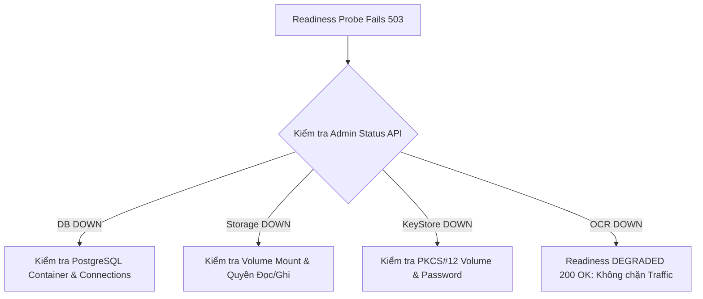

# EDMS PHASE 16 — OPERATIONS & OBSERVABILITY RUNBOOK
**Hệ Thống Quản Trị Tài Liệu Doanh Nghiệp (EDMS)**  
*Mã tài liệu: EDMS-SOP-OPS-PHASE16 | Phiên bản: 1.0.0 | Ngày ban hành: 28/09/2026*

---

## 1. TỔNG QUAN VẬN HÀNH (OPERATIONAL OVERVIEW)

Tài liệu này cung cấp quy trình chuẩn vận hành (Standard Operating Procedure - SOP) cho đội ngũ Vận hành (SRE/DevOps/SysAdmin) giám sát, chuẩn đoán, xử lý sự cố và duy trì tính khả dụng cao của hệ thống EDMS tại môi trường Production.

Hệ thống cung cấp các giao diện quan sát:
1. **Liveness Probe**: `GET /api/health/liveness` (Kiểm tra tiến trình JVM sống/chết).
2. **Readiness Probe**: `GET /api/health/readiness` (Kiểm tra các phụ thuộc cốt lõi DB, Storage, KeyStore, OCR).
3. **Backward-compatible Health**: `GET /api/health` (Tương thích ngược các hệ thống giám sát cũ).
4. **Admin System Status**: `GET /api/admin/system/status` (Chuẩn đoán chi tiết cho ROLE_ADMIN).
5. **Admin System Metrics**: `GET /api/admin/system/metrics` (Thống kê tài nguyên RAM, tổng số requests, độ trễ phản hồi).
6. **Request Correlation Tracking**: HTTP Header `X-Correlation-ID` & SLF4J MDC `[corr=<id>]`.
7. **Giao diện Quản trị Frontend**: Route `/system-status` (Tự động cập nhật mỗi 5 giây, bảo vệ bằng ROLE_ADMIN).

---

## 2. QUY TRÌNH KIỂM TRA SỨC KHỎE ĐỊNH KỲ (HEALTH VERIFICATION SOP)

### 2.1. Kiểm tra Liveness (JVM Process Alive)
```bash
curl -i http://localhost:8080/api/health/liveness
```
- **Kỳ vọng**: HTTP `200 OK`
- **Nội dung mẫu**:
  ```json
  {
    "status": "UP",
    "uptimeSeconds": 3600,
    "timestamp": "2026-09-28T09:00:00.000Z"
  }
  ```
- **Hành động khi HTTP != 200 hoặc Timeout**: Tiến trình JVM bị treo, Out Of Memory (OOM) hoặc container đã tắt. Cần khởi động lại container:
  ```bash
  docker compose restart backend
  ```

### 2.2. Kiểm tra Readiness (Traffic Acceptance)
```bash
curl -i http://localhost:8080/api/health/readiness
```
- **Kỳ vọng bình thường**: HTTP `200 OK`, `readiness: "READY"`
- **Kỳ vọng khi suy giảm dịch vụ phụ trợ (ví dụ OCR lỗi)**: HTTP `200 OK`, `readiness: "DEGRADED"` (Vẫn tiếp nhận nghiệp vụ tài liệu bình thường).
- **Kỳ vọng khi phụ thuộc cốt lõi lỗi (DB hoặc Storage hoặc KeyStore lỗi)**: HTTP `503 Service Unavailable`, `readiness: "NOT_READY"`.
- **Hành động khi HTTP 503**: Xem mục 3 bên dưới để phân loại và xử lý.

---

## 3. PHÂN LOẠI VÀ XỬ LÝ SỰ CỐ READINESS (READINESS TRIAGE)

Khi Readiness trả về HTTP 503 hoặc Admin System Status báo trạng thái DOWN:



### 3.1. Sự cố Cơ sở Dữ liệu (PostgreSQL DOWN)
1. **Dấu hiệu**: Readiness HTTP 503, `components.database.status: "DOWN"`.
2. **Kiểm tra trạng thái container Postgres**:
   ```bash
   docker ps -f name=edms-postgres
   docker exec edms-postgres pg_isready -U edms_user -d edms_db
   ```
3. **Kiểm tra log Postgres**:
   ```bash
   docker logs --tail 50 edms-postgres
   ```
4. **Khắc phục**:
   - Nếu container postgres đã dừng: `docker compose up -d postgres`.
   - Nếu cạn kiệt connection pool (HikariPool): Kiểm tra các truy vấn chậm hoặc khởi động lại backend: `docker compose restart backend`.

### 3.2. Sự cố Kho Lưu Trữ Tệp (Document Storage DOWN)
1. **Dấu hiệu**: Readiness HTTP 503, `components.storage.status: "DOWN"`, `writable: false`.
2. **Kiểm tra volume mount**:
   ```bash
   docker exec edms-backend ls -la /app/storage/uploads
   ```
3. **Kiểm tra dung lượng đĩa máy chủ**:
   ```bash
   docker exec edms-backend df -h /app/storage
   ```
4. **Khắc phục**: Giải phóng dung lượng đĩa máy chủ nếu đạt 100%, hoặc cấp lại quyền ghi (`chmod 755 /app/storage/uploads`).

### 3.3. Sự cố KeyStore Ký Số (Signing KeyStore DOWN)
1. **Dấu hiệu**: Readiness HTTP 503, `components.signingKeyStore.status: "DOWN"`, `keyStoreLoaded: false`.
2. **Kiểm tra tệp KeyStore**:
   ```bash
   docker exec edms-backend ls -la /app/keystore/edms-signing.p12
   ```
3. **Khắc phục**: Khôi phục tệp `edms-signing.p12` từ bản backup Phase 15 nếu tệp bị mất hoặc hỏng:
   ```bash
   cp backups/latest/edms-signing.p12 /var/lib/docker/volumes/doan_cnpmnc_keystore_data/_data/
   docker compose restart backend
   ```

### 3.4. Sự cố OCR (OCR Engine UNAVAILABLE)
1. **Dấu hiệu**: Readiness trả về `200 OK`, `readiness: "DEGRADED"`, `components.ocr.status: "UNAVAILABLE"`.
2. **Nguyên nhân**: Tesseract OCR process timeout hoặc tesseract binary không phản hồi.
3. **Tác động**: Hệ thống **KHÔNG ngắt kết nối nghiệp vụ**. Các thao tác lưu trữ, phân quyền, ký số, tải tệp vẫn hoạt động 100%. Tệp tải lên sẽ lưu trạng thái OCR FAILED hoặc PENDING mà không làm nghẽn hệ thống.

---

## 4. QUY TRÌNH TRUY VẾT YÊU CẦU THEO CORRELATION ID (CORRELATION TRACING)

### 4.1. Cấu trúc và Cơ chế
- Mỗi yêu cầu HTTP gửi đến Backend được gán một mã `X-Correlation-ID` duy nhất (UUID v4 hoặc do client chỉ định hợp lệ).
- Mã này được gắn vào:
  1. Header phản hồi HTTP: `X-Correlation-ID: <uuid>`
  2. Toàn bộ dòng log trong container thông qua SLF4J MDC: `[corr=<uuid>]`
  3. Thân JSON của phản hồi lỗi: `{"timestamp": "...", "status": 403, "correlationId": "<uuid>", ...}`

### 4.2. Các bước truy vết lỗi người dùng
Khi người dùng báo lỗi kèm `correlationId` (ví dụ: `d8f2882c-4731-4db8-8314-e0b4e234dbb9`):
1. **Tìm kiếm log tương ứng trong Backend**:
   ```bash
   docker logs edms-backend 2>&1 | grep "d8f2882c-4731-4db8-8314-e0b4e234dbb9"
   ```
2. **Xem ngữ cảnh trước và sau lỗi 10 dòng**:
   ```bash
   docker logs edms-backend 2>&1 | grep -C 10 "d8f2882c-4731-4db8-8314-e0b4e234dbb9"
   ```
3. Nhờ có `[corr=...]`, toàn bộ chuỗi sự kiện từ Authentication -> Controller -> Service -> Exception Handler đều xuất hiện tập trung, giúp xác định nguyên nhân trong vòng < 60 giây.

---

## 5. QUY TRÌNH GIÁM SÁT SỐ LIỆU VẬN HÀNH (METRICS INTERPRETATION)

Truy cập API số liệu (yêu cầu quyền ROLE_ADMIN):
```bash
TOKEN=$(curl -s -X POST http://localhost:8080/api/auth/login \
  -H "Content-Type: application/json" \
  -d '{"username":"hieu","password":"password123"}' | jq -r .token)

curl -s -H "Authorization: Bearer $TOKEN" http://localhost:8080/api/admin/system/metrics | jq .
```

### 5.1. Bảng diễn giải chỉ số
| Chỉ số | Vùng giá trị an toàn | Dấu hiệu cảnh báo | Hành động xử lý |
|---|---|---|---|
| `memory.usedMb` / `memory.maxMb` | < 75% | > 85% liên tục | Kiểm tra rò rỉ bộ nhớ, tăng giới hạn RAM trong `docker-compose.yml` (`mem_limit`). |
| `requests.averageResponseTimeMs` | < 500ms | > 2000ms | Kiểm tra các truy vấn SQL chậm, rà soát lại chỉ mục DB hoặc tải CPU máy chủ. |
| `counts.pendingReviews` | Ổn định theo workflow | Tăng đột biến không giảm | Nhắc nhở người phê duyệt hoặc phân bổ thêm nhân sự xét duyệt. |
| `counts.documents` | Tăng trưởng bình thường | Không tăng khi có upload | Kiểm tra lỗi giao dịch rollback trong log backend. |

---

## 6. CHÍNH SÁCH QUẢN LÝ NHẬT KÝ VÀ BẢO MẬT (LOG ROTATION & SECURITY)

### 6.1. Cấu hình xoay vòng log (Log Rotation)
Trong `docker-compose.yml`, toàn bộ dịch vụ được cấu hình xoay vòng tự động để tránh tràn đĩa:
```yaml
logging:
  driver: "json-file"
  options:
    max-size: "10m"
    max-file: "3"
```
Tổng dung lượng log tối đa cho mỗi container được giới hạn ở mức **30MB**, đảm bảo an toàn tuyệt đối cho đĩa lưu trữ.

### 6.2. Quy định cấm rò rỉ dữ liệu nhạy cảm (Zero-Leakage Policy)
1. **Tuyệt đối không log Bearer Token**: Bộ lọc bảo mật chỉ trích xuất thông tin người dùng, không bao giờ in JWT thô vào nhật ký.
2. **Tuyệt đối không log Private Key / KeyStore Password**: Toàn bộ mật khẩu và khóa mật được đóng gói trong bộ nhớ JVM, không bao giờ xuất hiện trong log hoặc REST API.
3. **Khử độc thông báo lỗi (Error Sanitization)**: Khi có ngoại lệ hệ thống không mong muốn (500 Internal Server Error), hệ thống chỉ trả về thông báo chung: *"Đã xảy ra lỗi máy chủ nội bộ. Vui lòng liên hệ quản trị viên."* cùng `correlationId`. Java stack trace, tên bảng SQL, hoặc đường dẫn tệp tuyệt đối bị loại bỏ hoàn toàn khỏi phản hồi API.

---

## 7. QUY TRÌNH QUẢN LÝ BÍ MẬT & XOAY KHÓA KEYSTORE (SECRET HYGIENE & KEYSTORE ROTATION SOP)

### 7.1. Chính sách Vệ sinh Bí mật (Secret Hygiene Policy)
1. **Cô lập bí mật qua biến môi trường**: Tất cả thông tin nhạy cảm (mật khẩu KeyStore, JWT secret, database credentials) được cấu hình độc quyền qua `.env` (nằm trong `.gitignore`).
2. **Khuôn mẫu an toàn**: Kho lưu trữ chỉ theo dõi `.env.example` với placeholder `CHANGE_ME`. Tuyệt đối không commit giá trị mật khẩu thật vào git.
3. **Phân tách môi trường**:
   - Môi trường Kiểm thử: `SPRING_PROFILES_ACTIVE=operational-test` (cho phép mô phỏng sự cố).
   - Môi trường Sản xuất: `SPRING_PROFILES_ACTIVE=prod` (tự động vô hiệu hóa toàn bộ header `X-Test-Simulate-Failure`).

### 7.2. Quy trình Xoay mật khẩu KeyStore an toàn (Zero-Downtime Rotation)
Khi cần đổi mật khẩu kho khóa `edms-signing.p12` mà **không làm mất tính hợp lệ của các chữ ký số lịch sử**:
1. **Sao lưu kho khóa**:
   ```bash
   docker exec edms-backend cp /app/keys/edms-signing.p12 /app/keys/edms-signing.p12.bak
   ```
2. **Tái mã hóa KeyStore bằng mật khẩu mới** (sử dụng `keytool` giữ nguyên cặp khóa và chứng chỉ):
   ```bash
   docker exec edms-backend keytool -importkeystore \
     -srckeystore /app/keys/edms-signing.p12.bak -srcstoretype PKCS12 -srcstorepass <OLD_PASSWORD> \
     -destkeystore /app/keys/edms-signing.p12.new -deststoretype PKCS12 -deststorepass <NEW_PASSWORD> \
     -srcalias edms-signing -destalias edms-signing
   ```
3. **Kiểm tra số seri và vân tay chứng chỉ**:
   ```bash
   docker exec edms-backend keytool -list -keystore /app/keys/edms-signing.p12.new -storepass <NEW_PASSWORD> -v
   # Số seri phải giữ nguyên 1790137027180
   ```
4. **Cập nhật tệp `.env` với mật khẩu mới** và thay thế tệp:
   ```bash
   docker exec edms-backend mv /app/keys/edms-signing.p12.new /app/keys/edms-signing.p12
   docker exec edms-backend rm /app/keys/edms-signing.p12.bak
   docker compose restart backend
   ```
5. **Xác nhận tính hợp lệ**: Gọi `GET /api/documents/1958/versions/1/integrity` để kiểm tra chữ ký lịch sử vẫn đạt trạng thái `VALID`.
