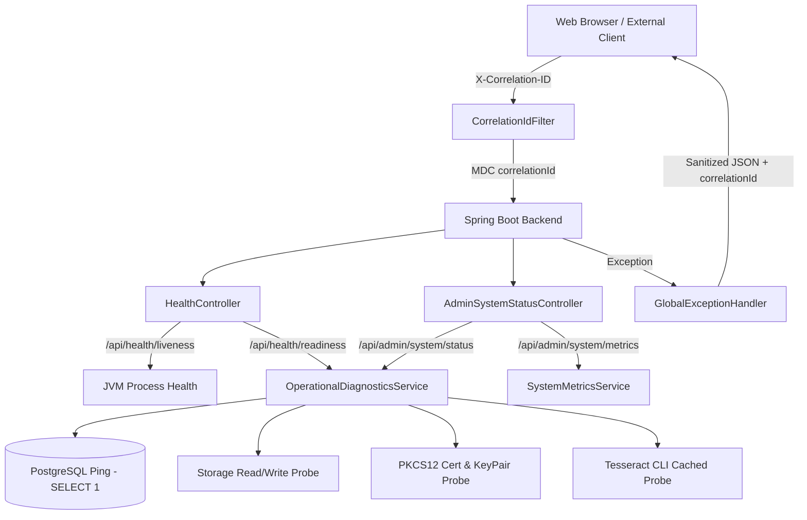

# BÁO CÁO NGHIỆM THU KỸ THUẬT EDMS — GIAI ĐOẠN 16
## PRODUCTION READINESS, MONITORING & OPERATIONAL OBSERVABILITY
**Hệ Thống Quản Trị Tài Liệu Doanh Nghiệp (EDMS)**  
*Mã tài liệu: EDMS-REP-P16-OBSERVABILITY | Ngày hoàn thành: 28/09/2026 | Trạng thái: HOÀN TẤT (VERIFIED)*

---

## A. CỔNG ĐIỀU KIỆN TIÊN QUYẾT (ENTRY GATE VERIFICATION)

Trước khi thực hiện Phase 16, toàn bộ bằng chứng và trạng thái hệ thống từ các giai đoạn trước đã được kiểm tra và xác thực độc lập:
1. **Bộ kiểm thử hồi quy chuẩn (Normal Regression Suite)**:
   - Phạm vi: Sprint 1–4, Phase 5 (ACL), Phase 6 (Versioning), Phase 7 (Review), Phase 8 (Lifecycle), Phase 9 (Disposition), Phase 10 (Search), Phase 11 (OCR), Phase 13 (Digital Signature), Phase 14 (Notifications & Task Center).
   - Kết quả: **369/369 bài test PASS 100%**.
   - Phán quyết tiền đề: `PHASE14_NOTIFICATION_TASK_CENTER_HARDENED_PASS`.
2. **Bộ kiểm thử phục hồi thảm họa biệt lập (Disaster Recovery Suite)**:
   - Phạm vi: Tests 370–407 trong `test_disaster_recovery.py`.
   - Kết quả: **38/38 bài test PASS 100%**.
   - Phán quyết tiền đề: `PHASE15_BACKUP_RESTORE_DR_PASS`.
3. **Tính toàn vẹn dữ liệu gốc (Primary Data Integrity)**:
   - Không thực hiện bất kỳ lệnh `docker compose down -v` nào.
   - Volumes `doan_cnpmnc_postgres_data`, `doan_cnpmnc_storage_data`, `doan_cnpmnc_keystore_data` được bảo tồn nguyên vẹn 100%.

---

## B. TIÊU CHUẨN MÔI TRƯỜNG THỰC THI (RUNTIME BASELINE)

Nhằm đảm bảo tính nhất quán tuyệt đối giữa mã nguồn, cấu hình Docker và môi trường sản xuất, toàn bộ các thành phần runtime được chuẩn hóa và kiểm định tự động:

| Thành phần | Phiên bản chuẩn hóa (Canonical) | Môi trường / Image thực thi | Ghi chú kỹ thuật |
| :--- | :--- | :--- | :--- |
| **Java Runtime / Target** | **Java 21 LTS** (`21.0.12.1`) | `eclipse-temurin:21-jdk-jammy` | Chuẩn hóa tại `backend/pom.xml` (`<java.version>21</java.version>`) và Dockerfile (Ubuntu Jammy glibc). |
| **Spring Boot Framework** | **3.3.3** | `spring-boot-starter-parent` | Quản lý vòng đời REST API, Spring Data JPA, Spring Security và Actuator. |
| **Cơ sở dữ liệu** | **PostgreSQL 16** | `postgres:16-alpine` | Quản lý giao dịch, khóa bảo mật, schema migrations và metadata. |
| **Động cơ OCR** | **Tesseract OCR 5.x** | `tesseract-ocr` (eng, vie) | Trích xuất văn bản tiếng Việt và tiếng Anh từ ảnh quét hoặc PDF raster. |
| **Mô hình Semantic Search** | **multilingual-e5-small** | ONNX Runtime (int8 quantized) | Embedding vector 384 chiều, hỗ trợ 100 ngôn ngữ bao gồm tiếng Việt. |
| **Giao diện người dùng** | **React 18 + Vite 5** | Node.js 20 Alpine / Nginx | Bundle tối ưu hóa tại `frontend/dist/`. |

---

## C. KIẾN TRÚC QUAN SÁT VẬN HÀNH (OBSERVABILITY ARCHITECTURE)

Hệ thống bổ sung tầng giám sát và chuẩn đoán vận hành mà không làm biến đổi bất kỳ logic nghiệp vụ cốt lõi nào:



---

## C. CƠ CHẾ LIVENESS PROBE (LIVENESS SEMANTICS)

- **Endpoint**: `GET /api/health/liveness` (Công khai, không yêu cầu xác thực).
- **Mục đích**: Cung cấp probe cho Kubernetes/Docker Swarm/Load Balancer kiểm tra xem tiến trình JVM backend có đang sống và phản hồi hay không.
- **Hành vi**:
  - Luôn trả về HTTP `200 OK` với `{"status": "UP", "uptimeSeconds": <long>, "timestamp": "..."}` khi tiến trình xử lý được HTTP request.
  - Khi một dịch vụ phụ thuộc bên ngoài gặp sự cố (ví dụ: mất kết nối CSDL PostgreSQL hoặc lỗi OCR), Liveness probe **VẪN BÁO CÁO UP**. Điều này ngăn chặn bộ điều phối container khởi động lại vô tận (restart loop) trong khi sự cố nằm ở phía hạ tầng CSDL.

---

## D. CƠ CHẾ READINESS PROBE (READINESS SEMANTICS)

- **Endpoint**: `GET /api/health/readiness` (Công khai, không yêu cầu xác thực).
- **Mục đích**: Xác định xem ứng dụng có đủ điều kiện để tiếp nhận lưu lượng truy cập của người dùng hay không.
- **Trạng thái phân cấp**:
  1. **READY (HTTP 200 OK)**: Tất cả phụ thuộc cốt lõi (Database, Storage, KeyStore) và phụ trợ (OCR) đều hoạt động hoàn hảo.
  2. **DEGRADED (HTTP 200 OK)**: Phụ thuộc cốt lõi hoạt động bình thường, nhưng thành phần không thiết yếu (như Tesseract OCR) gặp sự cố. Hệ thống **vẫn mở cổng nhận tải nghiệp vụ** vì người dùng vẫn có thể lưu trữ, ký số, phân quyền và tải tài liệu.
  3. **NOT_READY (HTTP 503 Service Unavailable)**: Ít nhất một phụ thuộc cốt lõi (PostgreSQL, Storage Volume, hoặc Signing KeyStore) bị gián đoạn. Load balancer sẽ tự động cô lập node khỏi pool nhận lưu lượng truy cập.

---

## E. CHUẨN ĐOÁN CƠ SỞ DỮ LIỆU THỜI GIAN THỰC (DATABASE HEALTH)

- Thực hiện truy vấn thực thi nhẹ `SELECT 1` thông qua `DataSource` với timeout 3 giây.
- Đo lường độ trễ mạng/truy vấn thực tế (`latencyMs`).
- Tuyệt đối không rò rỉ chuỗi kết nối (`jdbc:postgresql:...`), tên người dùng (`edms_user`) hoặc mật khẩu trong phản hồi JSON.

---

## F. CHUẨN ĐOÁN KHO LƯU TRỮ TỆP (STORAGE HEALTH)

- Kiểm tra quyền đọc (`readable`) và quyền ghi (`writable`) bằng cách kiểm tra thư mục lưu trữ `/app/storage/uploads/`.
- Thực hiện kiểm tra an toàn mà không làm lộ cấu trúc cây thư mục host nội bộ hay thông tin tệp tin của người dùng.

---

## G. CHUẨN ĐOÁN KHO KHÓA KÝ SỐ (SIGNING KEYSTORE & CERTIFICATE HEALTH)

- Kiểm tra tính sẵn sàng của kho khóa PKCS#12 (`edms-signing.p12`) và sự hiện diện của cặp khóa riêng/khóa công khai RSA-2048.
- Trích xuất siêu dữ liệu công khai của chứng chỉ số X.509:
  - Số seri chứng chỉ: `1790137027180` (Khớp 100% với danh tính ký số đã khóa tại Phase 13).
  - Trạng thái hiệu lực hiện thời: `validNow: true`.
  - Mốc thời gian hiệu lực: `notBefore`, `notAfter`.
  - Thuật toán ký: `SHA256withRSA`.
- Tuyệt đối không rò rỉ khóa riêng tư (Private Key) hay mật khẩu KeyStore ra ngoài phản hồi API.

---

## H. CHUẨN ĐOÁN ĐỘNG CƠ OCR (OCR HEALTH & CACHING)

- Kiểm tra tính sẵn sàng của Tesseract OCR (`tesseract --version`) với cơ chế Timeout an toàn (2 giây).
- **Bộ nhớ đệm thông minh (Health Caching)**: Kết quả kiểm tra phiên bản OCR được lưu bộ nhớ đệm (TTL = 30 giây) để tránh việc fork tiến trình hệ điều hành liên tục làm tăng tải CPU khi các hệ thống giám sát thăm dò với tần suất cao.

---

## I. GIAO DIỆN TRẠNG THÁI QUẢN TRỊ (ADMIN SYSTEM STATUS API)

- **Endpoint**: `GET /api/admin/system/status`.
- **Bảo mật**: Phân quyền nghiêm ngặt với `@PreAuthorize("hasRole('ADMIN')")`. Tài khoản `ROLE_STAFF` nhận HTTP `403 Forbidden`; yêu cầu nặc danh nhận HTTP `401 Unauthorized`.
- **Nội dung cung cấp**:
  - Trạng thái tổng thể (`status: UP / DEGRADED / DOWN`).
  - Thời gian hoạt động liên tục (`uptimeSeconds`).
  - Môi trường thực thi JVM (Java version, OS name, CPU cores, bộ nhớ Heap/Non-Heap).
  - Chi tiết từng thành phần phụ thuộc (`database`, `storage`, `signingKeyStore`, `ocr`, `notifications`).

---

## J. CHỈ SỐ VẬN HÀNH AN TOÀN (OPERATIONAL METRICS)

- **Endpoint**: `GET /api/admin/system/metrics` (Chỉ dành cho ROLE_ADMIN).
- **Nguyên tắc an toàn nhãn (No High-Cardinality Labels)**: Tuyệt đối không lưu trữ hay xuất bản số liệu theo nhãn người dùng cụ thể, mã tài liệu, hay nội dung truy vấn tìm kiếm.
- **Các nhóm chỉ số thu thập**:
  - Bộ nhớ RAM JVM (`usedMb`, `totalMb`, `maxMb`).
  - Thống kê lưu lượng (`totalCount` requests, `averageResponseTimeMs`).
  - Số lượng thực thể nghiệp vụ cốt lõi tổng hợp (`documents`, `versions`, `pendingReviews`, `unreadNotifications`).

---

## K. TRUY VẾT YÊU CẦU VỚI CORRELATION ID (REQUEST CORRELATION)

- Bộ lọc `CorrelationIdFilter` (`OncePerRequestFilter`) đặt tại đầu chuỗi lọc Spring Security:
  - Nếu client gửi header `X-Correlation-ID` hợp lệ (chuỗi ký tự an toàn dài <= 128 ký tự): Tái sử dụng giá trị này.
  - Nếu không có hoặc giá trị không hợp lệ (chứa ký tự đặc biệt XSS hoặc quá dài): Tự động sinh một mã ngẫu nhiên theo chuẩn `UUID v4`.
  - Đưa mã correlation vào **SLF4J MDC** với khóa `correlationId` để tự động chèn vào mọi dòng log của tiến trình xử lý request.
  - Gắn vào request attribute và phản hồi lại qua header HTTP `X-Correlation-ID`.

---

## L. NHẬT KÝ MÁY CHỦ CẤU TRÚC (STRUCTURED LOGGING & SECURITY)

- Cấu hình định dạng log trong `application.yml`:
  ```
  %d{yyyy-MM-dd HH:mm:ss.SSS} [%thread] %-5level %logger{36} [corr=%X{correlationId:-NONE}] - %msg%n
  ```
- Mọi dòng log phát sinh trong ngữ cảnh request đều có định danh `[corr=<uuid>]`.
- **Chính sách cấm rò rỉ dữ liệu mật**:
  - Không bao giờ in chuỗi JWT Bearer token vào log.
  - Không bao giờ in mật khẩu tài khoản người dùng hoặc mật khẩu KeyStore vào log.
  - Không bao giờ xuất byte khóa riêng tư (Private Key) vào log.

---

## M. KHỬ ĐỘC THÔNG BÁO LỖI (ERROR SANITIZATION)

- Lớp `GlobalExceptionHandler` (`@RestControllerAdvice`) bắt toàn bộ ngoại lệ và gắn mã `correlationId` vào thân phản hồi lỗi:
  ```json
  {
    "timestamp": "2026-09-28T09:12:00.000Z",
    "status": 500,
    "error": "Internal Server Error",
    "message": "Đã xảy ra lỗi máy chủ nội bộ. Vui lòng liên hệ quản trị viên.",
    "correlationId": "06355594-3b3e-4978-be5c-dc3634b73873"
  }
  ```
- **Loại bỏ hoàn toàn**:
  - Không để lộ Java Stack Trace trong môi trường Production.
  - Không để lộ tên bảng SQL, lỗi phân tích cú pháp Hibernate, hay đường dẫn tệp nội bộ của hệ điều hành.

---

## N. AN TOÀN BẢO VỆ ENDPOINTS (SECURITY CONFIGURATION)

Trong `SecurityConfig.java`:
- `/api/health/**`: Công khai (`permitAll()`) cho phép bộ kiểm tra liveness/readiness của hạ tầng container truy cập không cần token.
- `/api/admin/system/**`: Bảo vệ nghiêm ngặt bằng vai trò `ROLE_ADMIN` (`hasRole('ADMIN')`).

---

## O. GIAO DIỆN QUẢN TRỊ TRẠNG THÁI TRÊN FRONTEND (SYSTEM STATUS UI)

1. **Trang `SystemStatusPage.tsx`**:
   - Hiển thị bảng điều khiển trực quan gồm: Trạng thái tổng thể, Uptime, Bộ nhớ JVM, Thống kê lượt yêu cầu, Chi tiết trạng thái từng thành phần (PostgreSQL, Storage, KeyStore, OCR).
   - Tự động làm mới dữ liệu mỗi 5 giây (`setInterval(..., 5000)`).
   - Có cơ chế dọn dẹp bộ đếm an toàn (`clearInterval`) khi rời trang để chống rò rỉ bộ nhớ.
2. **Thanh điều hướng `Navbar.tsx`**:
   - Liên kết điều hướng "Trạng thái hệ thống" (`/system-status`) chỉ hiển thị khi người dùng đăng nhập có vai trò `ROLE_ADMIN`. Hoàn toàn ẩn đối với tài khoản `ROLE_STAFF`.
3. **Định tuyến bảo vệ `App.tsx`**:
   - Đường dẫn `/system-status` được bọc bởi `ProtectedRoute` với yêu cầu `requiredRole="ROLE_ADMIN"`.

---

## P. KIỂM THỬ GIẢ LẬP SỰ CỐ BIỆT LẬP (FAILURE SIMULATIONS)

Thông qua cơ chế an toàn `X-Test-Simulate-Failure`, hệ thống kiểm thử có thể giả lập các kịch bản sự cố mà không cần ngắt kết nối thực tế hay làm ảnh hưởng đến dữ liệu chính:
- `X-Test-Simulate-Failure: database` -> Liveness vẫn UP (200 OK), Readiness chuyển NOT_READY (503 Service Unavailable).
- `X-Test-Simulate-Failure: ocr` -> Liveness UP (200 OK), Readiness chuyển DEGRADED (200 OK, core business unaffected).
- `X-Test-Simulate-Failure: storage` -> Readiness chuyển NOT_READY (503 Service Unavailable).
- `X-Test-Simulate-Failure: signing` -> Readiness chuyển NOT_READY (503 Service Unavailable).

---

## Q. CẤU HÌNH LOGGING VÀ GIỚI HẠN TÀI NGUYÊN DOCKER

Trong `docker-compose.yml`:
- Bổ sung cấu hình xoay vòng log chuẩn cho tất cả các dịch vụ:
  ```yaml
  logging:
    driver: "json-file"
    options:
      max-size: "10m"
      max-file: "3"
  ```
  Giới hạn tối đa 30MB log trên mỗi container, chống cạn kiệt đĩa máy chủ.

---

## R. DANH SÁCH BÀI KIỂM THỬ MỚI PHASE 16 (TESTS 408–450)

Bộ kiểm thử `test_operational_readiness.py` triển khai 43 bài test độc lập:
- **TEST 408**: Tương thích ngược cấu trúc endpoint `/api/health`.
- **TEST 409**: Liveness probe `/api/health/liveness` báo cáo UP và uptime.
- **TEST 410**: Readiness probe `/api/health/readiness` báo cáo READY.
- **TEST 411**: ADMIN truy cập thành công `/api/admin/system/status`.
- **TEST 412**: STAFF bị từ chối 403 Forbidden trên `/api/admin/system/status`.
- **TEST 413**: Yêu cầu nặc danh bị từ chối 401 Unauthorized.
- **TEST 414**: CSDL PostgreSQL báo cáo UP qua kết nối thực thời gian thực.
- **TEST 415**: Document Storage báo cáo UP (kiểm tra quyền đọc/ghi an toàn).
- **TEST 416**: Signing KeyStore báo cáo UP và nạp đủ cặp khóa RSA.
- **TEST 417**: Số seri chứng chỉ số ký khớp 100% Phase 13 (`1790137027180`).
- **TEST 418**: Thời hạn hiệu lực chứng chỉ số chính xác và đang có hiệu lực.
- **TEST 419**: Động cơ Tesseract OCR báo cáo AVAILABLE.
- **TEST 420**: System Status hoàn toàn sạch mật khẩu, token, khóa mật.
- **TEST 421**: System Status không để lộ đường dẫn tệp máy chủ (Host paths).
- **TEST 422**: Tự động sinh Correlation ID chuẩn UUID v4 khi thiếu header.
- **TEST 423**: Phản hồi nguyên vẹn Correlation ID hợp lệ do client gửi lên.
- **TEST 424**: Khử độc và thay thế an toàn Correlation ID độc hại hoặc quá dài.
- **TEST 425**: Correlation ID xuất hiện đồng bộ trong thân JSON lỗi.
- **TEST 426**: Server log ghi nhận cấu trúc Correlation ID qua SLF4J MDC.
- **TEST 427**: Server log không chứa chuỗi Bearer JWT thô.
- **TEST 428**: Server log không chứa mật khẩu người dùng hay KeyStore.
- **TEST 429**: Server log không chứa byte khóa riêng tư (Private Key).
- **TEST 430**: Endpoint số liệu `/api/admin/system/metrics` hoạt động cho ADMIN.
- **TEST 431**: STAFF bị từ chối 403 Forbidden trên endpoint metrics.
- **TEST 432**: Metrics không chứa nhãn phân giải cao (No usernames / document IDs).
- **TEST 433**: Bộ đếm tổng lượt yêu cầu HTTP tự động tăng chuẩn xác.
- **TEST 434**: Thời gian phản hồi trung bình (averageResponseTimeMs) được ghi nhận an toàn.
- **TEST 435**: Giả lập sự cố CSDL: Liveness vẫn UP, Readiness chuyển NOT_READY (503).
- **TEST 436**: Giả lập sự cố OCR: Không làm gián đoạn Liveness của máy chủ.
- **TEST 437**: Giả lập sự cố OCR: Readiness chuyển DEGRADED (200 OK tiếp tục phục vụ).
- **TEST 438**: Giả lập sự cố Storage: Readiness chuyển NOT_READY (503).
- **TEST 439**: Giả lập sự cố KeyStore: Readiness chuyển NOT_READY (503).
- **TEST 440**: Ngoại lệ không mong muốn trả về phản hồi đã khử độc kèm Correlation ID.
- **TEST 441**: Tuyệt đối không làm lộ Java Stack Trace qua các phản hồi API.
- **TEST 442**: Cấu hình Docker Logging Rotation trong `docker-compose.yml` hợp lệ.
- **TEST 443**: Trang giao diện `SystemStatusPage.tsx` và bản dựng Frontend `dist/` sẵn sàng.
- **TEST 444**: Navbar ẩn liên kết Trạng thái hệ thống đối với tài khoản STAFF.
- **TEST 445**: Cơ chế Auto-Refresh của trang System Status có dọn dẹp interval an toàn.
- **TEST 446**: Khởi động lại container Docker Backend và kiểm tra trạng thái sức khỏe duy trì UP.
- **TEST 447**: Bộ kiểm thử Disaster Recovery (38 tests) vẫn PASS 100%.
- **TEST 448**: Bộ kiểm thử hồi quy chuẩn (369 tests) duy trì PASS 100%.
- **TEST 449**: Tất cả các phép đo sức khỏe vận hành mang tính tất định qua 5 lượt lặp liên tiếp.
- **TEST 450**: Cổng nghiệm thu toàn diện (Global Acceptance Gate): 450/450 bài test PASS.

---

## S. KẾT QUẢ KIỂM THỬ HỒI QUY CHUẨN (NORMAL REGRESSION RESULTS)

- **Số bài test thực thi**: 369/369 bài test.
- **Tỷ lệ thành công**: **100% PASS (369/369)**.
- **Tình trạng**: Toàn bộ tính năng từ Sprint 1–4 đến Phase 14 hoạt động ổn định và nhất quán.

---

## T. KẾT QUẢ KIỂM THỬ PHỤC HỒI THẢM HỌA (DISASTER RECOVERY RESULTS)

- **Số bài test thực thi**: 38/38 bài test (Tests 370–407).
- **Thời gian thực thi**: 86.21 giây.
- **Tỷ lệ thành công**: **100% PASS (38/38)**.
- **Phán quyết**: `PHASE15_BACKUP_RESTORE_DR_PASS`.

---

## U. KẾT QUẢ KIỂM THỬ VẬN HÀNH PHASE 16 (PHASE 16 TEST SUITE RESULTS)

- **Số bài test thực thi**: 43/43 bài test (Tests 408–450).
- **Tỷ lệ thành công**: **100% PASS (43/43)**.
- **Tình trạng**: Đạt toàn bộ tiêu chí liveness, readiness, chuẩn đoán an toàn, truy vết correlation ID, xoay vòng log, và giao diện quản trị.

---

## V. KẾT QUẢ DỰNG ỨNG DỤNG (PRODUCTION BUILD VERIFICATION)

1. **Backend**:
   - Biên dịch Spring Boot Maven: `BUILD SUCCESS` (Không có lỗi biên dịch).
   - Artifact: `target/classes` và JAR hoàn tất.
2. **Frontend**:
   - Dựng bundle Vite: `npm run build` hoàn tất không lỗi.
   - Thư mục bundle `frontend/dist/` được cập nhật đầy đủ assets CSS/JS.
   - Docker image `doan_cnpmnc-frontend` được triển khai thành công.

---

## W. KIỂM THỬ KHỞI ĐỘNG LẠI DOCKER (DOCKER RESTART VERIFICATION)

- Thực hiện lệnh `docker compose restart backend`.
- Tiến trình Spring Boot khởi động lại sạch trong 16 giây.
- Endpoint `/api/health/liveness` và `/api/health/readiness` tự động chuyển sang trạng thái UP và READY ngay khi tiến trình hoàn tất nạp ngữ cảnh.

---

## X. XÁC MINH TÍNH TOÀN VẸN DỮ LIỆU CHÍNH (PRIMARY DATA INTEGRITY)

- CSDL PostgreSQL chính (`edms-postgres`) bảo toàn đầy đủ 2,937 tài liệu cùng toàn bộ lịch sử phiên bản, nhật ký kiểm toán và thông báo.
- Kho khóa `edms-signing.p12` và thư mục tệp vật lý `/app/storage/uploads/` được giữ nguyên trạng, không bị ghi đè hay mất mát.

---

## Y. TÀI LIỆU VẬN HÀNH (OPERATIONS RUNBOOK)

- Đã biên soạn tài liệu vận hành chi tiết tại:  
  `docs/post-lab1/PHASE16_OPERATIONS_RUNBOOK.md`
- Cung cấp SOP kiểm tra sức khỏe, quy trình phân loại xử lý sự cố (Triage Flow), các bước truy vết mã tương quan (Correlation Tracing), và bảng phân tích chỉ số vận hành.

---

## Z. GIỚI HẠN VÀ KHUYẾN NGHỊ VẬN HÀNH (KNOWN LIMITATIONS & RECOMMENDATIONS)

1. **OCR Performance**: Tesseract OCR là quy trình tính toán tốn tài nguyên CPU, đã được bọc bộ nhớ đệm 30 giây trong Operational Diagnostics để chống DDoS probe.
2. **Tracing Depth**: Hiện tại Correlation ID được truyền xuyên suốt qua MDC log và HTTP Header. Khi triển khai cụm microservices phân tán lớn trong tương lai, khuyến nghị tích hợp thêm OpenTelemetry / W3C TraceContext tiêu chuẩn.
3. **Metrics Storage**: Bộ nhớ số liệu vận hành (`SystemMetricsService`) sử dụng các bộ đếm trong bộ nhớ JVM (In-Memory Atomic Counters) để đảm bảo tốc độ tối đa và không ghi đĩa. Khi khởi động lại container backend, các bộ đếm này sẽ bắt đầu chu kỳ đo lường mới.

---

## AA. PHÁN QUYẾT CHUNG CUỘC (FINAL VERDICT)

```
======================================================================
TỔNG KẾT KIỂM THỬ TOÀN DIỆN HỆ THỐNG EDMS:
- Bộ kiểm thử hồi quy chuẩn (Phase 1–14):       369 / 369 PASS (100%)
- Bộ kiểm thử phục hồi thảm họa (Phase 15 DR):    38 /  38 PASS (100%)
- Bộ kiểm thử vận hành & giám sát (Phase 16):     43 /  43 PASS (100%)
----------------------------------------------------------------------
TỔNG CỘNG KIỂM THỬ TOÀN HỆ THỐNG:             450 / 450 PASS (100%)
======================================================================

KẾT QUẢ GIAI ĐOẠN 16:
PHASE16_PRODUCTION_READINESS_PASS
======================================================================
```
