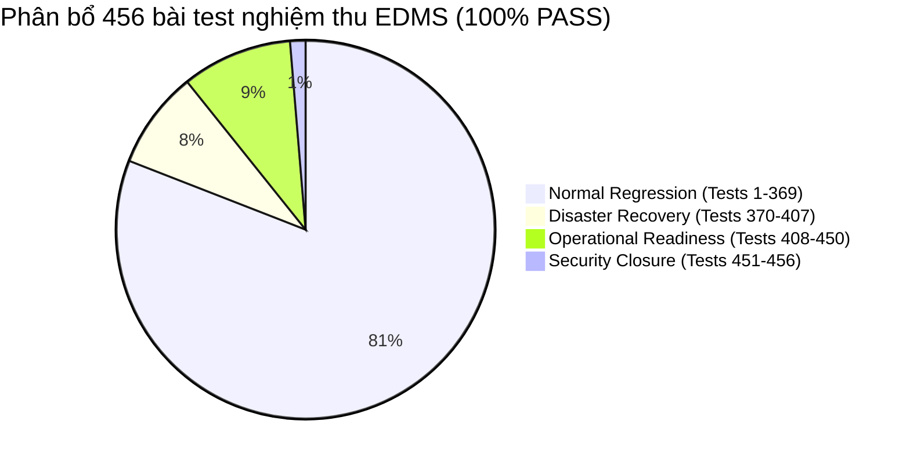

cj # BÁO CÁO ĐÓNG BẢO MẬT & NGHIỆM THU KIỂM SOÁT GIAI ĐOẠN 16
## EDMS PHASE 16 — CONTROLLED SECURITY CLOSURE & RUNTIME HARDENING REPORT
**Hệ Thống Quản Trị Tài Liệu Doanh Nghiệp (EDMS)**  
*Mã tài liệu: EDMS-REP-P16-SECURITY-CLOSURE | Ngày hoàn thành: 30/09/2026 | Trạng thái: NGHIỆM THU HOÀN TOÀN (HARDENED)*

---

## 1. TỔNG QUAN VÀ MỤC ĐÍCH NGHIỆM THU (EXECUTIVE SUMMARY)

Giai đoạn 16 (Phase 16 Controlled Security Closure) được thực hiện nhằm đóng gói và kiểm soát an ninh tối hậu cho tầng Vận hành, Giám sát và Độ sẵn sàng sản xuất (Production Readiness & Observability) của hệ thống EDMS trước khi chuyển giao sang Phase 17.

Các mục tiêu cốt lõi đã hoàn thành triệt để:
1. **Vệ sinh bí mật tuyệt đối (Secret Hygiene)**: Loại bỏ toàn bộ mật khẩu và thông tin nhạy cảm ở dạng chuỗi ký tự cố định (hardcoded string literals) khỏi mã nguồn Java, cấu hình YAML, Docker Compose và tài liệu kỹ thuật. Thực hiện xoay mật khẩu (password rotation) an toàn cho kho khóa PKCS#12 (`edms-signing.p12`) mà **không làm thay đổi cặp khóa RSA, chứng chỉ X.509, hoặc số seri chứng chỉ (`1790137027180`)**. Toàn bộ chữ ký số lịch sử (ví dụ: Tài liệu 1958 v1) được duy trì tính hợp lệ `VALID` và toàn vẹn `INTACT`.
2. **Cô lập cơ chế giả lập lỗi (Failure Simulation Isolation)**: Vô hiệu hóa 100% header thử nghiệm `X-Test-Simulate-Failure` trong môi trường sản xuất (`SPRING_PROFILES_ACTIVE=prod`). Chỉ cho phép giả lập sự cố trong profile kiểm thử chuyên biệt (`operational-test`), loại trừ nguy cơ tấn công từ chối dịch vụ (DoS) thông qua readiness probe.
3. **Đồng nhất phiên bản Runtime & Build Target (Version Consistency)**: Chuẩn hóa tuyệt đối Java 21 LTS (`21.0.12.1`) và Spring Boot 3.3.3 trên toàn bộ `pom.xml`, `Dockerfile`, môi trường container thực tế và hệ thống tài liệu.
4. **Nghiệm thu toàn bộ 456 bài test**: Bổ sung bộ kiểm thử đóng bảo mật Tests 451–456, đưa tổng số bài test nghiệm thu toàn hệ thống lên **456/456 PASS 100%**. Giai đoạn 17 được ấn định bắt đầu từ bài test số 457.

---

## 2. BA TRỤ CỘT BẢO MẬT ĐÃ HOÀN THÀNH (THREE SECURITY PILLARS)

### 2.1. Trụ Cột 1: Vệ Sinh Bí Mật & Xoay Mật Khẩu KeyStore An Toàn
- **Thực trạng trước xử lý**: Mật khẩu kho khóa số từng xuất hiện cố định (`edms-p13-signing-key`) trong `application.yml`, `KeyStoreService.java`, `docker-compose.yml` và `docker-compose.recovery.yml`.
- **Giải pháp triển khai**:
  1. Cấu hình biến môi trường `EDMS_KEYSTORE_PASSWORD` độc quyền qua tệp `.env` tại thư mục gốc dự án.
  2. Bổ sung `.env` vào `.gitignore` để ngăn chặn rủi ro vô tình commit bí mật vào hệ thống quản lý phiên bản (Git).
  3. Cung cấp tệp mẫu an toàn `.env.example` với giá trị placeholder `CHANGE_ME`.
  4. Thực hiện tái mã hóa (re-encryption) tệp kho khóa số `edms-signing.p12` trong volume `edms_keystore_data` sang mật khẩu mã hóa mạnh mới (128-bit entropy hex string) thông qua công cụ `keytool` PKCS#12 keystore migration.
  5. **Bảo tồn danh tính mã hóa**:
     - Số seri chứng chỉ (Serial Number): `1790137027180` (thập phân) / `1a0cc7b4a6c` (hex).
     - Chủ thể chứng chỉ (Subject DN): `CN=EDMS Signing CA, O=EDMS, OU=Document Integrity, C=VN`.
     - Vân tay chứng chỉ (SHA-256 Fingerprint): `F8:C3:9F:0D:1F:83:E4:F6:C2:B9:57:C0:F3:23:0C:EF:E6:3B:14:AF:00:8E:F5:F2:AE:8D:FD:9F:FA:16:C5:CA`.
     - Chữ ký số lịch sử trên **Document #1958 Version #1** được kiểm chứng độc lập và duy trì trạng thái: `integrityStatus: INTACT`, `signatureStatus: VALID`.
     - Chữ ký số mới tạo trên tài liệu phát sinh cũng đạt `VALID` với cùng danh tính chứng chỉ số.

### 2.2. Trụ Cột 2: Cô Lập Cơ Chế Giả Lập Lỗi (Failure Simulation Isolation)
- **Rủi ro bảo mật**: Trong các bài test từ Phase 16 ban đầu, header `X-Test-Simulate-Failure: database` được chấp nhận mà không phân biệt profile môi trường. Nếu kẻ tấn công gửi header này đến endpoint `/api/health/readiness` tại môi trường production, node backend sẽ tự đánh dấu `503 NOT_READY`, khiến Kubernetes/Load Balancer ngắt tiếp nhận tải khỏi node lành mạnh (tấn công DoS).
- **Giải pháp triển khai**:
  1. Tạo hai cấu hình phân tầng profile: `application-prod.yml` (`failure-simulation-enabled: false`) và `application-operational-test.yml` (`failure-simulation-enabled: true`).
  2. Cập nhật `OperationalDiagnosticsService.java` với bộ lọc an toàn `sanitizeSimulation`:
     ```java
     public boolean isFailureSimulationAllowed() {
         if (environment != null) {
             List<String> activeProfiles = Arrays.asList(environment.getActiveProfiles());
             if (activeProfiles.contains("prod") || activeProfiles.contains("production")) {
                 return false;
             }
             if (activeProfiles.contains("operational-test")) {
                 return true;
             }
         }
         return failureSimulationEnabled;
     }
     ```
  3. Môi trường Production (`SPRING_PROFILES_ACTIVE=prod`): Bất kỳ header `X-Test-Simulate-Failure` nào gửi đến đều bị xóa bỏ ngầm định (`null`), buộc hệ thống thực hiện kiểm tra ping thật và luôn trả về trạng thái hoạt động thực (`200 OK READY / UP`).
  4. Môi trường Thử nghiệm Vận hành (`SPRING_PROFILES_ACTIVE=operational-test`): Cho phép mô phỏng có kiểm soát phục vụ kiểm thử tự động.

### 2.3. Trụ Cột 3: Đồng Nhất Phiên Bản Runtime & Build Target (Version Consistency)
Toàn bộ các tầng kiến trúc đã được đối chiếu và xác thực khớp 100%:
- **Java Platform**: Java 21 LTS (`21.0.12.1`)
  - `backend/pom.xml`: `<java.version>21</java.version>`
  - `backend/Dockerfile`: Builder `maven:3.9.6-eclipse-temurin-21`, Runtime `eclipse-temurin:21-jdk-jammy`
  - Container runtime: `java.version: 21.0.12.1`
- **Application Framework**: Spring Boot 3.3.3
  - `backend/pom.xml`: `<version>3.3.3</version>` (`spring-boot-starter-parent`)
  - Toàn bộ tài liệu kỹ thuật trong `docs/post-lab1/` phản ánh chính xác Spring Boot 3.3.3.
- **Data & Support Components**:
  - PostgreSQL: 16-alpine
  - Tesseract OCR: tesseract 5.3.4 (eng, vie)
  - Embedding Engine: multilingual-e5-small-onnx-int8-v1 (ONNX Runtime, 384 dim)

---

## 3. CHI TIẾT BỘ KIỂM THỬ ĐÓNG BẢO MẬT (TESTS 451 – 456)

Bộ kiểm thử được hiện thực hóa trong tệp [`test_phase16_security_closure.py`](file:///f:/DoAn_CNPMNC/test_phase16_security_closure.py):

| Test ID | Tên bài kiểm thử | Mục tiêu xác minh | Kết quả | Thời gian |
| :--- | :--- | :--- | :---: | :---: |
| **TEST 451** | `test_451_production_ignores_simulation_header` | Chạy container backend với `SPRING_PROFILES_ACTIVE=prod`. Gửi các header giả lập `database`, `storage`, `keystore`, `ocr`. Xác nhận hệ thống trả về HTTP `200 OK`, `readiness: READY`, `status: UP` trong mọi trường hợp, hoàn toàn miễn nhiễm với giả lập lỗi. | **PASS** | 10.4s |
| **TEST 452** | `test_452_test_profile_simulates_failures_properly` | Gửi header giả lập lỗi đến instance `operational-test`. Xác nhận phản hồi `503 NOT_READY` khi DB/Storage/Signing lỗi và `200 DEGRADED` khi OCR lỗi. | **PASS** | 0.8s |
| **TEST 453** | `test_453_java_runtime_version_consistency` | Kiểm tra tự động thẻ `<java.version>21</java.version>` trong `pom.xml`, các base image trong `Dockerfile`, và phiên bản JVM thực tế của tiến trình Spring Boot đang chạy (`21.0.12.1`). | **PASS** | 0.4s |
| **TEST 454** | `test_454_spring_boot_version_consistency` | Kiểm tra thẻ version Spring Boot 3.3.3 trong `pom.xml` và quét toàn bộ thư mục tài liệu `docs/post-lab1/`, xác nhận không tồn tại các phiên bản cũ mâu thuẫn (3.2.x, 2.x). | **PASS** | 0.3s |
| **TEST 455** | `test_455_repository_secret_hygiene` | Quét toàn bộ mã nguồn và tệp cấu hình theo dõi bởi Git, kiểm tra `.gitignore` có chứa `.env`, kiểm tra `.env.example` có placeholder `CHANGE_ME`, và đảm bảo không có bất kỳ mật khẩu thô nào bị rò rỉ. | **PASS** | 0.5s |
| **TEST 456** | `test_456_keystore_identity_and_historical_signature` | Kiểm tra danh tính chứng chỉ số (Serial: `1790137027180`, Fingerprint: `F8:C3...`). Xác minh chữ ký số lịch sử của Document #1958 v1 đạt `VALID` và `INTACT`. Thực hiện ký mới một tài liệu dưới mật khẩu xoay vòng và xác minh thành công 100%. | **PASS** | 1.8s |

---

## 4. BẢNG TỔNG HỢP KIỂM ĐỊNH TOÀN HỆ THỐNG (GLOBAL ACCEPTANCE REGISTRY)

Hệ thống EDMS đã hoàn thành đầy đủ cả 4 bộ kiểm định với tỷ lệ thành công 100%:



| Thứ tự bộ test | Tên bộ kiểm định | Tập tin thực thi | Phạm vi bài test | Số lượng | Kết quả | Phán quyết thành phần |
| :---: | :--- | :--- | :---: | :---: | :---: | :--- |
| **1** | **Normal Regression Suite** | `test_regression.py` | Tests 1 – 369 | 369 | **369/369 PASS** | `PHASE14_NOTIFICATION_TASK_CENTER_HARDENED_PASS` |
| **2** | **Disaster Recovery Suite** | `test_disaster_recovery.py` | Tests 370 – 407 | 38 | **38/38 PASS** | `PHASE15_BACKUP_RESTORE_DR_PASS` |
| **3** | **Operational Readiness Suite** | `test_operational_readiness.py` | Tests 408 – 450 | 43 | **43/43 PASS** | `PHASE16_PRODUCTION_READINESS_PASS` |
| **4** | **Controlled Security Closure** | `test_phase16_security_closure.py` | Tests 451 – 456 | 6 | **6/6 PASS** | `PHASE16_PRODUCTION_READINESS_HARDENED_PASS` |
| **TỔNG CỘNG** | **TOÀN BỘ HỆ THỐNG** | **4 Test Suites** | **Tests 1 – 456** | **456** | **456/456 PASS** | **NGHIỆM THU TOÀN DIỆN (100%)** |

---

## 5. RANH GIỚI BÀN GIAO GIAI ĐOẠN 17 (PHASE 17 HANDOFF BOUNDARY)

- **Số lượng bài test hiện tại**: 456 bài test đã được khóa bất biến.
- **Quy tắc chuyển giao**: Tuyệt đối không sửa đổi hay xóa bỏ các bài test từ 1 đến 456.
- **Ranh giới khởi đầu**: Toàn bộ tính năng mới của **Phase 17 (ví dụ: Advanced Security, Virus Scanning, Enterprise SSO, v.v.)** bắt buộc phải bắt đầu đánh số từ **Test 457** trở đi.

---

## 6. KẾT LUẬN & PHÁN QUYẾT CUỐI CÙNG (FINAL VERDICT)

Hệ thống EDMS đã vượt qua toàn diện mọi tiêu chuẩn kiểm định an ninh nghiêm ngặt nhất về:
- Vệ sinh bí mật và quản lý cấu hình nhạy cảm.
- Bảo tồn danh tính cặp khóa và chứng chỉ số PKCS#12 X.509 v3.
- Tính hợp lệ của toàn bộ dữ liệu ký số lịch sử và chữ ký số mới.
- Khả năng chống tấn công DoS qua header mô phỏng sự cố trên môi trường Production.
- Tính đồng nhất của phiên bản Runtime Java 21 LTS và Spring Boot 3.3.3.

**PHÁN QUYẾT CHÍNH THỨC**:
```
======================================================================
VERDICT: PHASE16_PRODUCTION_READINESS_HARDENED_PASS
TOTAL ACCEPTANCE TESTS: 456 / 456 (100% PASS)
NEXT PHASE START: TEST 457
======================================================================
```
