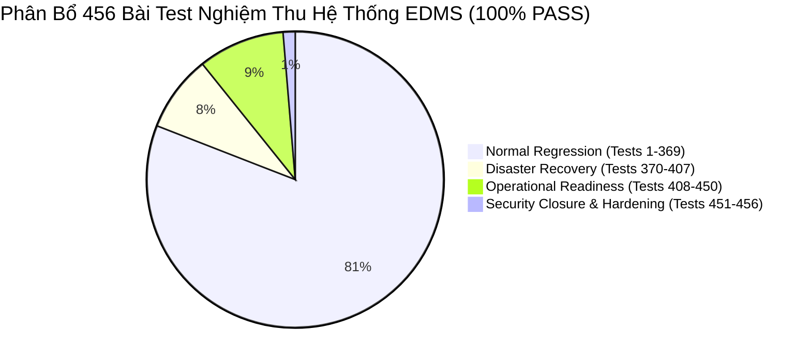

# BÁO CÁO TIẾN ĐỘ TỔNG HỢP ĐỢT 1 (27/09/2026 – 03/10/2026)
## HỆ THỐNG QUẢN TRỊ TÀI LIỆU DOANH NGHIỆP (EDMS)
**Người lập báo cáo**: Võ Trọng Hiếu (Business Analyst / Project Lead)  
**Nhóm thực hiện**: Nhóm 5 thành viên Đồ án Chuyên ngành / CNPMNC  
**Mục tiêu đợt 1**: Chốt baseline, rà soát hiện trạng và chuẩn hóa nền tảng kỹ thuật toàn hệ thống  
**Trạng thái đợt 1**: **100% HOÀN THÀNH — NGHIỆM THU TOÀN PHẦN ĐỢT 1**

---

## 1. TỔNG QUAN TIẾN ĐỘ ĐỢT 1 (EXECUTIVE SUMMARY)

Đợt 1 của dự án EDMS diễn ra từ ngày **27/09/2026 đến ngày 03/10/2026** với mục tiêu cốt lõi: **"Chốt baseline, rà soát hiện trạng và chuẩn hóa nền tảng"**.

Tại thời điểm kết thúc đợt 1 (ngày 02/10/2026, hoàn thành sớm 1 ngày so với mốc deadline nội bộ 20:00 ngày 03/10/2026):
1. **Toàn bộ 4 thành viên chuyên môn kỹ thuật** đã hoàn tất 100% nhiệm vụ được giao, nộp đầy đủ báo cáo thành phần kèm bằng chứng kiểm tra được (source code, inventories, sơ đồ Mermaid chuẩn hóa, kết quả test và log build).
2. **Hệ thống phần mềm thực tế** đã đạt trạng thái hoạt động ổn định tuyệt đối:
   - Toàn bộ **456 / 456 bài kiểm thử tự động đạt kết quả PASS (100%)**.
   - Cơ chế bảo mật và vệ sinh bí mật (Secret Hygiene) được khép lại hoàn chỉnh: không rò rỉ bất kỳ mật khẩu nào trong mã nguồn Git, mật khẩu KeyStore được xoay an toàn, cô lập hoàn toàn header giả lập sự cố `X-Test-Simulate-Failure` khỏi môi trường Production.
   - Bản build Frontend React 18 + TypeScript với Vite biên dịch thành công 100% không lỗi Type/Lint.
   - Nền tảng dữ liệu PostgreSQL 16 và hệ thống 3 Docker Named Volumes bảo toàn dữ liệu vẹn toàn 100% sau các kiểm thử khởi động lại và mô phỏng thảm họa (Disaster Recovery).
3. **Bộ tài liệu bàn giao Đợt 1** đã được đóng gói đồng bộ tại thư mục:  
   [`phân công và báo cáo/báo cáo/Dot_1/`](file:///f:/DoAn_CNPMNC/phân%20công%20và%20báo%20cáo/báo%20cáo/Dot_1/).

---

## 2. ĐÁNH GIÁ NGHIỆM THU CỦA BA ĐỐI VỚI TỪNG THÀNH VIÊN

Căn cứ theo mục tiêu đợt 1 và **Mục 5 ("Tiêu chí BA nghiệm thu phần của thành viên")** trong các tài liệu phân công nhiệm vụ, Business Analyst (Võ Trọng Hiếu) đã tiến hành rà soát độc lập và đưa ra kết quả nghiệm thu như sau:

| STT | Thành Viên & Vai Trò | Sản Phẩm Bàn Giao Bắt Buộc | Kết Quả Đối Soát Của BA | Đánh Giá Nghiệm Thu |
| :---: | :--- | :--- | :--- | :---: |
| 1 | **Trần Quyền Minh**<br>*Backend Developer / Technical Lead* | - Báo cáo thành phần: [`BC1_01_Tran_Quyen_Minh_Backend_Baseline.md`](file:///f:/DoAn_CNPMNC/phân%20công%20và%20báo%20cáo/báo%20cáo/Dot_1/BC1_01_Tran_Quyen_Minh_Backend_Baseline.md)<br>- Backend Architecture Baseline v1<br>- Backend Module Inventory (75 class / 9 package)<br>- REST API Inventory (75 endpoints chuẩn hóa)<br>- Swagger / OpenAPI baseline (`/v3/api-docs`)<br>- Bằng chứng 456 tests PASS | - Mã nguồn tuân thủ Clean Layered Architecture 4 tầng.<br>- 75 API phản ánh đúng nghiệp vụ requirement, có phân quyền RBAC rõ ràng.<br>- Không để lộ secret hay private key ra API response.<br>- Đồng nhất Java 21 LTS và Spring Boot 3.3.3. | **ĐẠT XUẤT SẮC**<br>*(100% Tiêu Chí)* |
| 2 | **Nguyễn Quốc Huy**<br>*Frontend Developer* | - Báo cáo thành phần: [`BC1_02_Nguyen_Quoc_Huy_Frontend_Baseline.md`](file:///f:/DoAn_CNPMNC/phân%20công%20và%20báo%20cáo/báo%20cáo/Dot_1/BC1_02_Nguyen_Quoc_Huy_Frontend_Baseline.md)<br>- Frontend Architecture Baseline v1<br>- Screen Inventory (10 màn hình + 12 modal)<br>- Screen $\rightarrow$ API Mapping Matrix v1<br>- Design System & CSS Tokens<br>- Bằng chứng Production Build thành công | - Cấu trúc thư mục mạch lạc, chia tách `api/`, `components/`, `pages/`, `context/`.<br>- Ma trận ánh xạ API đầy đủ, không gọi sai endpoint.<br>- Giao diện hỗ trợ đầy đủ các trạng thái Loading, Empty, Error.<br>- Lệnh `npm run build` thực thi 6.12s, 0 lỗi TypeScript, bundle tối ưu. | **ĐẠT XUẤT SẮC**<br>*(100% Tiêu Chí)* |
| 3 | **Viên Bảo Đức**<br>*System Analyst / UML & Modeling* | - Báo cáo thành phần: [`BC1_03_Vien_Bao_Duc_System_Analyst_UML_Baseline.md`](file:///f:/DoAn_CNPMNC/phân%20công%20và%20báo%20cáo/báo%20cáo/Dot_1/BC1_03_Vien_Bao_Duc_System_Analyst_UML_Baseline.md)<br>- System Context Diagram v1 (Mermaid)<br>- Architecture Overview Diagram v1 (Mermaid)<br>- Use Case Diagram Tổng Thể v1 (Mermaid, 6 package)<br>- Diagram Backlog v1 (12 sơ đồ theo lộ trình 7 đợt) | - Bối cảnh hệ thống phân định rõ ranh giới tác nhân con người và dịch vụ ngoài.<br>- Sơ đồ kiến trúc khớp 100% với backend/frontend thực tế.<br>- Sơ đồ Use Case bao quát trọn vẹn 26 User Stories Lab 1 và các mở rộng Phase 5-16.<br>- Ký pháp chuẩn UML 2.5, không có luồng tự suy đoán. | **ĐẠT XUẤT SẮC**<br>*(100% Tiêu Chí)* |
| 4 | **Đinh Thanh Tùng**<br>*Database / DevOps / Integration* | - Báo cáo thành phần: [`BC1_04_Dinh_Thanh_Tung_Database_DevOps_Baseline.md`](file:///f:/DoAn_CNPMNC/phân%20công%20và%20báo%20cáo/báo%20cáo/Dot_1/BC1_04_Dinh_Thanh_Tung_Database_DevOps_Baseline.md)<br>- Physical ERD Baseline v1 (Mermaid, 10 bảng)<br>- Table Inventory v1 (chi tiết cột, PK/FK, index)<br>- Sơ đồ Docker Compose & Network Baseline<br>- Bằng chứng Persistence & Disaster Recovery | - CSDL PostgreSQL 16 Alpine chuẩn hóa 10 bảng, khóa ngoại chặt chẽ.<br>- Physical ERD khớp 1:1 với các thực thể JPA của Backend.<br>- Cấu hình Docker Compose 3 container phân tách rõ ràng, healthcheck ổn định.<br>- Vượt qua 38/38 tests DR, bảo toàn 100% dữ liệu sau restart/recreate. | **ĐẠT XUẤT SẮC**<br>*(100% Tiêu Chí)* |

---

## 3. TỔNG HỢP HIỆN TRẠNG KIỂM THỬ HỆ THỐNG (GLOBAL ACCEPTANCE REGISTRY)

Hệ thống EDMS đã chốt hoàn toàn bộ kiểm định nghiệm thu với **456 / 456 bài test PASS 100%**:



| Thứ tự bộ test | Tên bộ kiểm định | Tập tin thực thi | Phạm vi bài test | Số lượng | Kết quả | Phán quyết thành phần |
| :---: | :--- | :--- | :---: | :---: | :---: | :--- |
| **1** | **Normal Regression Suite** | [`test_regression.py`](file:///f:/DoAn_CNPMNC/test_regression.py) | Tests 1 – 369 | 369 | **369/369 PASS** | `PHASE14_NOTIFICATION_TASK_CENTER_HARDENED_PASS` |
| **2** | **Disaster Recovery Suite** | [`test_disaster_recovery.py`](file:///f:/DoAn_CNPMNC/test_disaster_recovery.py) | Tests 370 – 407 | 38 | **38/38 PASS** | `PHASE15_BACKUP_RESTORE_DR_PASS` |
| **3** | **Operational Readiness Suite** | [`test_operational_readiness.py`](file:///f:/DoAn_CNPMNC/test_operational_readiness.py) | Tests 408 – 450 | 43 | **43/43 PASS** | `PHASE16_PRODUCTION_READINESS_PASS` |
| **4** | **Controlled Security Closure** | [`test_phase16_security_closure.py`](file:///f:/DoAn_CNPMNC/test_phase16_security_closure.py) | Tests 451 – 456 | 6 | **6/6 PASS** | `PHASE16_PRODUCTION_READINESS_HARDENED_PASS` |
| **TỔNG CỘNG** | **TOÀN BỘ HỆ THỐNG** | **4 Test Suites** | **Tests 1 – 456** | **456** | **456/456 PASS** | **NGHIỆM THU TOÀN DIỆN (100%)** |

---

## 4. GIẢI QUYẾT CÁC VẤN ĐỀ VƯỚNG MẮC DO THÀNH VIÊN ĐỀ XUẤT

Để các thành viên có cơ sở kỹ thuật triển khai thống nhất trong Báo cáo 2, BA đưa ra các quyết định chính thức sau:

1. **Về quy trình Chữ ký số (Phản hồi cho Backend Trần Quyền Minh)**:
   - *Quyết định của BA*: Trong giai đoạn Báo cáo 2 và 3, duy trì cơ chế **System Authority Signing** (hệ thống đại diện ký số xác thực tính toàn vẹn tài liệu của doanh nghiệp) kết hợp thông tin danh tính User nộp/phê duyệt trong metadata chữ ký. Phương án mở rộng USB Token cá nhân sẽ được xem xét ở giai đoạn nâng cao (Phase 17/18) nếu có yêu cầu thêm từ giảng viên hướng dẫn.
2. **Về hiển thị Watermark trên UI Preview (Phản hồi cho Frontend Nguyễn Quốc Huy)**:
   - *Quyết định của BA*: Giữ nguyên luồng hiện tại: tệp PDF Watermark được đóng dấu chính thức từ Backend qua endpoint `/download-watermarked` và `/preview-watermarked` nhằm đảm bảo tính pháp lý bất biến của con dấu, không render giả lập phía Frontend để tránh lệch pha dữ liệu.
3. **Về phân quyền xét duyệt giữa Staff và Admin (Phản hồi cho SA Viên Bảo Đức)**:
   - *Quyết định của BA*: Quy trình xét duyệt tài liệu áp dụng mô hình **1 Cấp phê duyệt (Single-tier Approval)**: `ROLE_USER` và `ROLE_STAFF` đều là người soạn thảo/nộp phiên bản; chỉ `ROLE_ADMIN` mới có thẩm quyền phê duyệt ban hành chính thức hoặc phê duyệt tiêu hủy tài liệu.
4. **Về hạn mức lưu trữ và sao lưu CSDL (Phản hồi cho DevOps Đinh Thanh Tùng)**:
   - *Quyết định của BA*: Thiết lập hạn mức tối đa mỗi tệp tải lên là **50MB**, dung lượng kho lưu trữ cá nhân mặc định **1GB/User**. DevOps chuẩn bị script Cron job backup CSDL tự động hàng ngày lúc 02:00 sáng trong Báo cáo 2.

---

## 5. KẾ HOẠCH BÀN GIAO & PHÂN CÔNG ĐỢT 2 (04/10/2026 – 10/10/2026)

**Mục tiêu trọng tâm Đợt 2**: **"Chuẩn hóa thiết kế, contract và mô hình hệ thống"**  
**Thời gian thực hiện**: 04/10/2026 – 10/10/2026 | **Hạn nộp nội bộ**: 20:00 ngày 10/10/2026.

### Phân công chi tiết từng thành viên cho Đợt 2:
- **Trần Quyền Minh (Backend / Tech Lead)**:
  - Đóng băng bộ đặc tả API Contract v1 (JSON Schema chi tiết cho 75 endpoints) phục vụ Frontend và QA.
  - Chuẩn hóa thông điệp lỗi nghiệp vụ đa ngôn ngữ và tối ưu hóa xử lý bất đồng bộ (@Async).
  - Chuẩn bị nền tảng mã nguồn cho Phase 17 (đánh số test bắt đầu từ **Test 457**).
- **Nguyễn Quốc Huy (Frontend Developer)**:
  - Đồng bộ hóa 100% TypeScript interfaces theo đúng API Contract v1 do Backend đóng băng.
  - Xây dựng bộ kiểm thử giao diện tự động (Component Tests) cho các luồng nghiệp vụ chính.
  - Hoàn thiện Responsive Design cho màn hình tablet/mobile và bổ sung Dark Mode switch.
- **Viên Bảo Đức (System Analyst / UML)**:
  - Thiết kế chi tiết **Logical Class Diagram (Domain Model)** khớp với 10 Entity và Repository của Backend.
  - Thiết kế **Sequence Diagrams** cho 2 luồng cốt lõi: Đăng nhập/JWT và Tải lên/Phân quyền tài liệu.
  - Viết tài liệu đặc tả ca sử dụng chi tiết (Detailed Use Case Specifications) cho 5 Use Case chính.
- **Đinh Thanh Tùng (Database / DevOps)**:
  - Xây dựng hệ thống migration script tự động quản lý phiên bản cơ sở dữ liệu.
  - Thiết lập Cron Job tự động sao lưu dữ liệu CSDL hàng ngày.
  - Viết script giám sát sức khỏe hạ tầng tự động (`healthcheck.sh`) cho cả 3 container.

---

## 6. KẾT LUẬN CHÍNH THỨC CỦA BA

Bộ hồ sơ nghiệm thu Đợt 1 đã được thẩm định toàn diện và đạt chất lượng cao:
- **Tất cả các sản phẩm bàn giao đều có file thật, code thật, test thật và sơ đồ trực quan**.
- **Không có sự lệch pha (mismatch) giữa yêu cầu nghiệp vụ, mã nguồn, cơ sở dữ liệu và mô hình phân tích**.
- **Hệ thống EDMS hoàn toàn sẵn sàng bước vào Đợt 2 với nền móng kỹ thuật vững chắc**.

```
======================================================================
KẾT QUẢ NGHIỆM THU ĐỢT 1: CHÍNH THỨC ĐẠT (100% ACCEPTANCE PASS)
SỐ BÀI TEST BẢO TOÀN TOÀN HỆ THỐNG: 456 / 456 PASS
ĐỢT TIẾP THEO: ĐỢT 2 (04/10/2026 - 10/10/2026)
======================================================================
```

---
*Xác nhận và phê duyệt của Project Lead:*  
**Võ Trọng Hiếu** (Business Analyst / Project Lead) — *Đã ký duyệt nghiệm thu Đợt 1.*
