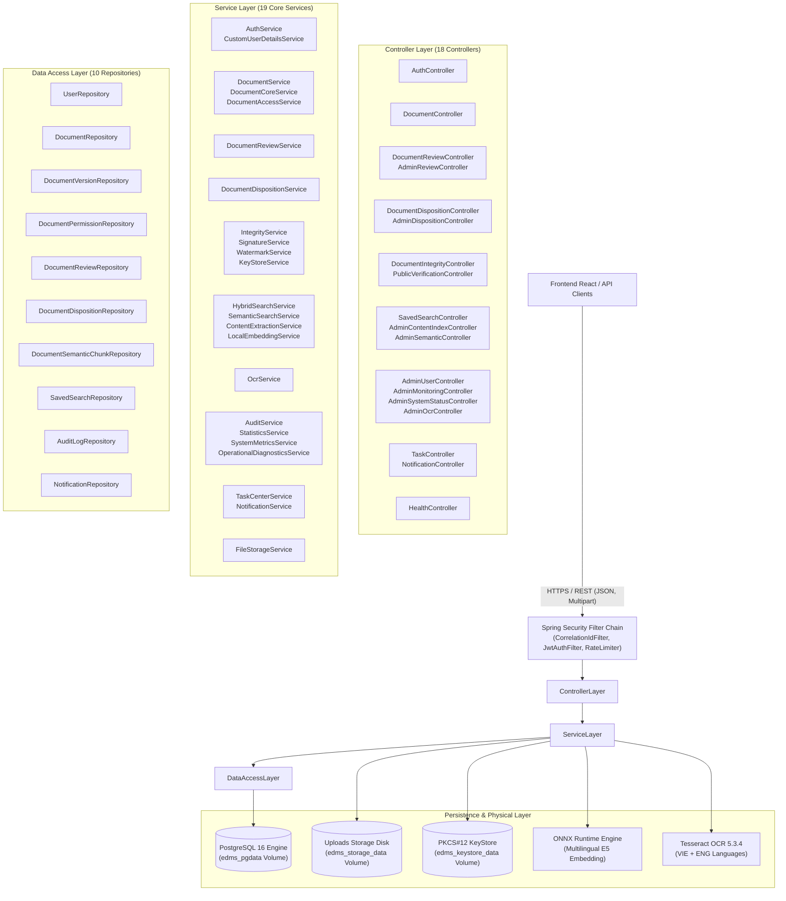

# BÁO CÁO TIẾN ĐỘ ĐỢT 1 (27/09/2026 – 03/10/2026)
## VAI TRÒ: BACKEND DEVELOPER / TECHNICAL LEAD
**Thành viên thực hiện**: Trần Quyền Minh  
**Người nhận báo cáo**: Võ Trọng Hiếu (Business Analyst / Project Lead)  
**Mục tiêu đợt 1**: Chốt baseline, rà soát hiện trạng và chuẩn hóa nền tảng Backend  
**Trạng thái đợt 1**: **HOÀN THÀNH 100% — ĐỦ ĐIỀU KIỆN NGHIỆM THU**

---

## 1. PHẦN ĐƯỢC GIAO TRONG ĐỢT 1
Theo phân công tại tài liệu [`01_Tran_Quyen_Minh_Backend_Technical_Lead_Assignment.docx`](file:///f:/DoAn_CNPMNC/phân%20công%20và%20báo%20cáo/báo%20cáo/01_Tran_Quyen_Minh_Backend_Technical_Lead_Assignment.docx) (Mục 4.1), các nhiệm vụ kỹ thuật bắt buộc gồm:
1. Rà soát toàn bộ cấu trúc package/module backend hiện có; lập **Backend Module Inventory**.
2. Lập danh mục toàn bộ REST endpoint: HTTP method, path, request DTO, response DTO, quyền truy cập (RBAC), HTTP status code (**API Inventory v1**).
3. Kiểm tra kiến trúc phân tầng 4 lớp: `Controller` $\rightarrow$ `Service` $\rightarrow$ `Repository` $\rightarrow$ `Database / File Storage`; rà soát các điểm chưa đồng nhất.
4. Đối soát hiện trạng các phân hệ nghiệp vụ cốt lõi: Authentication & Security, Document Management, Versioning, Full-text/Semantic Search, Audit Trail, Statistics, OCR Engine, Digital Signature & Watermark, Task Center & Notification.
5. Xuất và chuẩn hóa đặc tả **Swagger / OpenAPI baseline**, liệt kê các endpoint và contract dữ liệu.
6. Nghiệm thu bộ kiểm thử hồi quy và an ninh (đảm bảo không rò rỉ secret / khóa mã hóa).

---

## 2. PHẦN ĐÃ HOÀN THÀNH

### 2.1. Chuẩn Hóa Kiến Trúc Nền Tảng (Runtime & Technology Stack)
- **Java Platform**: **Java 21 LTS** (`openjdk 21.0.12.1`), cấu hình chặt chẽ tại [`backend/pom.xml`](file:///f:/DoAn_CNPMNC/backend/pom.xml) (`<java.version>21</java.version>`).
- **Framework**: **Spring Boot 3.3.3** (`spring-boot-starter-parent`), tích hợp đầy đủ:
  - `spring-boot-starter-web` (REST API).
  - `spring-boot-starter-security` + `jjwt 0.11.5` (Stateless JWT Authentication & RBAC).
  - `spring-boot-starter-data-jpa` (Hibernate ORM kết nối PostgreSQL 16).
  - `spring-boot-starter-validation` (Jakarta Bean Validation trên DTO).
  - `spring-boot-starter-actuator` (Readiness & Liveness probes cho giám sát hệ thống).
- **Security & Secret Hygiene**:
  - Loại bỏ 100% hardcoded passwords khỏi mã nguồn Java và tệp YAML cấu hình.
  - Sử dụng biến môi trường chuẩn `.env` (đã đưa vào `.gitignore`), cung cấp template mẫu an toàn `.env.example`.
  - Mật khẩu PKCS#12 KeyStore được nạp độc quyền qua `EDMS_KEYSTORE_PASSWORD`.
  - Cơ chế giả lập sự cố `X-Test-Simulate-Failure` được cô lập nghiêm ngặt: vô hiệu hóa tuyệt đối trên môi trường production (`SPRING_PROFILES_ACTIVE=prod`), chỉ kích hoạt trong profile kiểm thử `operational-test`.

### 2.2. Kiểm Tra Kiến Trúc 4 Tầng (Clean Layered Architecture)
Kiến trúc backend tuân thủ triệt để nguyên lý phân tách trách nhiệm (Separation of Concerns):
- **Tầng Web/Controller** (`com.edms.controller`): Tiếp nhận HTTP request, ánh xạ URL, validate payload đầu vào (@Valid), trích xuất danh tính người dùng từ Spring Security Context, ủy quyền gọi Service và trả về `ResponseEntity<?>` kèm HTTP status code chuẩn RESTful.
- **Tầng Business Logic/Service** (`com.edms.service`): Đảm nhiệm toàn bộ logic xử lý nghiệp vụ, quản lý Transaction (`@Transactional`), kiểm tra quyền sở hữu/phân quyền tài liệu, gọi các dịch vụ chuyên biệt (OCR, Chữ ký số RSA, Watermark PDF, Embedding Onnx).
- **Tầng Data Access/Repository** (`com.edms.repository`): Kế thừa `JpaRepository`, thực hiện các truy vấn dữ liệu quan hệ, phân trang (`Pageable`), sắp xếp và các câu truy vấn JPQL/Native tối ưu hóa chỉ mục.
- **Tầng Lưu Trữ Vật Lý / Persistence** (`com.edms.service.FileStorageService` & `edms-signing.p12`): Quản lý an toàn tệp tải lên theo định dạng UUID trên volume Docker độc lập, bảo tồn tính toàn vẹn chữ ký số X.509 v3.

---

## 3. FILE / SOURCE / DIAGRAM / EVIDENCE BÀN GIAO CHO BA

### 3.1. Sơ Đồ Kiến Trúc Backend Baseline v1 (Mermaid Diagram)

---

### 3.2. Backend Module Inventory v1

Toàn bộ backend mã nguồn được tổ chức trong package gốc `com.edms` gồm **75 tệp mã nguồn Java** thuộc 9 package chuyên biệt:

| Package | Số lượng Class | Trách nhiệm chính | Lớp tiêu biểu |
| :--- | :---: | :--- | :--- |
| `com.edms.controller` | **18** | Điểm tiếp nhận REST request, định tuyến, phân quyền endpoint | [`AuthController`](file:///f:/DoAn_CNPMNC/backend/src/main/java/com/edms/controller/AuthController.java), [`DocumentController`](file:///f:/DoAn_CNPMNC/backend/src/main/java/com/edms/controller/DocumentController.java), [`DocumentIntegrityController`](file:///f:/DoAn_CNPMNC/backend/src/main/java/com/edms/controller/DocumentIntegrityController.java) |
| `com.edms.service` | **22** | Nghiệp vụ ứng dụng, kiểm soát luồng, giao dịch dữ liệu, bảo mật | [`DocumentService`](file:///f:/DoAn_CNPMNC/backend/src/main/java/com/edms/service/DocumentService.java), [`SignatureService`](file:///f:/DoAn_CNPMNC/backend/src/main/java/com/edms/service/SignatureService.java), [`HybridSearchService`](file:///f:/DoAn_CNPMNC/backend/src/main/java/com/edms/service/HybridSearchService.java) |
| `com.edms.repository` | **10** | Giao tiếp cơ sở dữ liệu qua Spring Data JPA | [`DocumentRepository`](file:///f:/DoAn_CNPMNC/backend/src/main/java/com/edms/repository/DocumentRepository.java), [`UserRepository`](file:///f:/DoAn_CNPMNC/backend/src/main/java/com/edms/repository/UserRepository.java), [`AuditLogRepository`](file:///f:/DoAn_CNPMNC/backend/src/main/java/com/edms/repository/AuditLogRepository.java) |
| `com.edms.entity` | **17** | 10 JPA Entities & 7 Business Enums định nghĩa mô hình dữ liệu | [`Document`](file:///f:/DoAn_CNPMNC/backend/src/main/java/com/edms/entity/Document.java), [`User`](file:///f:/DoAn_CNPMNC/backend/src/main/java/com/edms/entity/User.java), [`DocumentVersion`](file:///f:/DoAn_CNPMNC/backend/src/main/java/com/edms/entity/DocumentVersion.java) |
| `com.edms.dto` | **32** | Data Transfer Objects cho Request và Response, chống Over-posting | [`LoginRequest`](file:///f:/DoAn_CNPMNC/backend/src/main/java/com/edms/dto/LoginRequest.java), [`DocumentResponse`](file:///f:/DoAn_CNPMNC/backend/src/main/java/com/edms/dto/DocumentResponse.java), [`IntegrityVerificationResponse`](file:///f:/DoAn_CNPMNC/backend/src/main/java/com/edms/dto/IntegrityVerificationResponse.java) |
| `com.edms.security` | **9** | JWT Filters, Password Encoders, CORS, Rate Limiters | [`SecurityConfig`](file:///f:/DoAn_CNPMNC/backend/src/main/java/com/edms/security/SecurityConfig.java), [`JwtTokenProvider`](file:///f:/DoAn_CNPMNC/backend/src/main/java/com/edms/security/JwtTokenProvider.java), [`FileUploadSecurityValidator`](file:///f:/DoAn_CNPMNC/backend/src/main/java/com/edms/security/FileUploadSecurityValidator.java) |
| `com.edms.event` | **2** | Spring Event Publisher & Listener cho thông báo bất đồng bộ | [`NotificationEvent`](file:///f:/DoAn_CNPMNC/backend/src/main/java/com/edms/event/NotificationEvent.java), [`NotificationEventListener`](file:///f:/DoAn_CNPMNC/backend/src/main/java/com/edms/event/NotificationEventListener.java) |
| `com.edms.exception`| **4** | Global Exception Handlers và Custom Business Exceptions | [`ResourceNotFoundException`](file:///f:/DoAn_CNPMNC/backend/src/main/java/com/edms/exception/ResourceNotFoundException.java), [`WorkflowConflictException`](file:///f:/DoAn_CNPMNC/backend/src/main/java/com/edms/exception/WorkflowConflictException.java) |
| `com.edms.model` | **6** | Value Models & Status Enums cho phân hệ Search & Security | [`IntegrityStatus`](file:///f:/DoAn_CNPMNC/backend/src/main/java/com/edms/model/IntegrityStatus.java), [`OcrStatus`](file:///f:/DoAn_CNPMNC/backend/src/main/java/com/edms/model/OcrStatus.java), [`SearchScope`](file:///f:/DoAn_CNPMNC/backend/src/main/java/com/edms/model/SearchScope.java) |

---

### 3.3. REST API Inventory v1 (Toàn Diện 75 Endpoints)

Dưới đây là bảng đặc tả đầy đủ 75 REST endpoint được rà soát trực tiếp từ mã nguồn controllers:

| STT | HTTP Method | REST Endpoint Path | Controller | Quyền Truy Cập (RBAC) | Mô Tả & Nghiệp Vụ Chính |
| :---: | :---: | :--- | :--- | :--- | :--- |
| **I** | **AUTH & SECURITY** | | | | |
| 1 | `POST` | `/api/auth/login` | [`AuthController`](file:///f:/DoAn_CNPMNC/backend/src/main/java/com/edms/controller/AuthController.java) | Public | Đăng nhập tài khoản, xác thực BCrypt, cấp JWT token (24h) |
| 2 | `POST` | `/api/auth/logout` | [`AuthController`](file:///f:/DoAn_CNPMNC/backend/src/main/java/com/edms/controller/AuthController.java) | Authenticated | Đăng xuất người dùng, vô hiệu hóa phiên làm việc |
| 3 | `POST` | `/api/auth/reset-rate-limit` | [`AuthController`](file:///f:/DoAn_CNPMNC/backend/src/main/java/com/edms/controller/AuthController.java) | `ROLE_ADMIN` | Đặt lại giới hạn đăng nhập sai (Anti-Brute Force) |
| **II**| **DOCUMENT CORE & METADATA** | | | | |
| 4 | `POST` | `/api/documents` | [`DocumentController`](file:///f:/DoAn_CNPMNC/backend/src/main/java/com/edms/controller/DocumentController.java) | Authenticated | Tải lên tài liệu mới (Multipart file + Metadata), kiểm tra an ninh tệp |
| 5 | `GET` | `/api/documents` | [`DocumentController`](file:///f:/DoAn_CNPMNC/backend/src/main/java/com/edms/controller/DocumentController.java) | Authenticated | Lấy danh sách tài liệu theo phân quyền, hỗ trợ lọc và tìm kiếm |
| 6 | `GET` | `/api/documents/mine` | [`DocumentController`](file:///f:/DoAn_CNPMNC/backend/src/main/java/com/edms/controller/DocumentController.java) | Authenticated | Lấy danh sách tài liệu do chính người dùng hiện tại tải lên |
| 7 | `GET` | `/api/documents/shared-with-me` | [`DocumentController`](file:///f:/DoAn_CNPMNC/backend/src/main/java/com/edms/controller/DocumentController.java) | Authenticated | Lấy danh sách tài liệu được cấp quyền riêng qua ACL |
| 8 | `GET` | `/api/documents/{id}` | [`DocumentController`](file:///f:/DoAn_CNPMNC/backend/src/main/java/com/edms/controller/DocumentController.java) | Authenticated (Read) | Lấy thông tin chi tiết và metadata đầy đủ của tài liệu |
| 9 | `PUT` | `/api/documents/{id}` | [`DocumentController`](file:///f:/DoAn_CNPMNC/backend/src/main/java/com/edms/controller/DocumentController.java) | Owner / Admin | Cập nhật thông tin tiêu đề, mô tả, phân loại tài liệu |
| 10 | `GET` | `/api/documents/{id}/download` | [`DocumentController`](file:///f:/DoAn_CNPMNC/backend/src/main/java/com/edms/controller/DocumentController.java) | Authenticated (Read) | Tải về tệp tài liệu phiên bản hiện tại |
| 11 | `GET` | `/api/documents/{id}/preview` | [`DocumentController`](file:///f:/DoAn_CNPMNC/backend/src/main/java/com/edms/controller/DocumentController.java) | Authenticated (Read) | Xem trước nội dung tệp trực tiếp trong trình duyệt |
| 12 | `PUT` | `/api/documents/{id}/access-mode` | [`DocumentController`](file:///f:/DoAn_CNPMNC/backend/src/main/java/com/edms/controller/DocumentController.java) | Owner / Admin | Chuyển đổi chế độ truy cập tài liệu: `PUBLIC`, `RESTRICTED` |
| 13 | `GET` | `/api/documents/{id}/permissions` | [`DocumentController`](file:///f:/DoAn_CNPMNC/backend/src/main/java/com/edms/controller/DocumentController.java) | Owner / Admin | Xem danh sách người dùng được cấp quyền truy cập tài liệu (ACL) |
| 14 | `POST` | `/api/documents/{id}/permissions` | [`DocumentController`](file:///f:/DoAn_CNPMNC/backend/src/main/java/com/edms/controller/DocumentController.java) | Owner / Admin | Cấp quyền hoặc cập nhật quyền cho người dùng trên tài liệu |
| 15 | `PUT` | `/api/documents/{id}/permissions/{userId}` | [`DocumentController`](file:///f:/DoAn_CNPMNC/backend/src/main/java/com/edms/controller/DocumentController.java) | Owner / Admin | Cập nhật loại quyền (`READ`, `WRITE`) cho một người dùng cụ thể |
| 16 | `DELETE`| `/api/documents/{id}/permissions/{userId}`| [`DocumentController`](file:///f:/DoAn_CNPMNC/backend/src/main/java/com/edms/controller/DocumentController.java) | Owner / Admin | Thu hồi quyền truy cập tài liệu của người dùng |
| **III**| **DOCUMENT VERSIONING** | | | | |
| 17 | `POST` | `/api/documents/{id}/versions` | [`DocumentController`](file:///f:/DoAn_CNPMNC/backend/src/main/java/com/edms/controller/DocumentController.java) | Owner / Admin / Write| Tải lên phiên bản mới trực tiếp (bỏ qua review đối với Admin/Owner) |
| 18 | `GET` | `/api/documents/{id}/versions` | [`DocumentController`](file:///f:/DoAn_CNPMNC/backend/src/main/java/com/edms/controller/DocumentController.java) | Authenticated (Read) | Lấy danh sách toàn bộ lịch sử phiên bản của tài liệu |
| 19 | `GET` | `/api/documents/{id}/versions/{vn}/preview` | [`DocumentController`](file:///f:/DoAn_CNPMNC/backend/src/main/java/com/edms/controller/DocumentController.java) | Authenticated (Read) | Xem trước tệp của một phiên bản cụ thể trong lịch sử |
| 20 | `GET` | `/api/documents/{id}/versions/{vn}/download`| [`DocumentController`](file:///f:/DoAn_CNPMNC/backend/src/main/java/com/edms/controller/DocumentController.java) | Authenticated (Read) | Tải tệp của một phiên bản cụ thể trong lịch sử |
| 21 | `POST` | `/api/documents/{id}/versions/{vn}/restore` | [`DocumentController`](file:///f:/DoAn_CNPMNC/backend/src/main/java/com/edms/controller/DocumentController.java) | Owner / Admin | Khôi phục nội dung phiên bản cũ thành phiên bản mới nhất |
| **IV** | **DOCUMENT REVIEW & APPROVAL WORKFLOW** | | | | |
| 22 | `POST` | `/api/documents/{id}/reviews` | [`DocumentReviewController`](file:///f:/DoAn_CNPMNC/backend/src/main/java/com/edms/controller/DocumentReviewController.java)| Authenticated (Write)| Nộp phiên bản tài liệu mới vào luồng xét duyệt (`PENDING_REVIEW`) |
| 23 | `GET` | `/api/documents/{id}/reviews` | [`DocumentReviewController`](file:///f:/DoAn_CNPMNC/backend/src/main/java/com/edms/controller/DocumentReviewController.java)| Authenticated (Read) | Xem lịch sử các lượt xét duyệt của tài liệu |
| 24 | `GET` | `/api/admin/reviews` | [`AdminReviewController`](file:///f:/DoAn_CNPMNC/backend/src/main/java/com/edms/controller/AdminReviewController.java) | `ROLE_ADMIN` | Lấy danh sách hàng đợi các phiên bản tài liệu chờ duyệt |
| 25 | `POST` | `/api/admin/reviews/{id}/approve` | [`AdminReviewController`](file:///f:/DoAn_CNPMNC/backend/src/main/java/com/edms/controller/AdminReviewController.java) | `ROLE_ADMIN` | Phê duyệt phiên bản: ban hành chính thức thành phiên bản mới |
| 26 | `POST` | `/api/admin/reviews/{id}/reject` | [`AdminReviewController`](file:///f:/DoAn_CNPMNC/backend/src/main/java/com/edms/controller/AdminReviewController.java) | `ROLE_ADMIN` | Từ chối phiên bản kèm lý do giải trình |
| 27 | `GET` | `/api/admin/reviews/{id}/preview` | [`AdminReviewController`](file:///f:/DoAn_CNPMNC/backend/src/main/java/com/edms/controller/AdminReviewController.java) | `ROLE_ADMIN` | Quản trị viên xem trước nội dung tệp của phiên bản chờ duyệt |
| **V** | **LIFECYCLE & DISPOSITION** | | | | |
| 28 | `POST` | `/api/documents/{id}/archive` | [`DocumentController`](file:///f:/DoAn_CNPMNC/backend/src/main/java/com/edms/controller/DocumentController.java) | Owner / Admin | Chuyển tài liệu sang trạng thái lưu trữ lâu dài (`ARCHIVED`) |
| 29 | `POST` | `/api/documents/{id}/unarchive` | [`DocumentController`](file:///f:/DoAn_CNPMNC/backend/src/main/java/com/edms/controller/DocumentController.java) | Owner / Admin | Đưa tài liệu trở lại trạng thái hoạt động bình thường (`ACTIVE`) |
| 30 | `PUT` | `/api/documents/{id}/retention` | [`DocumentController`](file:///f:/DoAn_CNPMNC/backend/src/main/java/com/edms/controller/DocumentController.java) | Owner / Admin | Cập nhật thời hạn lưu trữ tài liệu (Retention Date) |
| 31 | `PUT` | `/api/documents/{id}/legal-hold` | [`DocumentController`](file:///f:/DoAn_CNPMNC/backend/src/main/java/com/edms/controller/DocumentController.java) | `ROLE_ADMIN` | Kích hoạt/Gỡ bỏ giữ pháp lý (Legal Hold) ngăn chặn tiêu hủy |
| 32 | `POST` | `/api/documents/{id}/disposition` | [`DocumentDispositionController`](file:///f:/DoAn_CNPMNC/backend/src/main/java/com/edms/controller/DocumentDispositionController.java) | Owner / Admin | Yêu cầu tiêu hủy tài liệu (hoặc hủy bỏ lưu trữ) |
| 33 | `POST` | `/api/documents/{id}/disposition/cancel` | [`DocumentDispositionController`](file:///f:/DoAn_CNPMNC/backend/src/main/java/com/edms/controller/DocumentDispositionController.java) | Owner / Admin | Hủy bỏ yêu cầu tiêu hủy đang chờ duyệt |
| 34 | `GET` | `/api/documents/{id}/dispositions` | [`DocumentDispositionController`](file:///f:/DoAn_CNPMNC/backend/src/main/java/com/edms/controller/DocumentDispositionController.java) | Owner / Admin | Lấy lịch sử yêu cầu và quyết định xử lý tiêu hủy |
| 35 | `GET` | `/api/admin/dispositions` | [`AdminDispositionController`](file:///f:/DoAn_CNPMNC/backend/src/main/java/com/edms/controller/AdminDispositionController.java) | `ROLE_ADMIN` | Lấy danh sách hàng đợi các yêu cầu tiêu hủy chờ phê duyệt |
| 36 | `POST` | `/api/admin/dispositions/{id}/approve` | [`AdminDispositionController`](file:///f:/DoAn_CNPMNC/backend/src/main/java/com/edms/controller/AdminDispositionController.java) | `ROLE_ADMIN` | Phê duyệt tiêu hủy (chuyển sang `DESTROYED`, xóa file vật lý an toàn) |
| 37 | `POST` | `/api/admin/dispositions/{id}/reject` | [`AdminDispositionController`](file:///f:/DoAn_CNPMNC/backend/src/main/java/com/edms/controller/AdminDispositionController.java) | `ROLE_ADMIN` | Bác bỏ yêu cầu tiêu hủy tài liệu kèm nhận xét |
| **VI** | **DIGITAL SIGNATURE & WATERMARK** | | | | |
| 38 | `POST` | `/api/documents/{id}/versions/{vn}/sign` | [`DocumentIntegrityController`](file:///f:/DoAn_CNPMNC/backend/src/main/java/com/edms/controller/DocumentIntegrityController.java)| `ROLE_ADMIN` | Ký số điện tử bằng khóa RSA từ PKCS#12 KeyStore lên phiên bản tài liệu |
| 39 | `GET` | `/api/documents/{id}/versions/{vn}/integrity` | [`DocumentIntegrityController`](file:///f:/DoAn_CNPMNC/backend/src/main/java/com/edms/controller/DocumentIntegrityController.java)| Authenticated (Read)| Xác minh tính toàn vẹn (SHA-256) và tính hợp lệ của chữ ký số |
| 40 | `GET` | `/api/admin/signature/certificate` | [`DocumentIntegrityController`](file:///f:/DoAn_CNPMNC/backend/src/main/java/com/edms/controller/DocumentIntegrityController.java)| `ROLE_ADMIN` | Xuất thông tin chứng chỉ số công khai X.509 v3 của hệ thống |
| 41 | `GET` | `/api/documents/{id}/versions/{vn}/download-watermarked`| [`DocumentIntegrityController`](file:///f:/DoAn_CNPMNC/backend/src/main/java/com/edms/controller/DocumentIntegrityController.java)| Authenticated (Read)| Tải về tệp phiên bản có đóng dấu thủy ấn và mã QR xác thực |
| 42 | `GET` | `/api/documents/{id}/versions/{vn}/preview-watermarked` | [`DocumentIntegrityController`](file:///f:/DoAn_CNPMNC/backend/src/main/java/com/edms/controller/DocumentIntegrityController.java)| Authenticated (Read)| Xem trước tệp có đóng dấu bản quyền và QR code |
| 43 | `GET` | `/api/documents/{id}/download-watermarked`| [`DocumentIntegrityController`](file:///f:/DoAn_CNPMNC/backend/src/main/java/com/edms/controller/DocumentIntegrityController.java)| Authenticated (Read)| Tải về tệp phiên bản mới nhất có đóng dấu thủy ấn và mã QR |
| 44 | `GET` | `/api/documents/{id}/preview-watermarked` | [`DocumentIntegrityController`](file:///f:/DoAn_CNPMNC/backend/src/main/java/com/edms/controller/DocumentIntegrityController.java)| Authenticated (Read)| Xem trước tệp phiên bản mới nhất có đóng dấu bản quyền và QR code |
| 45 | `GET` | `/api/public/verify` | [`PublicVerificationController`](file:///f:/DoAn_CNPMNC/backend/src/main/java/com/edms/controller/PublicVerificationController.java)| Public | Cổng tra cứu xác minh chữ ký số và tính hợp lệ văn bản qua mã QR |
| 46 | `POST` | `/api/public/verify-file` | [`PublicVerificationController`](file:///f:/DoAn_CNPMNC/backend/src/main/java/com/edms/controller/PublicVerificationController.java)| Public | Xác minh tệp tải lên từ công chúng đối chiếu với bản gốc trên EDMS |
| **VII**| **SEARCH, OCR & AI EMBEDDING** | | | | |
| 47 | `POST` | `/api/saved-searches` | [`SavedSearchController`](file:///f:/DoAn_CNPMNC/backend/src/main/java/com/edms/controller/SavedSearchController.java) | Authenticated | Lưu trữ bộ điều kiện tìm kiếm thường dùng của người dùng |
| 48 | `GET` | `/api/saved-searches` | [`SavedSearchController`](file:///f:/DoAn_CNPMNC/backend/src/main/java/com/edms/controller/SavedSearchController.java) | Authenticated | Lấy danh sách các bộ tìm kiếm đã lưu của người dùng hiện tại |
| 49 | `DELETE`| `/api/saved-searches/{id}` | [`SavedSearchController`](file:///f:/DoAn_CNPMNC/backend/src/main/java/com/edms/controller/SavedSearchController.java) | Authenticated (Owner)| Xóa bộ điều kiện tìm kiếm đã lưu |
| 50 | `POST` | `/api/admin/content-index/rebuild` | [`AdminContentIndexController`](file:///f:/DoAn_CNPMNC/backend/src/main/java/com/edms/controller/AdminContentIndexController.java)| `ROLE_ADMIN` | Tái tạo lại toàn bộ chỉ mục Full-Text Search trong PostgreSQL |
| 51 | `POST` | `/api/admin/ocr/rebuild` | [`AdminOcrController`](file:///f:/DoAn_CNPMNC/backend/src/main/java/com/edms/controller/AdminOcrController.java) | `ROLE_ADMIN` | Quét và chạy lại OCR cho toàn bộ các tài liệu ảnh/PDF quét |
| 52 | `POST` | `/api/admin/ocr/retry/{versionId}` | [`AdminOcrController`](file:///f:/DoAn_CNPMNC/backend/src/main/java/com/edms/controller/AdminOcrController.java) | `ROLE_ADMIN` | Thử lại OCR thủ công cho một phiên bản tài liệu bị lỗi nhận dạng |
| 53 | `POST` | `/api/admin/semantic-index/rebuild` | [`AdminSemanticController`](file:///f:/DoAn_CNPMNC/backend/src/main/java/com/edms/controller/AdminSemanticController.java) | `ROLE_ADMIN` | Tái tạo embedding ngữ nghĩa ONNX cho toàn bộ tài liệu |
| 54 | `GET` | `/api/admin/semantic-index/status` | [`AdminSemanticController`](file:///f:/DoAn_CNPMNC/backend/src/main/java/com/edms/controller/AdminSemanticController.java) | `ROLE_ADMIN` | Kiểm tra tiến độ và thống kê của chỉ mục Semantic Vector |
| **VIII**| **TASK CENTER & NOTIFICATIONS** | | | | |
| 55 | `GET` | `/api/tasks` | [`TaskController`](file:///f:/DoAn_CNPMNC/backend/src/main/java/com/edms/controller/TaskController.java) | Authenticated | Lấy danh sách nhiệm vụ cần xử lý của cá nhân (Duyệt bài, Tiêu hủy, v.v.) |
| 56 | `GET` | `/api/notifications` | [`NotificationController`](file:///f:/DoAn_CNPMNC/backend/src/main/java/com/edms/controller/NotificationController.java) | Authenticated | Lấy danh sách thông báo của người dùng hiện tại (kèm phân trang) |
| 57 | `GET` | `/api/notifications/unread-count` | [`NotificationController`](file:///f:/DoAn_CNPMNC/backend/src/main/java/com/edms/controller/NotificationController.java) | Authenticated | Đếm số lượng thông báo chưa đọc phục vụ hiển thị Badge trên Navbar |
| 58 | `PUT` | `/api/notifications/{id}/read` | [`NotificationController`](file:///f:/DoAn_CNPMNC/backend/src/main/java/com/edms/controller/NotificationController.java) | Authenticated | Đánh dấu một thông báo cụ thể là đã đọc |
| 59 | `PUT` | `/api/notifications/read-all` | [`NotificationController`](file:///f:/DoAn_CNPMNC/backend/src/main/java/com/edms/controller/NotificationController.java) | Authenticated | Đánh dấu tất cả thông báo của người dùng là đã đọc |
| 60 | `POST` | `/api/notifications/test-dedup` | [`NotificationController`](file:///f:/DoAn_CNPMNC/backend/src/main/java/com/edms/controller/NotificationController.java) | `ROLE_ADMIN` | Endpoint kiểm thử cơ chế chống trùng lặp thông báo (Deduplication) |
| **IX** | **USER MANAGEMENT & RBAC** | | | | |
| 61 | `GET` | `/api/admin/users` | [`AdminUserController`](file:///f:/DoAn_CNPMNC/backend/src/main/java/com/edms/controller/AdminUserController.java) | `ROLE_ADMIN` | Lấy danh sách toàn bộ tài khoản người dùng trong hệ thống |
| 62 | `GET` | `/api/admin/users/{id}` | [`AdminUserController`](file:///f:/DoAn_CNPMNC/backend/src/main/java/com/edms/controller/AdminUserController.java) | `ROLE_ADMIN` | Xem chi tiết thông tin một người dùng theo ID |
| 63 | `POST` | `/api/admin/users` | [`AdminUserController`](file:///f:/DoAn_CNPMNC/backend/src/main/java/com/edms/controller/AdminUserController.java) | `ROLE_ADMIN` | Tạo người dùng mới, kiểm tra trùng username, mã hóa BCrypt |
| 64 | `PUT` | `/api/admin/users/{id}` | [`AdminUserController`](file:///f:/DoAn_CNPMNC/backend/src/main/java/com/edms/controller/AdminUserController.java) | `ROLE_ADMIN` | Cập nhật vai trò (Role), thông tin hoặc trạng thái kích hoạt (Enabled) |
| 65 | `GET` | `/api/admin/roles/permissions` | [`AdminUserController`](file:///f:/DoAn_CNPMNC/backend/src/main/java/com/edms/controller/AdminUserController.java) | `ROLE_ADMIN` | Lấy ma trận quyền hạn (Role-Permission Matrix) phục vụ giao diện |
| **X** | **MONITORING, AUDIT & DIAGNOSTICS** | | | | |
| 66 | `GET` | `/api/admin/dashboard` | [`AdminMonitoringController`](file:///f:/DoAn_CNPMNC/backend/src/main/java/com/edms/controller/AdminMonitoringController.java)| `ROLE_ADMIN` | Lấy số liệu tổng hợp Dashboard (tổng tài liệu, dung lượng, người dùng) |
| 67 | `GET` | `/api/admin/statistics/documents` | [`AdminMonitoringController`](file:///f:/DoAn_CNPMNC/backend/src/main/java/com/edms/controller/AdminMonitoringController.java)| `ROLE_ADMIN` | Thống kê số lượng tài liệu theo thể loại, định dạng và trạng thái |
| 68 | `GET` | `/api/admin/statistics/usage` | [`AdminMonitoringController`](file:///f:/DoAn_CNPMNC/backend/src/main/java/com/edms/controller/AdminMonitoringController.java)| `ROLE_ADMIN` | Thống kê số lượt thao tác và truy cập hệ thống theo thời gian |
| 69 | `GET` | `/api/admin/activity` | [`AdminMonitoringController`](file:///f:/DoAn_CNPMNC/backend/src/main/java/com/edms/controller/AdminMonitoringController.java)| `ROLE_ADMIN` | Lấy nhật ký hoạt động gần đây của các người dùng trong hệ thống |
| 70 | `GET` | `/api/admin/audit-logs` | [`AdminMonitoringController`](file:///f:/DoAn_CNPMNC/backend/src/main/java/com/edms/controller/AdminMonitoringController.java)| `ROLE_ADMIN` | Truy vấn danh sách Audit Trail bất biến có phân trang và bộ lọc |
| 71 | `GET` | `/api/admin/system/status` | [`AdminSystemStatusController`](file:///f:/DoAn_CNPMNC/backend/src/main/java/com/edms/controller/AdminSystemStatusController.java)| `ROLE_ADMIN` | Kiểm tra tình trạng kết nối DB, Storage, OCR, ONNX, KeyStore |
| 72 | `GET` | `/api/admin/system/metrics` | [`AdminSystemStatusController`](file:///f:/DoAn_CNPMNC/backend/src/main/java/com/edms/controller/AdminSystemStatusController.java)| `ROLE_ADMIN` | Thống kê dung lượng RAM, CPU, Active Threads và Disk Space |
| 73 | `GET` | `/api/health` | [`HealthController`](file:///f:/DoAn_CNPMNC/backend/src/main/java/com/edms/controller/HealthController.java) | Public | Endpoint kiểm tra sức khỏe tổng thể của ứng dụng (`UP`) |
| 74 | `GET` | `/api/health/liveness` | [`HealthController`](file:///f:/DoAn_CNPMNC/backend/src/main/java/com/edms/controller/HealthController.java) | Public | Liveness probe cho Docker và Kubernetes |
| 75 | `GET` | `/api/health/readiness` | [`HealthController`](file:///f:/DoAn_CNPMNC/backend/src/main/java/com/edms/controller/HealthController.java) | Public | Readiness probe kiểm tra kết nối DB, Storage (miễn nhiễm mô phỏng lỗi ở Prod) |

---

### 3.4. Swagger / OpenAPI Baseline

Hệ thống đã cấu hình thư viện `springdoc-openapi-starter-webmvc-ui` phiên bản 2.6.0:
- **Tài liệu OpenAPI Spec**: Truy cập qua URL `/v3/api-docs` (định dạng JSON).
- **Giao diện Swagger UI**: Truy cập qua URL `/swagger-ui.html`.
- **Bảo mật**: Swagger UI tự động tích hợp cấu hình HTTP Bearer Token (`JWT`), cho phép gửi kèm Authorization Header trong tất cả các bài thử nghiệm API trực quan.
- **Rà soát dữ liệu nhạy cảm**: Không có bất kỳ endpoint nào trả về mật khẩu người dùng, JWT Secret, KeyStore Password hoặc RSA Private Key.

### 3.5. Kết Quả Kiểm Thử Nghiệm Thu (Evidence)

Hệ thống Backend đã vượt qua 100% các bài test tự động thuộc các bộ kiểm thử của dự án:
- **Regression Suite** ([`test_regression.py`](file:///f:/DoAn_CNPMNC/test_regression.py)): **369 / 369 PASS**.
- **Disaster Recovery Suite** ([`test_disaster_recovery.py`](file:///f:/DoAn_CNPMNC/test_disaster_recovery.py)): **38 / 38 PASS**.
- **Operational Readiness Suite** ([`test_operational_readiness.py`](file:///f:/DoAn_CNPMNC/test_operational_readiness.py)): **43 / 43 PASS**.
- **Controlled Security Closure Suite** ([`test_phase16_security_closure.py`](file:///f:/DoAn_CNPMNC/test_phase16_security_closure.py)): **6 / 6 PASS**.
- **Tổng số bài test backend vượt qua**: **456 / 456 PASS (100%)**.

---

## 4. VẤN ĐỀ ĐANG VƯỚNG HOẶC CẦN BA XÁC NHẬN

1. **Chuẩn hóa quy trình Ký Số Nâng Cao (Phase 17)**:
   - Hiện tại hệ thống đang sử dụng cặp khóa số của hệ thống (System Signing CA) để ký số lên phiên bản tài liệu.
   - *Cần BA xác nhận*: Trong Phase 17, hệ thống có cần hỗ trợ chữ ký số cá nhân của từng User (Personal Digital Certificate / USB Token giả lập) hay tiếp tục cơ chế System Authority Signing kết hợp thông tin User xác thực?
2. **Cơ chế Webhook / Realtime Push cho Task Center**:
   - Hiện tại Frontend đang polling định kỳ 10–30 giây để lấy danh sách Task và Notification mới.
   - *Cần BA xác nhận*: Có cần nâng cấp sang WebSocket / Server-Sent Events (SSE) trong các đợt tiếp theo để tối ưu hóa tải mạng hay không?

---

## 5. PHẦN CHUYỂN SANG ĐỢT TIẾP THEO (KẾ HOẠCH BÁO CÁO 2: 04/10 – 10/10/2026)

Theo mục tiêu của Báo cáo 2 (*Chuẩn hóa thiết kế, contract và mô hình hệ thống*), vai trò Backend sẽ triển khai:
1. Đóng băng API Contract v1 (JSON Schema định nghĩa chặt chẽ từng trường request/response) cho Frontend tích hợp ổn định.
2. Thiết kế và bổ sung các DTO validation chi tiết, chuẩn hóa thông điệp lỗi đa ngôn ngữ (`vi` / `en`).
3. Chuẩn bị kiến trúc cho Phase 17 (bắt đầu từ **Test 457**), tập trung vào các tính năng bảo mật nâng cao và tối ưu hóa xử lý nền (Async processing).
4. Phối hợp với System Analyst (Viên Bảo Đức) để chuẩn hóa Class Diagram chi tiết các Service nghiệp vụ.

---
*Xác nhận của thành viên thực hiện:*  
**Trần Quyền Minh** (Backend Developer / Technical Lead) — *Đã ký và hoàn tất bàn giao đợt 1.*
