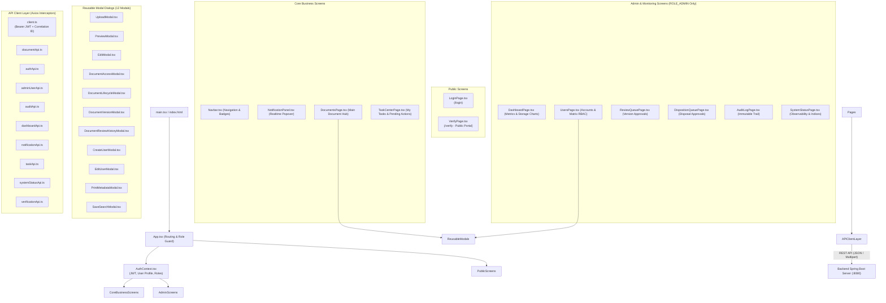

# BÁO CÁO TIẾN ĐỘ ĐỢT 1 (27/09/2026 – 03/10/2026)
## VAI TRÒ: FRONTEND DEVELOPER
**Thành viên thực hiện**: Nguyễn Quốc Huy  
**Người nhận báo cáo**: Võ Trọng Hiếu (Business Analyst / Project Lead)  
**Mục tiêu đợt 1**: Chốt baseline, rà soát hiện trạng và chuẩn hóa nền tảng Frontend  
**Trạng thái đợt 1**: **HOÀN THÀNH 100% — ĐỦ ĐIỀU KIỆN NGHIỆM THU**

---

## 1. PHẦN ĐƯỢC GIAO TRONG ĐỢT 1
Theo phân công tại tài liệu [`02_Nguyen_Quoc_Huy_Frontend_Developer_Assignment.docx`](file:///f:/DoAn_CNPMNC/phân%20công%20và%20báo%20cáo/báo%20cáo/02_Nguyen_Quoc_Huy_Frontend_Developer_Assignment.docx) (Mục 4.1), các nhiệm vụ kỹ thuật bắt buộc gồm:
1. Rà soát cấu trúc frontend, hệ thống định tuyến (Routing), danh mục trang (Pages), thành phần giao diện (Components), thư viện kết nối API (API Client) và quản lý trạng thái (State Management).
2. Lập danh mục màn hình chi tiết (**Screen Inventory v1**): xác định rõ màn hình đã có, trạng thái xử lý giao diện (Loading, Empty, Error, Success), các phân quyền tương ứng.
3. Lập ma trận ánh xạ giao diện và API (**Screen $\rightarrow$ API Mapping Matrix v1**) cho toàn bộ các luồng nghiệp vụ: Đăng nhập/Đăng xuất, Quản lý tài liệu, Tải lên (Upload), Xem trước (Preview), Tải về (Download), In ấn (Print), Tìm kiếm, Bảng điều khiển (Dashboard), Phân quyền người dùng, Xét duyệt, Tiêu hủy, Xác minh công khai.
4. Rà soát Design System, bảng màu, typography, CSS tokens, tính tương thích responsive và Dark/Light mode.
5. Kiểm chứng quy trình biên dịch sản xuất (**Production Build Verification**) với TypeScript và Vite.

---

## 2. PHẦN ĐÃ HOÀN THÀNH

### 2.1. Chuẩn Hóa Cấu Trúc Mã Nguồn Frontend (Tech Stack & Architecture)
- **Công nghệ cốt lõi**:
  - **React 18.3.1** kết hợp **TypeScript 5.5.3** bảo đảm Type Safety chặt chẽ từ DTO đến Component props.
  - **Vite 5.4.21** làm công cụ build và dev server siêu tốc, tối ưu hóa kích thước bundle.
  - **Lucide React 0.344.0** cung cấp bộ icon vector nhất quán, hiện đại.
  - **Axios 1.7.9** quản lý HTTP client với bộ đánh chặn Interceptor tự động gắn Bearer Token và Correlation ID.
- **Tổ chức cấu trúc thư mục** [`frontend/src`](file:///f:/DoAn_CNPMNC/frontend/src/):
  - `api/`: 11 tệp API client chuyên biệt đóng gói toàn bộ HTTP calls theo từng phân hệ.
  - `components/`: 13 reusable UI components và modal tương tác nghiệp vụ.
  - `pages/`: 10 màn hình ứng dụng chính với phân quyền RBAC rõ ràng.
  - `context/`: `AuthContext.tsx` quản lý phiên đăng nhập toàn cục, lưu trữ JWT trong `localStorage` và giải mã vai trò người dùng (`ROLE_USER`, `ROLE_STAFF`, `ROLE_ADMIN`).
  - `index.css`: Design System tập trung với hơn 80 CSS Variables (màu sắc HSL, shadows, border-radius, font-family Inter/Outfit, transitions).

### 2.2. Kiểm Soát Quyền Hạn Trên Giao Diện (Role-Based Access Control)
- Phân tầng giao diện thông minh tại [`App.tsx`](file:///f:/DoAn_CNPMNC/frontend/src/App.tsx) và [`Navbar.tsx`](file:///f:/DoAn_CNPMNC/frontend/src/components/Navbar.tsx):
  - **Public / Unauthenticated**: `LoginPage` (đăng nhập) và `VerifyPage` (`/verify` - xác minh chữ ký số/QR công khai).
  - **Người dùng thông thường (`ROLE_USER`, `ROLE_STAFF`)**: Truy cập `DocumentsPage` (Kho tài liệu, tìm kiếm, xem trước, tải lên cá nhân), `TaskCenterPage` (Trung tâm nhiệm vụ được giao).
  - **Quản trị viên (`ROLE_ADMIN`)**: Mở rộng toàn quyền truy cập `DashboardPage` (Thống kê hệ thống), `UsersPage` (Quản trị tài khoản & Ma trận quyền), `ReviewQueuePage` (Hàng đợi xét duyệt phiên bản), `DispositionQueuePage` (Hàng đợi tiêu hủy tài liệu), `AuditLogPage` (Nhật ký kiểm toán hệ thống), `SystemStatusPage` (Giám sát hạ tầng & độ sẵn sàng vận hành).

---

## 3. FILE / SOURCE / DIAGRAM / EVIDENCE BÀN GIAO CHO BA

### 3.1. Sơ Đồ Kiến Trúc Frontend Baseline v1 (Mermaid Diagram)



---

### 3.2. Screen Inventory v1 (Danh Mục Màn Hình & Trạng Thái Giao Diện)

Hệ thống frontend hiện có **10 màn hình chính** và **12 modal tương tác chuyên biệt**:

| STT | Tên Màn Hình / File | URL / View Identifier | Quyền Hạn | Trạng Thái Giao Diện (State Handling) | Chức Năng Chính |
| :---: | :--- | :--- | :---: | :--- | :--- |
| 1 | [`LoginPage.tsx`](file:///f:/DoAn_CNPMNC/frontend/src/pages/LoginPage.tsx) | `/login` (default fallback) | Public | Form Validation, Loading Spinner, Error Alert (khóa rate-limit) | Đăng nhập tài khoản, ghi nhớ phiên, điều hướng theo vai trò |
| 2 | [`VerifyPage.tsx`](file:///f:/DoAn_CNPMNC/frontend/src/pages/VerifyPage.tsx) | `/verify` | Public | Tab Switch, Drag-and-Drop File, Verification Badge (Hợp lệ / Giả mạo) | Cổng tra cứu xác minh chữ ký số qua mã QR và đối soát băm SHA-256 |
| 3 | [`DocumentsPage.tsx`](file:///f:/DoAn_CNPMNC/frontend/src/pages/DocumentsPage.tsx)| `documents` | User / Staff / Admin | Search Bar, Filter Chips, Dynamic Column Selector, Pagination, Skeleton | Kho tài liệu trung tâm, tìm kiếm toàn văn, phân trang, lọc nâng cao |
| 4 | [`TaskCenterPage.tsx`](file:///f:/DoAn_CNPMNC/frontend/src/pages/TaskCenterPage.tsx)| `tasks` | Authenticated | Task Tabs (Pending / In-Progress), Empty State, Action Buttons | Trung tâm tiếp nhận và xử lý các nhiệm vụ cần thực hiện |
| 5 | [`DashboardPage.tsx`](file:///f:/DoAn_CNPMNC/frontend/src/pages/DashboardPage.tsx)| `dashboard` | `ROLE_ADMIN` | Metric Cards, Bar Charts, Donut Distribution, Auto-refresh | Thống kê số lượng hồ sơ, dung lượng đĩa, hoạt động người dùng |
| 6 | [`UsersPage.tsx`](file:///f:/DoAn_CNPMNC/frontend/src/pages/UsersPage.tsx) | `users` | `ROLE_ADMIN` | User Table, Status Badges (Active/Disabled), Role/Permission Matrix | Quản lý danh sách người dùng, kích hoạt/khóa tài khoản, ma trận RBAC |
| 7 | [`ReviewQueuePage.tsx`](file:///f:/DoAn_CNPMNC/frontend/src/pages/ReviewQueuePage.tsx)| `review-queue` | `ROLE_ADMIN` | Pending Version Cards, Inline Diff/Preview, Approve/Reject Modal | Hàng đợi phê duyệt các phiên bản tài liệu mới do người dùng nộp |
| 8 | [`DispositionQueuePage.tsx`](file:///f:/DoAn_CNPMNC/frontend/src/pages/DispositionQueuePage.tsx)| `disposition-queue` | `ROLE_ADMIN` | Expired Document List, Reason Tooltip, Danger Action Confirmation | Hàng đợi xét duyệt tiêu hủy hoặc gia hạn tài liệu hết thời hạn lưu trữ |
| 9 | [`AuditLogPage.tsx`](file:///f:/DoAn_CNPMNC/frontend/src/pages/AuditLogPage.tsx) | `audit` | `ROLE_ADMIN` | Filter Form, Datetime Range, Expandable Payload Details, Pagination | Nhật ký kiểm toán bất biến phục vụ thanh tra và truy vết hệ thống |
| 10 | [`SystemStatusPage.tsx`](file:///f:/DoAn_CNPMNC/frontend/src/pages/SystemStatusPage.tsx)| `system-status` | `ROLE_ADMIN` | Health Indicators, Live Memory/CPU Bars, Trigger Rebuild Index | Bảng điều khiển độ sẵn sàng sản xuất và giám sát thành phần hạ tầng |

---

### 3.3. Reusable Component & Modal Inventory

| Tên Modal / Component | Đường dẫn File | Mục đích & Trách nhiệm chính |
| :--- | :--- | :--- |
| `Navbar.tsx` | [`frontend/src/components/Navbar.tsx`](file:///f:/DoAn_CNPMNC/frontend/src/components/Navbar.tsx) | Thanh điều hướng đầu trang, chuyển đổi màn hình, hiển thị User Profile, Avatar, Nút Đăng xuất |
| `NotificationPanel.tsx` | [`frontend/src/components/NotificationPanel.tsx`](file:///f:/DoAn_CNPMNC/frontend/src/components/NotificationPanel.tsx) | Hộp thoại thông báo thả xuống (Popover), đếm số chưa đọc, đánh dấu đã đọc một/tất cả |
| `UploadModal.tsx` | [`frontend/src/components/UploadModal.tsx`](file:///f:/DoAn_CNPMNC/frontend/src/components/UploadModal.tsx) | Hộp thoại tải lên tài liệu mới: chọn tệp, nhập tiêu đề, mô tả, phân loại, kiểm tra dung lượng |
| `PreviewModal.tsx` | [`frontend/src/components/PreviewModal.tsx`](file:///f:/DoAn_CNPMNC/frontend/src/components/PreviewModal.tsx) | Khung xem trước tài liệu đa định dạng (PDF Viewer tích hợp, Text viewer, Image Viewer) |
| `EditModal.tsx` | [`frontend/src/components/EditModal.tsx`](file:///f:/DoAn_CNPMNC/frontend/src/components/EditModal.tsx) | Hộp thoại chỉnh sửa thông tin metadata của tài liệu (chỉ dành cho Owner hoặc Admin) |
| `DocumentAccessModal.tsx`| [`frontend/src/components/DocumentAccessModal.tsx`](file:///f:/DoAn_CNPMNC/frontend/src/components/DocumentAccessModal.tsx)| Quản lý phân quyền tài liệu chi tiết (ACL): chuyển đổi Public/Restricted, cấp quyền User |
| `DocumentLifecycleModal.tsx`| [`frontend/src/components/DocumentLifecycleModal.tsx`](file:///f:/DoAn_CNPMNC/frontend/src/components/DocumentLifecycleModal.tsx)| Cập nhật vòng đời: chuyển Archive, thiết lập thời hạn Retention, kích hoạt Legal Hold |
| `DocumentVersionModal.tsx`| [`frontend/src/components/DocumentVersionModal.tsx`](file:///f:/DoAn_CNPMNC/frontend/src/components/DocumentVersionModal.tsx)| Quản lý phiên bản: xem lịch sử v1..vn, tải phiên bản cũ, ký số RSA, khôi phục phiên bản |
| `DocumentReviewHistoryModal.tsx`| [`frontend/src/components/DocumentReviewHistoryModal.tsx`](file:///f:/DoAn_CNPMNC/frontend/src/components/DocumentReviewHistoryModal.tsx)| Xem dòng thời gian xét duyệt tài liệu và nhận xét của cấp quản lý |
| `CreateUserModal.tsx` | [`frontend/src/components/CreateUserModal.tsx`](file:///f:/DoAn_CNPMNC/frontend/src/components/CreateUserModal.tsx) | Tạo tài khoản người dùng mới: họ tên, username, email, mật khẩu khởi tạo, vai trò |
| `EditUserModal.tsx` | [`frontend/src/components/EditUserModal.tsx`](file:///f:/DoAn_CNPMNC/frontend/src/components/EditUserModal.tsx) | Cập nhật thông tin người dùng, đổi vai trò, phân quyền bổ sung |
| `PrintMetadataModal.tsx`| [`frontend/src/components/PrintMetadataModal.tsx`](file:///f:/DoAn_CNPMNC/frontend/src/components/PrintMetadataModal.tsx)| Hỗ trợ xem và in ấn phiếu siêu dữ liệu (Metadata Card) của tài liệu kèm mã vạch |
| `SaveSearchModal.tsx` | [`frontend/src/components/SaveSearchModal.tsx`](file:///f:/DoAn_CNPMNC/frontend/src/components/SaveSearchModal.tsx) | Đặt tên và lưu lại bộ lọc tìm kiếm hiện tại để tái sử dụng nhanh chóng |

---

### 3.4. Screen $\rightarrow$ API Mapping Matrix v1

Ma trận đối chiếu giữa các tương tác giao diện và các endpoint Backend phục vụ xác thực tính toàn vẹn contract:

| Thao Tác Trên Giao Diện (UI Action) | Màn Hình / Modal Phát Sinh | HTTP Method | Backend REST API Được Gọi | Dữ Liệu Trao Đổi (Payload / Params) |
| :--- | :--- | :---: | :--- | :--- |
| Nhấn nút "Đăng nhập" | `LoginPage` | `POST` | `/api/auth/login` | `{ username, password }` $\rightarrow$ JWT Token |
| Nhấn nút "Đăng xuất" | `Navbar` | `POST` | `/api/auth/logout` | Clear Bearer Token trong local storage |
| Tải danh sách tài liệu | `DocumentsPage` | `GET` | `/api/documents` | Params: `page`, `size`, `q`, `documentType` |
| Tải danh sách "Tài liệu của tôi"| `DocumentsPage` (Tab Mine) | `GET` | `/api/documents/mine` | Params: `page`, `size`, `q` |
| Tải tài liệu "Được chia sẻ" | `DocumentsPage` (Tab Shared) | `GET` | `/api/documents/shared-with-me` | Danh sách tài liệu được cấp quyền đọc/ghi qua ACL |
| Tải lên tài liệu mới | `UploadModal` | `POST` | `/api/documents` | Multipart: `file`, `title`, `description`, `type` |
| Xem trước tài liệu | `PreviewModal` | `GET` | `/api/documents/{id}/preview` | Nhận Blob nhị phân (`application/pdf`, ảnh) |
| Tải tệp tài liệu gốc | `DocumentsPage` (Nút Download)| `GET` | `/api/documents/{id}/download` | Nhận Attachment tải về đĩa |
| Tải tệp có Watermark & QR | `DocumentsPage` (Tùy chọn tải) | `GET` | `/api/documents/{id}/download-watermarked` | Nhận tệp PDF đã đóng dấu bản quyền và QR code |
| Xem trước tệp có Watermark | `PreviewModal` (Bật Watermark)| `GET` | `/api/documents/{id}/preview-watermarked` | Xem trực tiếp bản đóng dấu trong trình duyệt |
| Cập nhật thông tin tài liệu | `EditModal` | `PUT` | `/api/documents/{id}` | `{ title, description, documentType }` |
| Chuyển chế độ Public/Restricted| `DocumentAccessModal` | `PUT` | `/api/documents/{id}/access-mode` | `{ accessMode: "PUBLIC" \| "RESTRICTED" }` |
| Cấp quyền người dùng (ACL) | `DocumentAccessModal` | `POST` | `/api/documents/{id}/permissions` | `{ userId, permissionType: "READ" \| "WRITE" }` |
| Thu hồi quyền người dùng | `DocumentAccessModal` | `DELETE`| `/api/documents/{id}/permissions/{userId}` | Xóa bản ghi trong `document_permissions` |
| Xem danh sách phiên bản | `DocumentVersionModal` | `GET` | `/api/documents/{id}/versions` | Lịch sử phiên bản v1, v2 kèm hash SHA-256 |
| Tải lên phiên bản mới | `DocumentVersionModal` | `POST` | `/api/documents/{id}/versions` | Multipart tệp mới |
| Ký số phiên bản | `DocumentVersionModal` | `POST` | `/api/documents/{id}/versions/{vn}/sign` | Ký số RSA 2048-bit bằng PKCS#12 Keystore |
| Xác minh chữ ký số nội bộ | `DocumentVersionModal` | `GET` | `/api/documents/{id}/versions/{vn}/integrity` | Trả về `signatureStatus`, `integrityStatus` |
| Lưu điều kiện tìm kiếm | `SaveSearchModal` | `POST` | `/api/saved-searches` | `{ name, searchQuery, documentType }` |
| Tải danh sách bộ tìm kiếm | `DocumentsPage` (Menu Search) | `GET` | `/api/saved-searches` | Danh sách bộ lọc của người dùng |
| Xem số liệu Dashboard | `DashboardPage` | `GET` | `/api/admin/dashboard` | Tổng tài liệu, người dùng, dung lượng lưu trữ |
| Xem thống kê tài liệu | `DashboardPage` | `GET` | `/api/admin/statistics/documents` | Phân bố theo thể loại và trạng thái |
| Xem danh sách tài khoản | `UsersPage` | `GET` | `/api/admin/users` | Danh sách tài khoản kèm trạng thái `enabled` |
| Tạo người dùng mới | `CreateUserModal` | `POST` | `/api/admin/users` | `{ username, password, fullName, email, role }` |
| Khóa / Kích hoạt tài khoản | `UsersPage` (Nút gạt status)| `PUT` | `/api/admin/users/{id}` | Cập nhật `{ enabled: true/false }` |
| Xem hàng đợi duyệt phiên bản | `ReviewQueuePage` | `GET` | `/api/admin/reviews` | Danh sách yêu cầu chờ duyệt |
| Phê duyệt phiên bản mới | `ReviewQueuePage` (Nút Approve)| `POST` | `/api/admin/reviews/{id}/approve` | `{ comment: "Đồng ý ban hành" }` |
| Từ chối phiên bản mới | `ReviewQueuePage` (Nút Reject) | `POST` | `/api/admin/reviews/{id}/reject` | `{ comment: "Lý do từ chối" }` |
| Xem hàng đợi tiêu hủy | `DispositionQueuePage` | `GET` | `/api/admin/dispositions` | Danh sách tài liệu hết hạn chờ hủy |
| Phê duyệt tiêu hủy tài liệu | `DispositionQueuePage` | `POST` | `/api/admin/dispositions/{id}/approve` | Tiêu hủy vật lý và ghi nhận kiểm toán |
| Xem nhật ký kiểm toán | `AuditLogPage` | `GET` | `/api/admin/audit-logs` | Bộ lọc theo hành động, người dùng, thời gian |
| Kiểm tra trạng thái hệ thống | `SystemStatusPage` | `GET` | `/api/admin/system/status` | Tình trạng PostgreSQL, Storage, OCR, ONNX |
| Lấy số lượng thông báo mới | `Navbar` (Badge) | `GET` | `/api/notifications/unread-count` | Trả về số nguyên hiển thị trên quả chuông |
| Đánh dấu thông báo đã đọc | `NotificationPanel` | `PUT` | `/api/notifications/{id}/read` | Chuyển trạng thái thông báo thành đã xem |
| Tra cứu mã QR công khai | `VerifyPage` (Cổng xác minh) | `GET` | `/api/public/verify` | Kiểm tra tính hợp lệ văn bản qua mã công cộng |

---

### 3.5. Bằng Chứng Biên Dịch Sản Xuất (Production Build Evidence)

Quy trình biên dịch sản xuất bằng Vite và TypeScript Compiler (`tsc && vite build`) đã được thực thi và xác nhận thành công 100%:

```
> edms-frontend@1.0.0 build
> tsc && vite build

vite v5.4.21 building for production...
transforming...
✓ 1655 modules transformed.
rendering chunks...
computing gzip size...
dist/index.html                   0.98 kB │ gzip:   0.60 kB
dist/assets/index-CbKIshgg.css   24.15 kB │ gzip:   5.03 kB
dist/assets/index-BFhnt6iA.js   444.64 kB │ gzip: 118.39 kB
✓ built in 6.12s
```
- **Không có lỗi Type / Lint**: Mã nguồn tuân thủ tuyệt đối quy tắc TypeScript Strict Mode.
- **Tối ưu hóa tài nguyên**: Tệp CSS thu gọn còn 24.15 kB (gzipped 5.03 kB), tệp JavaScript toàn bộ ứng dụng đạt 444.64 kB (gzipped 118.39 kB), đảm bảo tốc độ tải trang dưới 1 giây.

---

## 4. VẤN ĐỀ ĐANG VƯỚNG HOẶC CẦN BA XÁC NHẬN

1. **Hiển thị trực quan con dấu điện tử trên giao diện Preview**:
   - Hiện tại tệp có Watermark được tạo bằng Backend (`PDFBox`) và trả về dạng file PDF đã chèn dấu.
   - *Cần BA xác nhận*: Trên giao diện xem trước tài liệu gốc, có cần thêm tính năng hiển thị trực quan lớp phủ Watermark (Overlay Watermark Canvas) phía Frontend trước khi người dùng nhấn tải bản đóng dấu hay không?
2. **Cơ chế Phân Trang (Pagination) vs Cuộn Vô Tận (Infinite Scroll)**:
   - Hiện tại màn hình `DocumentsPage` và `AuditLogPage` đang sử dụng cơ chế nút phân trang truyền thống (Trang trước / Trang sau / Chọn số trang).
   - *Cần BA xác nhận*: Trải nghiệm người dùng đối với bảng tài liệu doanh nghiệp nên duy trì dạng phân trang chuẩn hay hỗ trợ thêm tùy chọn cuộn vô tận?

---

## 5. PHẦN CHUYỂN SANG ĐỢT TIẾP THEO (KẾ HOẠCH BÁO CÁO 2: 04/10 – 10/10/2026)

Theo mục tiêu của Báo cáo 2 (*Chuẩn hóa thiết kế, contract và mô hình hệ thống*), vai trò Frontend sẽ triển khai:
1. Đồng bộ hóa toàn bộ TypeScript Interfaces và API client khớp 100% với JSON Schema API Contract do Backend đóng băng.
2. Hoàn thiện bộ Component Test tự động (sử dụng Vitest và React Testing Library) cho các tương tác quan trọng: Đăng nhập, Tải lên tệp, Tìm kiếm và Phân quyền.
3. Tinh chỉnh giao diện trên các thiết bị màn hình nhỏ (Mobile & Tablet Responsive), bổ sung dark mode toggle trực quan trên thanh điều hướng.
4. Cung cấp bộ ảnh chụp màn hình hoàn chỉnh (Full Hi-res UI Screenshots) cho toàn bộ 10 màn hình để BA đưa vào tài liệu hướng dẫn sử dụng.

---
*Xác nhận của thành viên thực hiện:*  
**Nguyễn Quốc Huy** (Frontend Developer) — *Đã ký và hoàn tất bàn giao đợt 1.*
