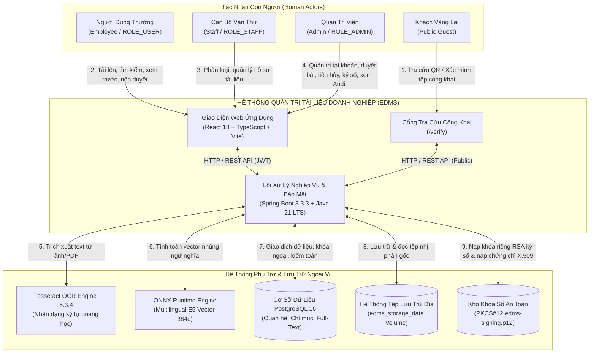

# BÁO CÁO TIẾN ĐỘ ĐỢT 1 (27/09/2026 – 03/10/2026)
## VAI TRÒ: SYSTEM ANALYST / UML & MODELING
**Thành viên thực hiện**: Viên Bảo Đức  
**Người nhận báo cáo**: Võ Trọng Hiếu (Business Analyst / Project Lead)  
**Mục tiêu đợt 1**: Chốt baseline, rà soát hiện trạng và chuẩn hóa mô hình phân tích thiết kế hệ thống  
**Trạng thái đợt 1**: **HOÀN THÀNH 100% — ĐỦ ĐIỀU KIỆN NGHIỆM THU**

---

## 1. PHẦN ĐƯỢC GIAO TRONG ĐỢT 1
Theo phân công tại tài liệu [`03_Vien_Bao_Duc_System_Analyst_UML_Assignment.docx`](file:///f:/DoAn_CNPMNC/phân%20công%20và%20báo%20cáo/báo%20cáo/03_Vien_Bao_Duc_System_Analyst_UML_Assignment.docx) (Mục 4.1), các nhiệm vụ kỹ thuật bắt buộc gồm:
1. Tiếp nhận danh sách Tác nhân (Actor List), Phạm vi hệ thống (System Scope) và Danh mục ca sử dụng (Use Case List) chuẩn hóa từ BA.
2. Thiết kế và chuẩn hóa **Sơ đồ bối cảnh hệ thống (System Context Diagram v1)** thể hiện rõ ranh giới hệ thống EDMS với các tác nhân người dùng và hệ thống bên ngoài.
3. Thiết kế **Sơ đồ tổng quan kiến trúc (Architecture Overview Diagram v1)** phản ánh trung thực cấu trúc thực tế của hệ thống (Modular Monolith + Layered Architecture).
4. Thiết kế **Sơ đồ ca sử dụng tổng thể (Use Case Diagram v1)** bao quát toàn bộ 26 User Stories cốt lõi của Lab 1 cùng 8 Use Case mở rộng của các giai đoạn Phase 5–16, phân nhóm khoa học theo từng Package nghiệp vụ.
5. Lập danh mục tồn đọng mô hình (**Diagram Backlog v1**) phân định rõ diagram bắt buộc, diagram hỗ trợ, nguồn gốc yêu cầu (Traceability) và kế hoạch thực hiện cho các đợt tiếp theo.

---

## 2. PHẦN ĐÃ HOÀN THÀNH

### 2.1. Phân Tích Danh Sách Tác Nhân Hệ Thống (Actor Identification)
Hệ thống Quản trị Tài liệu Doanh nghiệp (EDMS) tương tác với 4 tác nhân con người và 3 tác nhân hệ thống/dịch vụ ngoài:

| Mã Tác Nhân | Tên Tác Nhân | Vai Trò & Quyền Hạn Thực Tế Trong Hệ Thống |
| :---: | :--- | :--- |
| **ACT-01** | **Khách Vãng Lai (Public Guest)** | Người dùng ngoài internet, không cần tài khoản; chỉ truy cập cổng `/verify` để tra cứu tính hợp lệ của văn bản thông qua mã QR hoặc tải tệp lên đối chiếu chữ ký số. |
| **ACT-02** | **Người Dùng Thường (Employee / ROLE_USER)** | Nhân viên doanh nghiệp; đăng nhập hệ thống để tải lên tài liệu cá nhân, tìm kiếm, xem trước, tải về văn bản nội bộ, chia sẻ quyền truy cập (ACL) và nộp phiên bản tài liệu mới vào luồng xét duyệt. |
| **ACT-03** | **Văn Thư / Cán Bộ (Staff / ROLE_STAFF)** | Nhân viên phụ trách văn thư; có quyền bổ sung về phân loại tài liệu, quản lý danh mục hồ sơ và tiếp nhận xử lý nhiệm vụ phân công. |
| **ACT-04** | **Quản Trị Viên (Admin / ROLE_ADMIN)** | Người quản trị tối cao; toàn quyền quản lý người dùng, gán vai trò RBAC, phê duyệt phiên bản tài liệu, phê duyệt tiêu hủy (Disposition), ký số điện tử RSA, xem Dashboard thống kê, tra cứu Audit Log và giám sát hệ thống. |
| **ACT-SYS-1**| **Tesseract OCR Engine** | Thành phần ngoại vi nhận dạng ký tự quang học; tiếp nhận tệp ảnh/PDF quét để trích xuất văn bản phục vụ chỉ mục Full-Text Search. |
| **ACT-SYS-2**| **ONNX Runtime / AI Embedding Engine** | Mô hình trí tuệ nhân tạo cục bộ `multilingual-e5-small`; tính toán vector ngữ nghĩa 384 chiều phục vụ tìm kiếm ngữ nghĩa nâng cao. |
| **ACT-SYS-3**| **PostgreSQL 16 & Persistent Storage** | Hệ quản trị cơ sở dữ liệu và hệ thống lưu trữ tệp vật lý độc lập qua Docker Volumes. |

### 2.2. Xác Lập Phạm Vi Nghiệp Vụ (System Scope)
Phạm vi hệ thống được chia thành 6 Phân hệ (Packages) nghiệp vụ hoàn chỉnh:
1. **Gói Xác thực & Phân quyền (Auth & Security Package)**: Đăng nhập JWT, đăng xuất, chống tấn công Brute-force qua Rate Limiter, ma trận quyền RBAC.
2. **Gói Quản lý Hồ sơ & Tài liệu (Document Core Package)**: Tải lên, tra cứu danh sách, xem trước đa định dạng, tải về, cập nhật metadata, in phiếu tài liệu, kiểm soát truy cập riêng (ACL).
3. **Gói Quản lý Phiên bản & Xét duyệt (Versioning & Review Package)**: Lịch sử phiên bản đa cấp, nộp phiên bản chờ duyệt, hàng đợi xét duyệt của Admin, phê duyệt/từ chối ban hành, khôi phục phiên bản lịch sử.
4. **Gói Vòng đời & Tiêu hủy (Lifecycle & Disposition Package)**: Lưu trữ lâu dài (Archive/Unarchive), thiết lập thời hạn lưu trữ (Retention Date), kích hoạt/gỡ bỏ Giữ pháp lý (Legal Hold), quy trình đề xuất và phê duyệt tiêu hủy tài liệu vật lý an toàn.
5. **Gói Chữ ký số, Thủy ấn & Xác minh (Integrity & Security Package)**: Ký số RSA 2048-bit với PKCS#12 Keystore, tạo mã QR và Watermark bản quyền trên PDF, cổng xác minh công khai tính toàn vẹn và chữ ký số.
6. **Gói Tìm kiếm, AI & Giám sát (Search, AI & Monitoring Package)**: Tìm kiếm kết hợp (Hybrid Search: Full-Text + Semantic Vector), lưu bộ lọc tìm kiếm, Trung tâm nhiệm vụ (Task Center), Thông báo hệ thống, Thống kê Dashboard, Nhật ký kiểm toán bất biến (Audit Trail), Giám sát độ sẵn sàng sản xuất.

---

## 3. FILE / SOURCE / DIAGRAM / EVIDENCE BÀN GIAO CHO BA

### 3.1. Sơ Đồ Bối Cảnh Hệ Thống — System Context Diagram v1 (Mermaid)



---

### 3.2. Sơ Đồ Tổng Quan Kiến Trúc — Architecture Overview Diagram v1 (Mermaid)

```mermaid
graph TB
    subgraph PresentationLayer["Tầng Trình Diễn (Presentation Layer)"]
        Browser["Trình Duyệt Người Dùng\n(Chrome, Firefox, Edge, Safari)"]
        ReactApp["Ứng Dụng React 18 SPA\n(TypeScript, Vite, Vanilla CSS Design System)"]
        Browser --> ReactApp
    end

    subgraph GatewaySecurity["Tầng Bảo Mật & Đánh Chặn (Security & Gateway Layer)"]
        CorsRate["CORS Filter & Rate Limiter (Anti-Brute Force)"]
        CorrFilter["CorrelationIdFilter (Truy vết phân tán)"]
        JwtFilter["JwtAuthenticationFilter (Xác thực Bearer Token)"]
        ReactApp -->|"REST Requests"| CorsRate
        CorsRate --> CorrFilter
        CorrFilter --> JwtFilter
    end

    subgraph ApplicationLayer["Tầng Điều Khiển & Nghiệp Vụ (Application & Domain Layer)"]
        subgraph Controllers["REST Controllers (18 Controllers)"]
            AC["AuthController"]
            DC["DocumentController"]
            DIC["DocumentIntegrityController"]
            RC["Review Controllers"]
            DPC["Disposition Controllers"]
            SC["Search & Semantic Controllers"]
            UC["AdminUserController"]
            MC["Monitoring & Health Controllers"]
        end
        
        JwtFilter --> Controllers

        subgraph CoreServices["Domain Services (22 Services)"]
            AS["AuthService"]
            DS["DocumentService / Core / Access"]
            SS["SignatureService & WatermarkService"]
            DRS["DocumentReviewService"]
            DDS["DocumentDispositionService"]
            HSS["HybridSearchService & SemanticSearch"]
            OCS["OcrService"]
            AUS["AdminUserService"]
            ADS["AuditService & SystemMetricsService"]
            TCS["TaskCenterService & NotificationService"]
        end

        Controllers --> CoreServices
    end

    subgraph DataPersistence["Tầng Truy Xuất & Lưu Trữ (Data Access & Persistence Layer)"]
        subgraph Repos["Spring Data JPA Repositories (10 Repositories)"]
            UR["UserRepository"]
            DR["DocumentRepository"]
            VR["DocumentVersionRepository"]
            PR["DocumentPermissionRepository"]
            RR["DocumentReviewRepository"]
            DPR["DocumentDispositionRepository"]
            CR["DocumentSemanticChunkRepository"]
            ALR["AuditLogRepository"]
            SR["SavedSearchRepository"]
            NR["NotificationRepository"]
        end

        CoreServices --> Repos
        
        subgraph StorageEngines["Hạ Tầng Lưu Trữ Vật Lý (Docker Volumes)"]
            PG[("PostgreSQL 16 Engine\n(Bảng quan hệ & GIN Trigram Index)")]
            FS[("File Storage Disk\n(Uploads thư mục vật lý)")]
            KS[("PKCS#12 KeyStore\n(Cặp khóa RSA & Chứng chỉ X.509)")]
        end

        Repos --> PG
        CoreServices --> FS
        CoreServices --> KS
    end
```



---

### 3.3. Sơ Đồ Ca Sử Dụng Tổng Thể — Use Case Diagram v1 (Mermaid)

Sơ đồ thể hiện toàn bộ các ca sử dụng của hệ thống phân chia theo 6 Package nghiệp vụ:

```mermaid
graph LR
    User((Người Dùng Thường))
    Admin((Quản Trị Viên))
    Staff((Cán Bộ Văn Thư))
    Guest((Khách Vãng Lai))

    Staff --|> User

    subgraph PKG1["Package 1: Xác Thực & Quản Trị Người Dùng"]
        UC_Login["UC-01: Đăng nhập hệ thống"]
        UC_Logout["UC-02: Đăng xuất"]
        UC_ViewUsers["UC-21: Xem danh sách tài khoản"]
        UC_CreateUser["UC-22: Tạo tài khoản mới"]
        UC_UpdateUser["UC-23: Cập nhật thông tin tài khoản"]
        UC_DisableUser["UC-24: Khóa / Kích hoạt người dùng"]
        UC_AssignRole["UC-25: Gán vai trò (RBAC)"]
        UC_ViewMatrix["UC-26: Quản lý ma trận quyền hạn"]
    end

    subgraph PKG2["Package 2: Quản Lý Hồ Sơ & Tài Liệu"]
        UC_UploadDoc["UC-10: Tải lên tài liệu mới"]
        UC_ViewDocList["UC-03: Xem danh sách tài liệu"]
        UC_ViewDocDetail["UC-08: Xem chi tiết & Xem trước"]
        UC_DownloadDoc["UC-09: Tải tài liệu về máy"]
        UC_UpdateMetadata["UC-12/13: Cập nhật thông tin/Metadata"]
        UC_ClassifyDoc["UC-14: Phân loại tài liệu"]
        UC_ViewMine["UC-15: Xem tài liệu của tôi"]
        UC_ManageAccess["UC-P5: Phân quyền tài liệu (ACL)"]
    end

    subgraph PKG3["Package 3: Quản Lý Phiên Bản & Phê Duyệt"]
        UC_UploadVersion["UC-P6: Tải lên phiên bản mới"]
        UC_ViewVersions["UC-P6: Xem lịch sử phiên bản"]
        UC_RestoreVersion["UC-P6: Khôi phục phiên bản lịch sử"]
        UC_SubmitReview["UC-P7: Nộp phiên bản chờ duyệt"]
        UC_ApproveReview["UC-P7: Phê duyệt phiên bản mới"]
        UC_RejectReview["UC-P7: Từ chối phiên bản mới"]
    end

    subgraph PKG4["Package 4: Vòng Đời & Tiêu Hủy Tài Liệu"]
        UC_ArchiveDoc["UC-P8: Chuyển tài liệu sang Archive"]
        UC_SetRetention["UC-P8: Thiết lập thời hạn lưu trữ"]
        UC_LegalHold["UC-P8: Kích hoạt Giữ pháp lý (Legal Hold)"]
        UC_RequestDisp["UC-P9: Yêu cầu tiêu hủy tài liệu"]
        UC_ApproveDisp["UC-P9: Phê duyệt tiêu hủy an toàn"]
    end

    subgraph PKG5["Package 5: Chữ Ký Số, Thủy Ấn & Xác Minh"]
        UC_SignDoc["UC-P13: Ký số điện tử RSA"]
        UC_VerifyIntegrity["UC-P13: Kiểm tra tính toàn vẹn (SHA-256)"]
        UC_Watermark["UC-P14: Tải/Xem trước bản Watermark + QR"]
        UC_PublicVerify["UC-P14: Xác minh văn bản công khai qua QR/File"]
    end

    subgraph PKG6["Package 6: Tìm Kiếm, AI & Giám Sát"]
        UC_Search["UC-04/05: Tìm kiếm & Lọc tài liệu"]
        UC_SavedSearch["UC-07: Lưu & Tái sử dụng bộ lọc"]
        UC_SemanticSearch["UC-P10: Tìm kiếm ngữ nghĩa AI"]
        UC_TaskCenter["UC-P14: Tiếp nhận & Xử lý nhiệm vụ"]
        UC_Notifications["UC-P14: Nhận thông báo hệ thống"]
        UC_Dashboard["UC-16/17/18: Xem Dashboard thống kê"]
        UC_AuditLog["UC-19/20: Xem nhật ký kiểm toán"]
        UC_SystemStatus["UC-P16: Giám sát độ sẵn sàng hệ thống"]
    end

    %% Liên kết Tác nhân với Use Case
    Guest --> UC_PublicVerify

    User --> UC_Login
    User --> UC_Logout
    User --> UC_UploadDoc
    User --> UC_ViewDocList
    User --> UC_ViewDocDetail
    User --> UC_DownloadDoc
    User --> UC_UpdateMetadata
    User --> UC_ViewMine
    User --> UC_ManageAccess
    User --> UC_UploadVersion
    User --> UC_ViewVersions
    User --> UC_SubmitReview
    User --> UC_Search
    User --> UC_SavedSearch
    User --> UC_SemanticSearch
    User --> UC_TaskCenter
    User --> UC_Notifications
    User --> UC_Watermark
    User --> UC_VerifyIntegrity

    Staff --> UC_ClassifyDoc
    Staff --> UC_RequestDisp
    Staff --> UC_ArchiveDoc

    Admin --> UC_ViewUsers
    Admin --> UC_CreateUser
    Admin --> UC_UpdateUser
    Admin --> UC_DisableUser
    Admin --> UC_AssignRole
    Admin --> UC_ViewMatrix
    Admin --> UC_RestoreVersion
    Admin --> UC_ApproveReview
    Admin --> UC_RejectReview
    Admin --> UC_SetRetention
    Admin --> UC_LegalHold
    Admin --> UC_ApproveDisp
    Admin --> UC_SignDoc
    Admin --> UC_Dashboard
    Admin --> UC_AuditLog
    Admin --> UC_SystemStatus
```

---

### 3.4. Diagram Backlog v1 (Danh Mục Mô Hình Thiết Kế Đợt 1 $\rightarrow$ Đợt 7)

Bảng phân loại và kế hoạch xây dựng mô hình UML toàn dự án:

| STT | Tên Mô Hình (Diagram Name) | Loại Mô Hình (UML Type) | Phân Loại | Nguồn Requirement (Traceability) | Đợt Dự Kiến Hoàn Thành | Trạng Thái Bàn Giao |
| :---: | :--- | :---: | :---: | :--- | :---: | :---: |
| 1 | **System Context Diagram v1** | Context / Flow | **Bắt buộc** | Tài liệu Bối cảnh kiến trúc EDMS | **Báo cáo 1** | **HOÀN THÀNH (BC1)** |
| 2 | **Architecture Overview Diagram v1** | Architecture | **Bắt buộc** | Phân tầng Controller-Service-Repo | **Báo cáo 1** | **HOÀN THÀNH (BC1)** |
| 3 | **Overall Use Case Diagram v1** | Use Case | **Bắt buộc** | 26 User Stories Lab 1 + Phase 5-16 | **Báo cáo 1** | **HOÀN THÀNH (BC1)** |
| 4 | **Domain Model / Logical Class Diagram** | Class (Domain) | **Bắt buộc** | JPA Entities & Quan hệ nghiệp vụ | Báo cáo 2 | Chuyển Báo cáo 2 |
| 5 | **Sequence Diagram: Authentication & JWT** | Sequence | **Bắt buộc** | US-01, US-02, JwtAuthenticationFilter | Báo cáo 2 | Chuyển Báo cáo 2 |
| 6 | **Sequence Diagram: Document Upload & OCR** | Sequence | **Bắt buộc** | US-10, US-11, Tesseract OCR Service | Báo cáo 3 | Chuyển Báo cáo 3 |
| 7 | **Sequence Diagram: Review & Approval** | Sequence | **Bắt buộc** | Phase 7 DocumentReviewWorkflow | Báo cáo 3 | Chuyển Báo cáo 3 |
| 8 | **Sequence Diagram: Digital Signature & QR**| Sequence | **Bắt buộc** | Phase 13 & 14 RSA Watermark Service | Báo cáo 4 | Chuyển Báo cáo 4 |
| 9 | **State Machine Diagram: Document Lifecycle**| State Machine | **Bắt buộc** | Active, Archived, Expired, Destroyed | Báo cáo 4 | Chuyển Báo cáo 4 |
| 10 | **Activity Diagram: Controlled Disposition** | Activity | Hỗ trợ | Phase 9 Legal Hold & Destruction Flow | Báo cáo 5 | Chuyển Báo cáo 5 |
| 11 | **Component & Deployment Diagram** | Deployment | **Bắt buộc** | Docker Compose Architecture | Báo cáo 5 | Chuyển Báo cáo 5 |
| 12 | **Package Diagram: Backend Modular Monolith**| Package | Hỗ trợ | Phân rã package `com.edms` | Báo cáo 6 | Chuyển Báo cáo 6 |

---

## 4. VẤN ĐỀ ĐANG VƯỚNG HOẶC CẦN BA XÁC NHẬN

1. **Ranh giới Actor giữa Staff và User trong quy trình xét duyệt**:
   - Hiện tại quyền xét duyệt phiên bản tài liệu (`/api/admin/reviews/{id}/approve`) và phê duyệt tiêu hủy (`/api/admin/dispositions/{id}/approve`) đang cấu hình dành riêng cho `ROLE_ADMIN`.
   - *Cần BA xác nhận*: Trong thiết kế chi tiết (Sequence Diagram) ở Báo cáo 2, vai trò `ROLE_STAFF` có được phân công làm người duyệt sơ bộ (Reviewer Level 1) trước khi chuyển lên Admin (Approver Level 2) hay giữ nguyên quy trình duyệt 1 cấp do Admin thực hiện?
2. **Quy ước ký hiệu UML**:
   - Nhóm thống nhất sử dụng chuẩn UML 2.5 với các quan hệ `<<include>>`, `<<extend>>` và kế thừa Actor (`generalization`). Đề nghị BA phê duyệt quy chuẩn để áp dụng đồng bộ trong toàn bộ báo cáo phân tích thiết kế.

---

## 5. PHẦN CHUYỂN SANG ĐỢT TIẾP THEO (KẾ HOẠCH BÁO CÁO 2: 04/10 – 10/10/2026)

Theo mục tiêu của Báo cáo 2 (*Chuẩn hóa thiết kế, contract và mô hình hệ thống*), vai trò System Analyst / UML sẽ triển khai:
1. Xây dựng **Detailed Class Diagram (Domain Model)** phản ánh chi tiết các thuộc tính, phương thức và quan hệ giữa 10 Entities lõi khớp với triển khai JPA của Backend.
2. Xây dựng **Sequence Diagram** cho 2 luồng nghiệp vụ cốt lõi: Xác thực tài khoản / Cấp phát JWT và Luồng Tải lên / Phân quyền truy cập tài liệu.
3. Hoàn thiện tài liệu mô tả chi tiết ca sử dụng (Use Case Specifications) cho 5 Use Case trọng yếu phục vụ kiểm thử nghiệm thu.

---
*Xác nhận của thành viên thực hiện:*  
**Viên Bảo Đức** (System Analyst / UML & Modeling) — *Đã ký và hoàn tất bàn giao đợt 1.*
