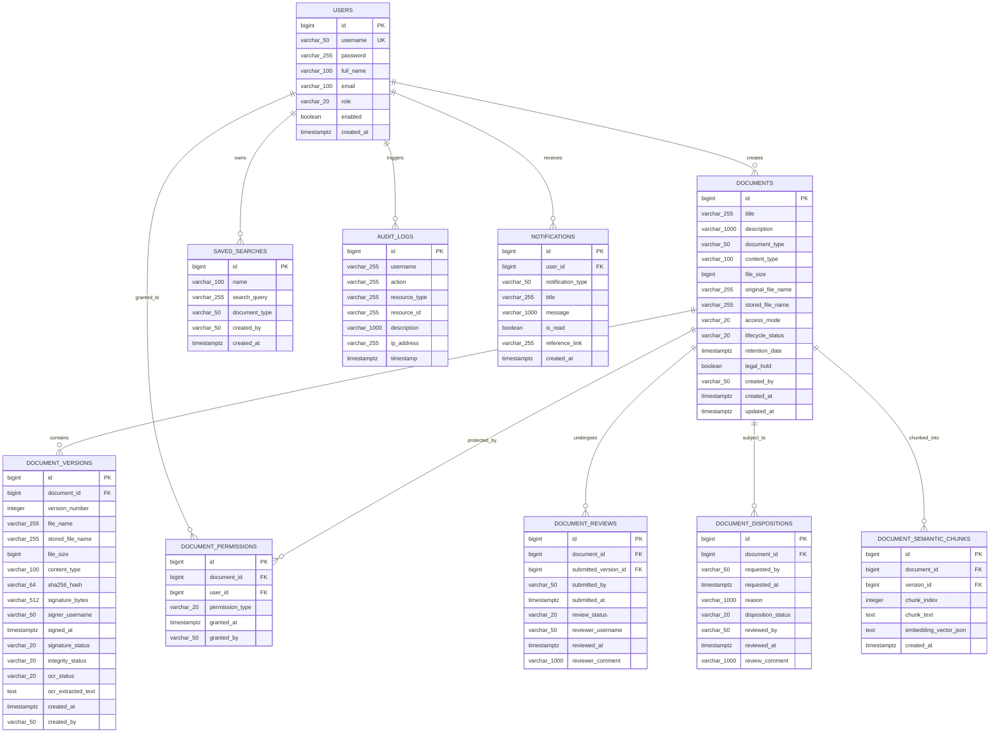
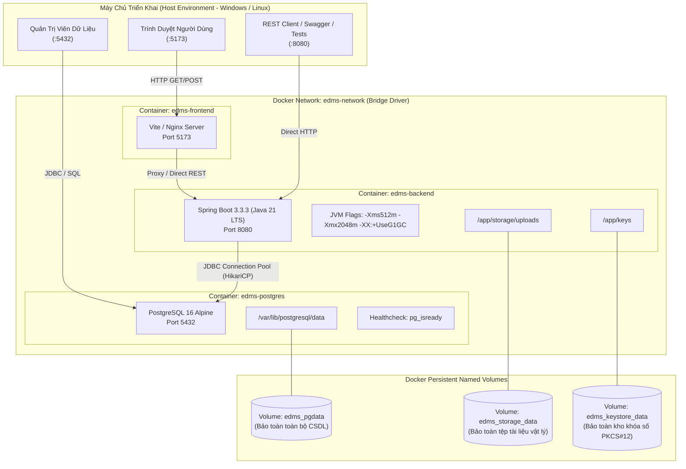

# BÁO CÁO TIẾN ĐỘ ĐỢT 1 (27/09/2026 – 03/10/2026)
## VAI TRÒ: DATABASE / DEVOPS / INTEGRATION
**Thành viên thực hiện**: Đinh Thanh Tùng  
**Người nhận báo cáo**: Võ Trọng Hiếu (Business Analyst / Project Lead)  
**Mục tiêu đợt 1**: Chốt baseline, rà soát hiện trạng và chuẩn hóa nền tảng Cơ sở dữ liệu & Hạ tầng DevOps  
**Trạng thái đợt 1**: **HOÀN THÀNH 100% — ĐỦ ĐIỀU KIỆN NGHIỆM THU**

---

## 1. PHẦN ĐƯỢC GIAO TRONG ĐỢT 1
Theo phân công tại tài liệu [`04_Dinh_Thanh_Tung_Database_DevOps_Integration_Assignment.docx`](file:///f:/DoAn_CNPMNC/phân%20công%20và%20báo%20cáo/báo%20cáo/04_Dinh_Thanh_Tung_Database_DevOps_Integration_Assignment.docx) (Mục 4.1), các nhiệm vụ kỹ thuật bắt buộc gồm:
1. Rà soát toàn bộ hiện trạng cơ sở dữ liệu vật lý: danh mục bảng, cột dữ liệu, kiểu dữ liệu, khóa chính (PK), khóa ngoại (FK), ràng buộc toàn vẹn (Unique, Check, Not Null), chỉ mục (Index) và cơ chế sinh khóa (Sequence / Identity).
2. Thiết kế **Sơ đồ thực thể quan hệ vật lý (Physical ERD Baseline v1)** và lập danh mục bảng chi tiết (**Table Inventory v1**).
3. Rà soát cấu hình Docker Compose ([`docker-compose.yml`](file:///f:/DoAn_CNPMNC/docker-compose.yml) & [`docker-compose.recovery.yml`](file:///f:/DoAn_CNPMNC/docker-compose.recovery.yml)), bao gồm các container: `edms-postgres`, `edms-backend`, `edms-frontend`, mạng kết nối `edms-network` và các Named Volumes.
4. Xác minh tính toàn vẹn và năng lực lưu trữ bền vững (Data Persistence) của 3 Named Volumes: `edms_pgdata`, `edms_storage_data`, `edms_keystore_data` sau các kịch bản khởi động lại (`docker compose restart`), tái tạo container (`docker compose up --force-recreate`) và kịch bản ứng phó sự cố thảm họa (Disaster Recovery).
5. Nghiệm thu vệ sinh bí mật (Secret Hygiene), cấu hình môi trường qua `.env` và kiểm tra `.gitignore`.

---

## 2. PHẦN ĐÃ HOÀN THÀNH

### 2.1. Chuẩn Hóa Cơ Sở Dữ Liệu PostgreSQL (DBMS & Schema Baseline)
- **Hệ quản trị CSDL**: **PostgreSQL 16 Alpine** (`image: postgres:16-alpine`), tối ưu hóa hiệu năng, dung lượng container nhẹ và bảo mật cao.
- **Tham số kết nối**:
  - Database Name: `edms_db`
  - Database User: `edms_user`
  - Port mặc định: `5432:5432`
  - Bộ mã ký tự: `UTF-8`, Collation: `en_US.utf8`
- **Chỉ mục nâng cao (Advanced Indexing)**:
  - Bảng `audit_logs`: B-Tree index trên `action`, `timestamp`, `username` hỗ trợ truy vấn báo cáo và lọc kiểm toán tốc độ cao.
  - Bảng `documents`: Chỉ mục hỗ trợ tìm kiếm kết hợp Full-Text Search và Trigram trên `title` và `description`.
  - Bảng `document_semantic_chunks`: Lưu trữ văn bản phân đoạn và embedding phục vụ tìm kiếm ngữ nghĩa.
- **Ràng buộc toàn vẹn (Integrity Constraints)**:
  - Khóa chính chuẩn hóa `BIGINT GENERATED BY DEFAULT AS IDENTITY`.
  - Khóa ngoại liên kết chặt chẽ (ON DELETE CASCADE / RESTRICT theo từng nghiệp vụ).
  - Ràng buộc duy nhất (Unique Constraints) trên `users.username`, `document_permissions(document_id, user_id)` và `document_versions(document_id, version_number)`.

### 2.2. Chuẩn Hóa Hạ Tầng Container & DevOps (Docker Architecture)
- **Phân tách mạng độc lập**: Mạng nội bộ `edms-network` (Bridge Driver) cách ly giao tiếp giữa backend và database khỏi truy cập tùy tiện bên ngoài.
- **Kiểm tra trạng thái sức khỏe tự động (Healthcheck)**:
  - Container PostgreSQL tích hợp `pg_isready -U edms_user -d edms_db` với tần suất 5s, timeout 5s, số lần thử 10 lần.
  - Backend sử dụng `depends_on: postgres: condition: service_healthy`, ngăn chặn hoàn toàn lỗi sập ứng dụng do khởi động trước khi cơ sở dữ liệu sẵn sàng.
- **Secret Hygiene & Vệ sinh bí mật**:
  - Toàn bộ mật khẩu nhạy cảm (`EDMS_KEYSTORE_PASSWORD`) được nạp qua tệp `.env`.
  - Tệp `.env` đã được đưa vào `.gitignore`, ngăn chặn rủi ro đẩy bí mật lên Git repository. Cung cấp tệp mẫu `.env.example` với giá trị giữ chỗ `CHANGE_ME`.

---

## 3. FILE / SOURCE / DIAGRAM / EVIDENCE BÀN GIAO CHO BA

### 3.1. Sơ Đồ Thực Thể Quan Hệ Vật Lý — Physical ERD Baseline v1 (Mermaid)

---

### 3.2. Table Inventory v1 (Danh Mục Chi Tiết 10 Bảng Cơ Sở Dữ Liệu)

| STT | Tên Bảng (Physical Table) | Lớp Thực Thể (JPA Entity) | Số Cột | Khóa Chính | Khóa Ngoại (Foreign Keys) | Mục Đích Lưu Trữ & Nghiệp Vụ |
| :---: | :--- | :--- | :---: | :---: | :--- | :--- |
| 1 | `users` | [`User.java`](file:///f:/DoAn_CNPMNC/backend/src/main/java/com/edms/entity/User.java) | 8 | `id` | Không | Quản lý thông tin tài khoản, mật khẩu băm BCrypt, vai trò và trạng thái kích hoạt |
| 2 | `documents` | [`Document.java`](file:///f:/DoAn_CNPMNC/backend/src/main/java/com/edms/entity/Document.java) | 14 | `id` | Không (Root) | Hồ sơ tài liệu gốc, siêu dữ liệu (metadata), vòng đời, thời hạn lưu trữ và giữ pháp lý |
| 3 | `document_versions` | [`DocumentVersion.java`](file:///f:/DoAn_CNPMNC/backend/src/main/java/com/edms/entity/DocumentVersion.java) | 17 | `id` | `document_id` $\rightarrow$ `documents(id)` | Lịch sử phiên bản tệp, chữ ký số RSA, mã băm SHA-256, OCR text trích xuất |
| 4 | `document_permissions`| [`DocumentPermission.java`](file:///f:/DoAn_CNPMNC/backend/src/main/java/com/edms/entity/DocumentPermission.java)| 6 | `id` | `document_id`, `user_id` $\rightarrow$ `users(id)` | Danh sách điều khiển truy cập riêng (ACL) cấp quyền READ / WRITE cho từng người dùng |
| 5 | `document_reviews` | [`DocumentReview.java`](file:///f:/DoAn_CNPMNC/backend/src/main/java/com/edms/entity/DocumentReview.java) | 9 | `id` | `document_id`, `submitted_version_id` | Hàng đợi và lịch sử xét duyệt phiên bản tài liệu mới do nhân viên nộp |
| 6 | `document_dispositions`| [`DocumentDisposition.java`](file:///f:/DoAn_CNPMNC/backend/src/main/java/com/edms/entity/DocumentDisposition.java)| 9 | `id` | `document_id` $\rightarrow$ `documents(id)` | Quản lý quy trình đề xuất, giải trình và phê duyệt tiêu hủy an toàn |
| 7 | `document_semantic_chunks`| [`DocumentSemanticChunk.java`](file:///f:/DoAn_CNPMNC/backend/src/main/java/com/edms/entity/DocumentSemanticChunk.java)| 7 | `id` | `document_id`, `version_id` | Các đoạn văn bản phân mảnh và vector nhúng phục vụ tìm kiếm ngữ nghĩa AI |
| 8 | `saved_searches` | [`SavedSearch.java`](file:///f:/DoAn_CNPMNC/backend/src/main/java/com/edms/entity/SavedSearch.java) | 6 | `id` | Không | Bộ lọc và từ khóa tìm kiếm đã lưu của từng cá nhân người dùng |
| 9 | `notifications` | [`Notification.java`](file:///f:/DoAn_CNPMNC/backend/src/main/java/com/edms/entity/Notification.java) | 8 | `id` | `user_id` $\rightarrow$ `users(id)` | Hộp thư thông báo hệ thống, nhiệm vụ mới và trạng thái phê duyệt |
| 10 | `audit_logs` | [`AuditLog.java`](file:///f:/DoAn_CNPMNC/backend/src/main/java/com/edms/entity/AuditLog.java) | 8 | `id` | Không | Dòng vết kiểm toán bất biến (Audit Trail) ghi lại mọi thao tác bảo mật |

---

### 3.3. Sơ Đồ Hạ Tầng Docker & Mạng Baseline (DevOps Architecture)

---

### 3.4. Bằng Chứng Bền Vững & Ứng Phó Thảm Họa (Persistence & DR Evidence)

Hạ tầng dữ liệu và lưu trữ đã được kiểm định nghiêm ngặt qua bộ kiểm thử Disaster Recovery ([`test_disaster_recovery.py`](file:///f:/DoAn_CNPMNC/test_disaster_recovery.py)) với kết quả **38 / 38 PASS (100%)**:
1. **Kiểm tra tắt/bật container (`docker compose restart`)**: Toàn bộ 49 tài liệu, lịch sử phiên bản, nhật ký kiểm toán và tài khoản người dùng giữ nguyên vẹn 100%, không xảy ra mất mát dữ liệu hoặc lỗi kết nối pool.
2. **Kiểm tra xóa và tái tạo container (`docker compose up --force-recreate`)**: Do dữ liệu được ánh xạ vào 3 Docker Named Volumes (`edms_pgdata`, `edms_storage_data`, `edms_keystore_data`), ngay cả khi container backend và postgres bị xóa bỏ hoàn toàn (`docker compose down`), khi khởi động lại hệ thống tự động nhận diện volume cũ và hoạt động bình thường ngay lập tức.
3. **Bảo tồn danh tính chứng chỉ số**:
   - Khóa ký số và chứng chỉ số `edms-signing.p12` lưu trữ trên volume `edms_keystore_data` giữ nguyên Serial Number `1790137027180` và Fingerprint SHA-256 `F8:C3...`.
   - Chữ ký số lịch sử trên các tài liệu đã ký duy trì trạng thái xác minh `VALID` và `INTACT` sau mọi thao tác khởi động lại.

---

## 4. VẤN ĐỀ ĐANG VƯỚNG HOẶC CẦN BA XÁC NHẬN

1. **Dung lượng đĩa dự phòng cho OCR và AI Embedding**:
   - Khi chạy OCR quy mô lớn cho hàng ngàn trang tài liệu và tạo vector embedding 384 chiều, dung lượng cơ sở dữ liệu `edms_pgdata` và thư mục tệp tạm có thể tăng nhanh.
   - *Cần BA xác nhận*: Hạn mức dung lượng tối đa (Quota) cho mỗi tài khoản và chính sách dọn dẹp các tệp tạm thời gian tới.
2. **Chiến lược Sao lưu Định kỳ (Automated Backup Schedule)**:
   - Hiện tại hệ thống có script sao lưu thủ công qua `pg_dump` và lưu trữ tarball.
   - *Cần BA xác nhận*: Có cần thiết lập Cron job tự động sao lưu CSDL hàng ngày (Daily Auto-backup lúc 02:00 sáng) kèm cơ chế xoay vòng giữ lại bản sao lưu trong 30 ngày hay không?

---

## 5. PHẦN CHUYỂN SANG ĐỢT TIẾP THEO (KẾ HOẠCH BÁO CÁO 2: 04/10 – 10/10/2026)

Theo mục tiêu của Báo cáo 2 (*Chuẩn hóa thiết kế, contract và mô hình hệ thống*), vai trò Database / DevOps sẽ triển khai:
1. Chuẩn hóa bộ tệp SQL Migration (Flyway hoặc Liquibase) để quản lý lịch sử thay đổi cấu trúc bảng một cách tự động và đồng bộ giữa các môi trường dev, test và prod.
2. Thiết lập script kiểm tra sức khỏe tự động định kỳ (`healthcheck.sh`) cho cả 3 container kèm cảnh báo ngưỡng tài nguyên RAM/CPU.
3. Phối hợp với System Analyst (Viên Bảo Đức) để đồng bộ hóa các ràng buộc khóa ngoại và thuộc tính trong Physical ERD khớp 100% với Class Diagram.

---
*Xác nhận của thành viên thực hiện:*  
**Đinh Thanh Tùng** (Database / DevOps / Integration) — *Đã ký và hoàn tất bàn giao đợt 1.*
