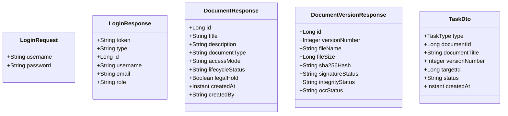

# BÁO CÁO TIẾN ĐỘ ĐỢT 2 (04/10/2026 – 10/10/2026)
## VAI TRÒ: BACKEND DEVELOPER / TECHNICAL LEAD
**Tập tin**: `BC2_01_Tran_Quyen_Minh_Backend_API_Contract.md`  
**Thành viên thực hiện**: Trần Quyền Minh  
**Người nhận báo cáo**: Võ Trọng Hiếu (Business Analyst / Project Lead)  
**Mục tiêu đợt 2**: Khóa Backend API Contract v1, chuẩn hóa DTO, xử lý lỗi và ranh giới giao dịch  
**Trạng thái đợt 2**: **HOÀN THÀNH — ĐÃ KHÓA CONTRACT BASELINE V1**

---

## A. PHẠM VI VÀ MỤC TIÊU KHÓA CONTRACT (SCOPE)

Trong giai đoạn Đợt 2 (04/10/2026 – 10/10/2026), vai trò Backend Developer / Technical Lead tập trung hoàn toàn vào việc:
1. Rà soát và khóa toàn bộ **Backend API Contract Baseline v1** cho hệ thống EDMS hiện tại, phục vụ việc tích hợp ổn định với Frontend (Nguyễn Quốc Huy), mô hình hóa UML (Viên Bảo Đức) và tích hợp CSDL (Đinh Thanh Tùng).
2. Lập danh mục chi tiết **18 REST Controllers** và toàn bộ **75 REST Endpoints** đang hoạt động thực tế trên mã nguồn Java.
3. Xuất bản **DTO Catalog (37 DTOs)**, tách bạch rõ ràng giữa Request DTO và Response DTO, bảo đảm nguyên tắc không để lộ thực thể CSDL (JPA Entity) trực tiếp ra ngoài giao diện công khai.
4. Chuẩn hóa **Mô hình lỗi tập trung (Error Contract)** dựa trên [`GlobalExceptionHandler.java`](file:///f:/DoAn_CNPMNC/backend/src/main/java/com/edms/config/GlobalExceptionHandler.java), bao gồm các mã trạng thái HTTP chuẩn: 400, 401, 403, 404, 409, 413, 429, 500 cùng cơ chế truy vết `correlationId`.
5. Xác lập **Ranh giới giao dịch (Transaction Boundaries)** cho các luồng nghiệp vụ quan trọng (Tải lên tệp, Đổi phiên bản, Phê duyệt, Tiêu hủy, Ký số và Thông báo `AFTER_COMMIT`).
6. Đóng băng hợp đồng API (API Contract Freeze) với các nhãn phân loại: `STABLE`, `NEEDS REVIEW`, `OWNER-OPEN`.

---

## B. HIỆN TRẠNG KIẾN TRÚC BACKEND (CURRENT ARCHITECTURE)

Hệ thống Backend được phát triển trên nền tảng:
- **Ngôn ngữ**: **Java 21 LTS** (`openjdk 21.0.12.1`), cấu hình tại [`backend/pom.xml`](file:///f:/DoAn_CNPMNC/backend/pom.xml).
- **Framework**: **Spring Boot 3.3.3** (`spring-boot-starter-parent`).
- **Mô hình kiến trúc**: **Clean Layered Architecture (Kiến trúc phân tầng sạch 4 lớp)** kết hợp **Modular Monolith**:
  1. *Presentation Layer (Controller)*: Tiếp nhận REST requests, kiểm tra hợp lệ DTO (`@Valid`), giải mã thông tin ngữ cảnh bảo mật từ JWT.
  2. *Business Logic Layer (Service)*: Thực thi logic nghiệp vụ, quản lý giao dịch `@Transactional`, phân quyền sở hữu tài liệu (ACL/Owner), điều phối dịch vụ chữ ký số, OCR và tìm kiếm ngữ nghĩa.
  3. *Data Access Layer (Repository)*: Giao tiếp CSDL thông qua Spring Data JPA và các chỉ mục tối ưu hóa PostgreSQL.
  4. *Physical / Integration Layer*: Tương tác trực tiếp với File Storage vật lý (`edms_storage_data`), PKCS#12 Keystore (`edms_keystore_data`), ONNX Runtime Embedding Engine và tiến trình Tesseract OCR.
- **Tổng số lớp mã nguồn**: **131 Java Classes** phân bố trong 11 packages chuẩn mực thuộc `com.edms`.

---

## C. DANH MỤC CONTROLLER THỰC TẾ (CONTROLLER INVENTORY)

Toàn bộ 18 REST Controller đang vận hành trong gói [`com.edms.controller`](file:///f:/DoAn_CNPMNC/backend/src/main/java/com/edms/controller/):

| STT | Tên Controller | Base Request Path | Mục Đích Nghiệp Vụ | Phân Quyền Yêu Cầu (Role) | Module Liên Quan |
| :---: | :--- | :--- | :--- | :---: | :--- |
| 1 | [`AuthController`](file:///f:/DoAn_CNPMNC/backend/src/main/java/com/edms/controller/AuthController.java) | `/api/auth` | Đăng nhập tài khoản, đăng xuất, mở khóa rate-limit | Public / Admin | Auth & Security |
| 2 | [`DocumentController`](file:///f:/DoAn_CNPMNC/backend/src/main/java/com/edms/controller/DocumentController.java) | `/api/documents` | Quản lý hồ sơ, tải lên, xem trước, tải về, phân quyền ACL, quản lý phiên bản | Authenticated / Owner / Admin | Document Core |
| 3 | [`DocumentReviewController`](file:///f:/DoAn_CNPMNC/backend/src/main/java/com/edms/controller/DocumentReviewController.java) | `/api/documents/{id}/reviews` | Nộp phiên bản chờ duyệt, xem lịch sử duyệt của tài liệu | Authenticated (Write/Read) | Review Workflow |
| 4 | [`AdminReviewController`](file:///f:/DoAn_CNPMNC/backend/src/main/java/com/edms/controller/AdminReviewController.java) | `/api/admin/reviews` | Hàng đợi xét duyệt phiên bản, phê duyệt / từ chối ban hành | `ROLE_ADMIN` | Review Workflow |
| 5 | [`DocumentDispositionController`](file:///f:/DoAn_CNPMNC/backend/src/main/java/com/edms/controller/DocumentDispositionController.java) | `/api/documents/{id}/disposition` | Yêu cầu tiêu hủy tài liệu, hủy yêu cầu, xem lịch sử | Owner / Admin | Disposition |
| 6 | [`AdminDispositionController`](file:///f:/DoAn_CNPMNC/backend/src/main/java/com/edms/controller/AdminDispositionController.java) | `/api/admin/dispositions` | Hàng đợi tiêu hủy, phê duyệt tiêu hủy tài liệu vật lý an toàn | `ROLE_ADMIN` | Disposition |
| 7 | [`DocumentIntegrityController`](file:///f:/DoAn_CNPMNC/backend/src/main/java/com/edms/controller/DocumentIntegrityController.java) | `/api/documents` | Ký số RSA, xác minh tính toàn vẹn (SHA-256), tải bản Watermark & QR | Authenticated / Admin | Integrity & Security |
| 8 | [`PublicVerificationController`](file:///f:/DoAn_CNPMNC/backend/src/main/java/com/edms/controller/PublicVerificationController.java) | `/api/public` | Cổng xác minh văn bản công khai qua mã QR hoặc tải tệp đối soát | Public (No Auth) | Public Portal |
| 9 | [`SavedSearchController`](file:///f:/DoAn_CNPMNC/backend/src/main/java/com/edms/controller/SavedSearchController.java) | `/api/saved-searches` | Quản lý bộ lọc tìm kiếm lưu trữ cá nhân (CRUD) | Authenticated | Search & Discovery |
| 10 | [`AdminContentIndexController`](file:///f:/DoAn_CNPMNC/backend/src/main/java/com/edms/controller/AdminContentIndexController.java) | `/api/admin/content-index` | Tái tạo chỉ mục Full-Text Search trong PostgreSQL | `ROLE_ADMIN` | Search Indexing |
| 11 | [`AdminOcrController`](file:///f:/DoAn_CNPMNC/backend/src/main/java/com/edms/controller/AdminOcrController.java) | `/api/admin/ocr` | Quét lại OCR hàng loạt, thử lại OCR cho phiên bản bị lỗi | `ROLE_ADMIN` | OCR Engine |
| 12 | [`AdminSemanticController`](file:///f:/DoAn_CNPMNC/backend/src/main/java/com/edms/controller/AdminSemanticController.java) | `/api/admin/semantic-index` | Tái tạo chỉ mục Vector Embeddings ONNX, xem tiến độ | `ROLE_ADMIN` | AI Semantic Search |
| 13 | [`TaskController`](file:///f:/DoAn_CNPMNC/backend/src/main/java/com/edms/controller/TaskController.java) | `/api/tasks` | Lấy danh sách nhiệm vụ cá nhân (Dynamic derived work items) | Authenticated | Task Center |
| 14 | [`NotificationController`](file:///f:/DoAn_CNPMNC/backend/src/main/java/com/edms/controller/NotificationController.java) | `/api/notifications` | Lấy thông báo, đếm số chưa đọc, đánh dấu đã đọc | Authenticated | Notification |
| 15 | [`AdminUserController`](file:///f:/DoAn_CNPMNC/backend/src/main/java/com/edms/controller/AdminUserController.java) | `/api/admin/users` | Quản lý tài khoản, tạo người dùng, đổi quyền, khóa/mở khóa | `ROLE_ADMIN` | User Management |
| 16 | [`AdminMonitoringController`](file:///f:/DoAn_CNPMNC/backend/src/main/java/com/edms/controller/AdminMonitoringController.java) | `/api/admin` | Dashboard thống kê, thống kê tài liệu/truy cập, Audit Logs | `ROLE_ADMIN` | Monitoring & Audit |
| 17 | [`AdminSystemStatusController`](file:///f:/DoAn_CNPMNC/backend/src/main/java/com/edms/controller/AdminSystemStatusController.java) | `/api/admin/system` | Giám sát độ sẵn sàng các thành phần DB, Storage, OCR, ONNX | `ROLE_ADMIN` | Observability |
| 18 | [`HealthController`](file:///f:/DoAn_CNPMNC/backend/src/main/java/com/edms/controller/HealthController.java) | `/api/health` | Health, Liveness và Readiness probes cho Docker / K8s | Public | Platform Health |

---

## D. BẢNG ĐẶC TẢ CHI TIẾT API CONTRACT (API CONTRACT INVENTORY)

Dưới đây là đặc tả hợp đồng chi tiết cho các nhóm API trọng yếu của hệ thống:

### 1. Phân hệ Xác Thực & Bảo Mật (Authentication & Security)
| Method | Endpoint | Auth / Role | Request DTO | Response DTO | Success | Error Status | Quy Tắc Nghiệp Vụ (Business Rule) | Màn Hình Liên Quan |
| :---: | :--- | :---: | :--- | :--- | :---: | :---: | :--- | :--- |
| `POST` | `/api/auth/login` | Public | [`LoginRequest`](file:///f:/DoAn_CNPMNC/backend/src/main/java/com/edms/dto/LoginRequest.java) | [`LoginResponse`](file:///f:/DoAn_CNPMNC/backend/src/main/java/com/edms/dto/LoginResponse.java) | 200 OK | 400, 401, 429 | Xác thực BCrypt; sai quá 5 lần khóa tạm 60s (429); cấp JWT 24h | [`LoginPage.tsx`](file:///f:/DoAn_CNPMNC/frontend/src/pages/LoginPage.tsx) |
| `POST` | `/api/auth/logout` | Authenticated | Không | `Map<String, String>` | 200 OK | 401 | Xóa token tại client; ghi vết kiểm toán đăng xuất | [`Navbar.tsx`](file:///f:/DoAn_CNPMNC/frontend/src/components/Navbar.tsx) |
| `POST` | `/api/auth/reset-rate-limit` | `ROLE_ADMIN` | Không | `Map<String, String>` | 200 OK | 401, 403 | Admin mở khóa tài khoản bị giới hạn rate-limit | [`UsersPage.tsx`](file:///f:/DoAn_CNPMNC/frontend/src/pages/UsersPage.tsx) |

### 2. Phân hệ Tài Liệu Cốt Lõi & Quyền Truy Cập (Document Core & Access Control)
| Method | Endpoint | Auth / Role | Request DTO | Response DTO | Success | Error Status | Quy Tắc Nghiệp Vụ (Business Rule) | Màn Hình Liên Quan |
| :---: | :--- | :---: | :--- | :--- | :---: | :---: | :--- | :--- |
| `POST` | `/api/documents` | Authenticated | Multipart (`file`, `title`, `description`, `documentType`) | [`DocumentResponse`](file:///f:/DoAn_CNPMNC/backend/src/main/java/com/edms/dto/DocumentResponse.java) | 201 Created | 400, 413, 415 | Tệp tối đa 20MB; lưu đĩa UUID; tạo version 1; tự động xếp hàng OCR | [`UploadModal.tsx`](file:///f:/DoAn_CNPMNC/frontend/src/components/UploadModal.tsx) |
| `GET` | `/api/documents` | Authenticated | Params (`q`, `documentType`, `page`, `size`) | `Page<DocumentResponse>` | 200 OK | 400, 401 | Phân trang; lọc tài liệu người dùng có quyền đọc (Public, Owner, ACL) | [`DocumentsPage.tsx`](file:///f:/DoAn_CNPMNC/frontend/src/pages/DocumentsPage.tsx) |
| `GET` | `/api/documents/{id}` | Read Perm | Không | [`DocumentResponse`](file:///f:/DoAn_CNPMNC/backend/src/main/java/com/edms/dto/DocumentResponse.java) | 200 OK | 401, 403, 404 | Kiểm tra quyền đọc; trả về chi tiết metadata và thông tin phiên bản mới nhất | [`PreviewModal.tsx`](file:///f:/DoAn_CNPMNC/frontend/src/components/PreviewModal.tsx) |
| `PUT` | `/api/documents/{id}` | Owner / Admin | [`DocumentUpdateRequest`](file:///f:/DoAn_CNPMNC/backend/src/main/java/com/edms/dto/DocumentUpdateRequest.java) | [`DocumentResponse`](file:///f:/DoAn_CNPMNC/backend/src/main/java/com/edms/dto/DocumentResponse.java) | 200 OK | 400, 403, 404 | Chỉ chủ sở hữu hoặc Quản trị viên mới được cập nhật tiêu đề, mô tả | [`EditModal.tsx`](file:///f:/DoAn_CNPMNC/frontend/src/components/EditModal.tsx) |
| `PUT` | `/api/documents/{id}/access-mode` | Owner / Admin | `Map<String, String>` (`accessMode`) | [`DocumentResponse`](file:///f:/DoAn_CNPMNC/backend/src/main/java/com/edms/dto/DocumentResponse.java) | 200 OK | 400, 403, 404 | Chuyển đổi trạng thái `PUBLIC` hoặc `RESTRICTED` (yêu cầu ACL) | [`DocumentAccessModal.tsx`](file:///f:/DoAn_CNPMNC/frontend/src/components/DocumentAccessModal.tsx) |
| `POST` | `/api/documents/{id}/permissions` | Owner / Admin | [`ShareDocumentRequest`](file:///f:/DoAn_CNPMNC/backend/src/main/java/com/edms/dto/ShareDocumentRequest.java) | [`DocumentPermissionsResponse`](file:///f:/DoAn_CNPMNC/backend/src/main/java/com/edms/dto/DocumentPermissionsResponse.java) | 200 OK | 400, 403, 404 | Cấp quyền `READ` hoặc `WRITE` cho User trên tài liệu bị hạn chế | [`DocumentAccessModal.tsx`](file:///f:/DoAn_CNPMNC/frontend/src/components/DocumentAccessModal.tsx) |
| `DELETE`| `/api/documents/{id}/permissions/{uid}` | Owner / Admin | Không | `Map<String, String>` | 200 OK | 403, 404 | Thu hồi quyền truy cập của người dùng trên tài liệu | [`DocumentAccessModal.tsx`](file:///f:/DoAn_CNPMNC/frontend/src/components/DocumentAccessModal.tsx) |

### 3. Phân hệ Phiên Bản & Quy Trình Xét Duyệt (Versioning & Review Workflow)
| Method | Endpoint | Auth / Role | Request DTO | Response DTO | Success | Error Status | Quy Tắc Nghiệp Vụ (Business Rule) | Màn Hình Liên Quan |
| :---: | :--- | :---: | :--- | :--- | :---: | :---: | :--- | :--- |
| `POST` | `/api/documents/{id}/versions` | Owner / Admin / Write | Multipart (`file`) | [`DocumentVersionResponse`](file:///f:/DoAn_CNPMNC/backend/src/main/java/com/edms/dto/DocumentVersionResponse.java) | 201 Created | 400, 403, 404, 409 | Tăng số hiệu phiên bản; cập nhật tệp active; kích hoạt OCR xử lý ngầm | [`DocumentVersionModal.tsx`](file:///f:/DoAn_CNPMNC/frontend/src/components/DocumentVersionModal.tsx) |
| `GET` | `/api/documents/{id}/versions` | Read Perm | Không | `List<DocumentVersionResponse>` | 200 OK | 401, 403, 404 | Trả về toàn bộ lịch sử phiên bản kèm mã băm SHA-256 và trạng thái ký | [`DocumentVersionModal.tsx`](file:///f:/DoAn_CNPMNC/frontend/src/components/DocumentVersionModal.tsx) |
| `POST` | `/api/documents/{id}/reviews` | Write Perm | Multipart (`file`) | [`ReviewResponse`](file:///f:/DoAn_CNPMNC/backend/src/main/java/com/edms/dto/ReviewResponse.java) | 201 Created | 400, 403, 409 | Nhân viên nộp phiên bản mới vào hàng đợi duyệt (`PENDING_REVIEW`) | [`ReviewQueuePage.tsx`](file:///f:/DoAn_CNPMNC/frontend/src/pages/ReviewQueuePage.tsx) |
| `POST` | `/api/admin/reviews/{id}/approve` | `ROLE_ADMIN` | [`ReviewActionRequest`](file:///f:/DoAn_CNPMNC/backend/src/main/java/com/edms/dto/ReviewActionRequest.java) | [`ReviewResponse`](file:///f:/DoAn_CNPMNC/backend/src/main/java/com/edms/dto/ReviewResponse.java) | 200 OK | 403, 404, 409 | Admin duyệt: chính thức ban hành phiên bản mới; thông báo cho tác giả | [`ReviewQueuePage.tsx`](file:///f:/DoAn_CNPMNC/frontend/src/pages/ReviewQueuePage.tsx) |
| `POST` | `/api/admin/reviews/{id}/reject` | `ROLE_ADMIN` | [`ReviewActionRequest`](file:///f:/DoAn_CNPMNC/backend/src/main/java/com/edms/dto/ReviewActionRequest.java) | [`ReviewResponse`](file:///f:/DoAn_CNPMNC/backend/src/main/java/com/edms/dto/ReviewResponse.java) | 200 OK | 400, 403, 404, 409 | Admin từ chối kèm lý do; gửi thông báo phản hồi cho tác giả | [`ReviewQueuePage.tsx`](file:///f:/DoAn_CNPMNC/frontend/src/pages/ReviewQueuePage.tsx) |

### 4. Phân hệ Vòng Đời & Tiêu Hủy (Lifecycle & Disposition)
| Method | Endpoint | Auth / Role | Request DTO | Response DTO | Success | Error Status | Quy Tắc Nghiệp Vụ (Business Rule) | Màn Hình Liên Quan |
| :---: | :--- | :---: | :--- | :--- | :---: | :---: | :--- | :--- |
| `POST` | `/api/documents/{id}/archive` | Owner / Admin | Không | [`DocumentResponse`](file:///f:/DoAn_CNPMNC/backend/src/main/java/com/edms/dto/DocumentResponse.java) | 200 OK | 403, 404, 409 | Chuyển trạng thái sang `ARCHIVED`; ngăn chặn chỉnh sửa trực tiếp | [`DocumentLifecycleModal.tsx`](file:///f:/DoAn_CNPMNC/frontend/src/components/DocumentLifecycleModal.tsx) |
| `PUT` | `/api/documents/{id}/legal-hold` | `ROLE_ADMIN` | [`LegalHoldRequest`](file:///f:/DoAn_CNPMNC/backend/src/main/java/com/edms/dto/LegalHoldRequest.java) | [`DocumentResponse`](file:///f:/DoAn_CNPMNC/backend/src/main/java/com/edms/dto/DocumentResponse.java) | 200 OK | 403, 404 | Bật/tắt Legal Hold; khi bật thì TUYỆT ĐỐI không cho phép tiêu hủy | [`DocumentLifecycleModal.tsx`](file:///f:/DoAn_CNPMNC/frontend/src/components/DocumentLifecycleModal.tsx) |
| `POST` | `/api/documents/{id}/disposition` | Owner / Admin | [`DispositionRequestDto`](file:///f:/DoAn_CNPMNC/backend/src/main/java/com/edms/dto/DispositionRequestDto.java) | [`DispositionResponseDto`](file:///f:/DoAn_CNPMNC/backend/src/main/java/com/edms/dto/DispositionResponseDto.java) | 201 Created | 400, 403, 409 | Yêu cầu tiêu hủy; thất bại nếu tài liệu đang có `legal_hold = true` | [`DispositionQueuePage.tsx`](file:///f:/DoAn_CNPMNC/frontend/src/pages/DispositionQueuePage.tsx) |
| `POST` | `/api/admin/dispositions/{id}/approve` | `ROLE_ADMIN` | [`DispositionDecisionDto`](file:///f:/DoAn_CNPMNC/backend/src/main/java/com/edms/dto/DispositionDecisionDto.java) | [`DispositionResponseDto`](file:///f:/DoAn_CNPMNC/backend/src/main/java/com/edms/dto/DispositionResponseDto.java) | 200 OK | 403, 404, 409 | Admin phê duyệt tiêu hủy: xóa tệp vật lý trên đĩa, đánh dấu `DESTROYED` | [`DispositionQueuePage.tsx`](file:///f:/DoAn_CNPMNC/frontend/src/pages/DispositionQueuePage.tsx) |

### 5. Phân hệ Chữ Ký Số, Thủy Ấn & Xác Minh Công Khai
| Method | Endpoint | Auth / Role | Request DTO | Response DTO | Success | Error Status | Quy Tắc Nghiệp Vụ (Business Rule) | Màn Hình Liên Quan |
| :---: | :--- | :---: | :--- | :--- | :---: | :---: | :--- | :--- |
| `POST` | `/api/documents/{id}/versions/{vn}/sign` | `ROLE_ADMIN` | Không | [`SignDocumentResponse`](file:///f:/DoAn_CNPMNC/backend/src/main/java/com/edms/dto/SignDocumentResponse.java) | 200 OK | 403, 404, 409 | Ký số RSA 2048-bit bằng chứng chỉ PKCS#12; lưu `signature_bytes` | [`DocumentVersionModal.tsx`](file:///f:/DoAn_CNPMNC/frontend/src/components/DocumentVersionModal.tsx) |
| `GET` | `/api/documents/{id}/versions/{vn}/integrity` | Read Perm | Không | [`IntegrityVerificationResponse`](file:///f:/DoAn_CNPMNC/backend/src/main/java/com/edms/dto/IntegrityVerificationResponse.java) | 200 OK | 403, 404 | Tính lại băm SHA-256 tệp thực tế và xác minh chữ ký số | [`DocumentVersionModal.tsx`](file:///f:/DoAn_CNPMNC/frontend/src/components/DocumentVersionModal.tsx) |
| `GET` | `/api/documents/{id}/download-watermarked` | Read Perm | Không | Tệp nhị phân (`application/pdf`) | 200 OK | 403, 404 | Trả về tệp PDF được chèn dấu thủy ấn bảo mật và mã QR xác thực | [`DocumentsPage.tsx`](file:///f:/DoAn_CNPMNC/frontend/src/pages/DocumentsPage.tsx) |
| `GET` | `/api/public/verify` | Public | Params (`docId`, `vn`, `token`) | [`PublicVerificationResponse`](file:///f:/DoAn_CNPMNC/backend/src/main/java/com/edms/dto/PublicVerificationResponse.java) | 200 OK | 400, 404 | Tra cứu công khai tính hợp lệ của văn bản thông qua việc quét mã QR | [`VerifyPage.tsx`](file:///f:/DoAn_CNPMNC/frontend/src/pages/VerifyPage.tsx) |
| `POST` | `/api/public/verify-file` | Public | Multipart (`file`) | [`PublicVerificationResponse`](file:///f:/DoAn_CNPMNC/backend/src/main/java/com/edms/dto/PublicVerificationResponse.java) | 200 OK | 400, 404 | Người dân tải tệp lên cổng công khai để kiểm tra tính nguyên vẹn | [`VerifyPage.tsx`](file:///f:/DoAn_CNPMNC/frontend/src/pages/VerifyPage.tsx) |

---

## E. DANH MỤC DATA TRANSFER OBJECTS (DTO CATALOG)

Hệ thống có **37 DTOs** độc lập tại [`backend/src/main/java/com/edms/dto`](file:///f:/DoAn_CNPMNC/backend/src/main/java/com/edms/dto/), phân định tuyệt đối không trả thực thể CSDL (Entity) ra Controller:



### 1. Nhóm Request DTOs (Tiếp nhận & Validate payload):
1. `LoginRequest`: Nhận `username` và `password` khi đăng nhập.
2. `DocumentMetadataRequest`: Dữ liệu đặc tả ban đầu khi tải lên tài liệu mới.
3. `DocumentUpdateRequest`: Dữ liệu cập nhật tiêu đề, mô tả, thể loại.
4. `ShareDocumentRequest`: Cấp quyền truy cập cho User (`userId`, `permissionType`).
5. `ReviewActionRequest`: Payload duyệt/từ chối phiên bản (`comment`).
6. `DispositionRequestDto`: Payload yêu cầu tiêu hủy tài liệu (`reason`).
7. `DispositionDecisionDto`: Payload quyết định phê duyệt/từ chối tiêu hủy (`comment`).
8. `LegalHoldRequest`: Payload kích hoạt/hủy bỏ giữ pháp lý (`reason`, `holdActive`).
9. `RetentionUpdateRequest`: Payload cập nhật thời hạn lưu trữ tài liệu (`retentionDate`).
10. `SavedSearchRequest`: Payload lưu điều kiện tìm kiếm (`name`, `searchQuery`, `documentType`).
11. `UpdateUserRequest`: Payload cập nhật người dùng (`email`, `fullName`, `role`, `enabled`).

### 2. Nhóm Response DTOs (Trả về Client):
1. `LoginResponse`: JWT token, thông tin cơ bản của phiên người dùng.
2. `DocumentResponse`: Toàn bộ metadata, vòng đời, phân loại của tài liệu.
3. `DocumentVersionResponse`: Chi tiết phiên bản, hash SHA-256, trạng thái ký và OCR.
4. `DocumentPermissionsResponse` & `DocumentPermissionItemResponse`: Danh sách quyền ACL.
5. `ReviewResponse`: Thông tin lượt xét duyệt phiên bản và nhận xét quản lý.
6. `DispositionResponseDto`: Thông tin yêu cầu tiêu hủy và trạng thái phê duyệt.
7. `SignDocumentResponse`: Kết quả ký số RSA, serial chứng chỉ, thời điểm ký.
8. `IntegrityVerificationResponse`: Kết quả xác minh toàn vẹn tệp và chữ ký số.
9. `PublicVerificationResponse`: Dữ liệu tra cứu công khai cho người dân.
10. `TaskDto` & `TaskType`: Dữ liệu nhiệm vụ cần xử lý trong Task Center.
11. `NotificationResponse`: Chi tiết thông báo hệ thống và liên kết hành động.
12. `DashboardResponse`, `DocumentStatisticsResponse`, `UsageStatisticsResponse`: Số liệu báo cáo.
13. `RolePermissionMatrixResponse`: Ma trận phân quyền theo vai trò.
14. `UserResponse`: Thông tin tài khoản người dùng phục vụ quản trị.
15. `OcrIndexRebuildResponse`: Tiến độ và kết quả quét lại OCR.

---

## F. MÔ HÌNH XỬ LÝ LỖI CHUẨN HÓA (ERROR MODEL CONTRACT)

Toàn bộ lỗi nghiệp vụ và hệ thống được xử lý tập trung qua [`GlobalExceptionHandler.java`](file:///f:/DoAn_CNPMNC/backend/src/main/java/com/edms/config/GlobalExceptionHandler.java).

### 1. Cấu trúc Response lỗi JSON đồng nhất:
```json
{
  "timestamp": "2026-10-04T08:30:00.123Z",
  "status": 400,
  "error": "Bad Request",
  "message": "Tên tài liệu không được để trống.",
  "correlationId": "edms-corr-8f92b4a1-7c3e",
  "details": {
    "title": "Tên tài liệu không được để trống."
  }
}
```

### 2. Bảng ánh xạ mã trạng thái HTTP:
| HTTP Status | Tên Lỗi (Error Name) | Ngoại Lệ Kích Hoạt (Java Exception) | Ý Nghĩa Nghiệp Vụ & Cơ Chế Xử Lý |
| :---: | :--- | :--- | :--- |
| **400** | Bad Request | `MethodArgumentNotValidException`, `IllegalArgumentException` | Dữ liệu đầu vào sai định dạng; trả về map `details` chỉ rõ trường sai |
| **401** | Unauthorized | `BadCredentialsException`, `DisabledException`, `AuthenticationException` | Chưa xác thực hoặc sai mật khẩu; trả thông báo chung chống dò user |
| **403** | Forbidden | `AccessDeniedException` | Người dùng không đủ quyền thực hiện hành động trên tài nguyên |
| **404** | Not Found | `ResourceNotFoundException` | Không tìm thấy tài liệu, phiên bản hoặc tài khoản theo ID yêu cầu |
| **409** | Conflict | `WorkflowConflictException`, `UserAlreadyExistsException`, `DataIntegrityViolationException` | Xung đột nghiệp vụ: trùng username, tài liệu đang bị Legal Hold |
| **413** | Payload Too Large | `MaxUploadSizeExceededException` | Tệp tải lên vượt quá giới hạn cấu hình (20MB) |
| **429** | Too Many Requests | `LoginRateLimitedException` | Đăng nhập sai quá 5 lần; trả về kèm header `Retry-After: 60` |
| **500** | Internal Server Error | `Exception` (Unhandled) | Lỗi máy chủ không mong muốn; làm sạch thông báo, không lộ stack trace |

---

## G. CHÍNH SÁCH BẢO MẬT & PHÂN QUYỀN (SECURITY CONTRACT)

Cấu hình an ninh được khóa tại [`SecurityConfig.java`](file:///f:/DoAn_CNPMNC/backend/src/main/java/com/edms/security/SecurityConfig.java):
1. **Stateless JWT**: Sử dụng thuật toán `HMAC-SHA256`, token có thời hạn 24 giờ.
2. **Correlation ID**: Bộ lọc [`CorrelationIdFilter`](file:///f:/DoAn_CNPMNC/backend/src/main/java/com/edms/security/CorrelationIdFilter.java) tự động tạo hoặc kế thừa header `X-Correlation-ID` gắn vào log MDC và error responses.
3. **Phân quyền 3 mức**:
   - `ROLE_ADMIN`: Toàn quyền hệ thống, phê duyệt review, duyệt disposition, ký số RSA, xem dashboard và quản trị người dùng.
   - `ROLE_STAFF`: Nhân viên văn thư, tải lên tài liệu, phân loại tài liệu, nộp phiên bản chờ duyệt.
   - `ROLE_USER`: Người dùng tiêu chuẩn, quản lý tài liệu cá nhân, tra cứu tài liệu được chia sẻ.
4. **Kiểm soát truy cập tài liệu (Object-level ACL)**:
   - Nếu `access_mode = PUBLIC`: Bất kỳ user đã đăng nhập nào cũng có quyền đọc.
   - Nếu `access_mode = RESTRICTED`: Chỉ chấp thuận nếu người dùng là Owner, Admin hoặc có bản ghi trong bảng `document_permissions` với quyền `READ`/`WRITE`.

---

## H. RANH GIỚI GIAO DỊCH CSDL (TRANSACTION BOUNDARIES)

Các ranh giới giao dịch `@Transactional` được xác lập nhằm bảo đảm tính toàn vẹn ACID:
- **Tải lên tài liệu mới (`uploadDocument`)**: Giao dịch bao gồm: tạo bản ghi `documents`, tạo bản ghi `document_versions` (v1), ghi nhận `audit_logs`. Tệp vật lý được lưu trữ trước; nếu DB lỗi rollback thì tệp rác được tự động dọn dẹp.
- **Tạo phiên bản mới (`uploadNewVersion`)**: Giao dịch bao gồm: kiểm tra quyền ghi, tăng số hiệu phiên bản `v_{n+1}`, lưu bản ghi version mới, cập nhật thời điểm `updated_at` của document gốc.
- **Phê duyệt phiên bản (`approveReview`)**: Giao dịch cập nhật trạng thái `DocumentReview` thành `APPROVED`, kích hoạt phiên bản chính thức, ghi nhận audit log.
- **Cơ chế Thông báo bất đồng bộ (`AFTER_COMMIT`)**:
  - Giao dịch nghiệp vụ lõi (Review, Version, Disposition) hoàn tất và `COMMIT` thành công trước.
  - Bộ lắng nghe sự kiện [`NotificationEventListener`](file:///f:/DoAn_CNPMNC/backend/src/main/java/com/edms/event/NotificationEventListener.java) bắt sự kiện với pha `@TransactionalEventListener(phase = TransactionPhase.AFTER_COMMIT)`.
  - [`NotificationService`](file:///f:/DoAn_CNPMNC/backend/src/main/java/com/edms/service/NotificationService.java) lưu bản ghi thông báo trong giao dịch độc lập với thuộc tính `propagation = Propagation.REQUIRES_NEW`. Sự cố ghi thông báo tuyệt đối không làm ảnh hưởng đến tính hợp lệ của giao dịch lõi đã cam kết.

---

## I. SƠ ĐỒ PHỤ THUỘC MODULE BACKEND (MERMAID)

```mermaid
graph TD
    subgraph Controller_Layer["Controller Layer (18 Controllers)"]
        AC[AuthController]
        DC[DocumentController]
        DRC[DocumentReviewController / AdminReviewController]
        DDC[DocumentDispositionController / AdminDispositionController]
        DIC[DocumentIntegrityController / PublicVerificationController]
        SSC[SavedSearchController / AdminContentIndexController]
        AUC[AdminUserController]
        AMC[AdminMonitoringController / AdminSystemStatusController]
        TC[TaskController / NotificationController]
    end

    subgraph Service_Layer["Service Layer (25 Services)"]
        AuthS[AuthService / CustomUserDetailsService]
        DocS[DocumentService / DocumentCoreService / DocumentAccessService]
        RevS[DocumentReviewService]
        DispS[DocumentDispositionService]
        IntegS[IntegrityService / SignatureService / WatermarkService]
        SearchS[HybridSearchService / SemanticSearchService / ContentExtractionService]
        TaskS[TaskCenterService / NotificationService]
        AuditS[AuditService / StatisticsService / SystemMetricsService]
        FileS[FileStorageService]
        KeyS[KeyStoreService]
    end

    subgraph Repository_Layer["Repository Layer (10 Repositories)"]
        UserRepo[UserRepository]
        DocRepo[DocumentRepository]
        VerRepo[DocumentVersionRepository]
        PermRepo[DocumentPermissionRepository]
        RevRepo[DocumentReviewRepository]
        DispRepo[DocumentDispositionRepository]
        ChunkRepo[DocumentSemanticChunkRepository]
        SearchRepo[SavedSearchRepository]
        NotifRepo[NotificationRepository]
        AuditRepo[AuditLogRepository]
    end

    subgraph External_Engines["External Engines & Storage"]
        PG[("PostgreSQL 16 Engine")]
        Disk[("Uploads Disk (/app/storage)")]
        P12[("PKCS#12 File (/app/keys)")]
        ONNX["ONNX Runtime Engine"]
        Tess["Tesseract OCR CLI"]
    end

    AC --> AuthS
    DC --> DocS
    DRC --> RevS
    DDC --> DispS
    DIC --> IntegS
    SSC --> SearchS
    AUC --> AuthS
    AMC --> AuditS
    TC --> TaskS

    DocS --> FileS
    DocS --> DocRepo
    DocS --> VerRepo
    DocS --> PermRepo

    RevS --> RevRepo
    RevS --> DocS
    RevS -.->|Spring Event| TaskS

    DispS --> DispRepo
    DispS --> DocS
    DispS --> FileS

    IntegS --> KeyS
    IntegS --> VerRepo
    IntegS --> FileS

    SearchS --> ChunkRepo
    SearchS --> DocRepo
    SearchS --> ONNX
    SearchS --> Tess

    KeyS --> P12
    FileS --> Disk
    
    UserRepo --> PG
    DocRepo --> PG
    VerRepo --> PG
    PermRepo --> PG
    RevRepo --> PG
    DispRepo --> PG
    ChunkRepo --> PG
    SearchRepo --> PG
    NotifRepo --> PG
    AuditRepo --> PG
```



---

## J. ĐÓNG BĂNG HỢP ĐỒNG API (BACKEND CONTRACT FREEZE RESULT)

Dựa trên kết quả rà soát thực tế, Backend Contract Baseline v1 được phân loại đóng băng như sau:
1. **STABLE (Đã khóa 71 / 75 endpoints — 94.7%)**:
   - Toàn bộ các API Xác thực, Quản lý tài liệu, Phân quyền ACL, Lịch sử phiên bản, Xét duyệt phiên bản, Tiêu hủy tài liệu, Tìm kiếm lưu trữ, Quản lý người dùng, Dashboard, Audit Log và Health Probes.
2. **NEEDS REVIEW (2 / 75 endpoints — 2.7%)**:
   - `POST /api/notifications/test-dedup`: Cần chuẩn hóa lại tham số kiểm thử trùng lặp trước khi phát hành production.
   - `POST /api/auth/reset-rate-limit`: Cần bổ sung thêm tham số `username` để reset cụ thể theo tài khoản thay vì reset toàn bộ IP cache.
3. **OWNER-OPEN (2 / 75 endpoints — 2.7%)**:
   - Hỗ trợ cơ chế Webhook / WebSocket Push cho Task Center thay cho Polling.
   - Mở rộng hỗ trợ chữ ký số cá nhân (Personal Certificate) ở các giai đoạn sau nếu BA yêu cầu.

---
*Xác nhận của thành viên thực hiện:*  
**Trần Quyền Minh** (Backend Developer / Technical Lead) — *Đã ký và khóa hợp đồng API Đợt 2.*
