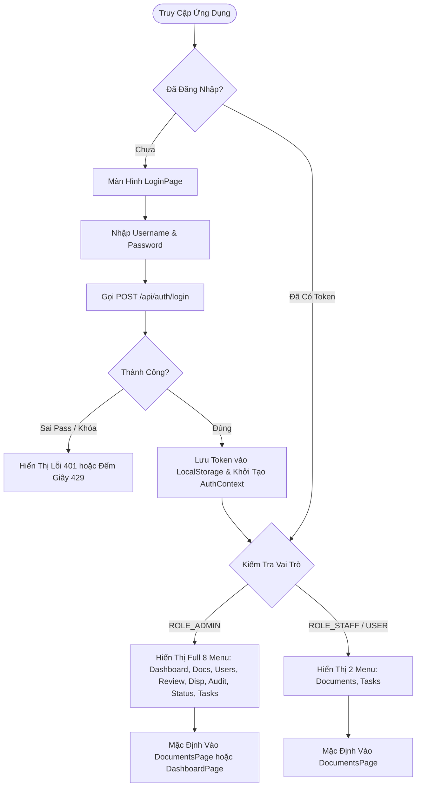
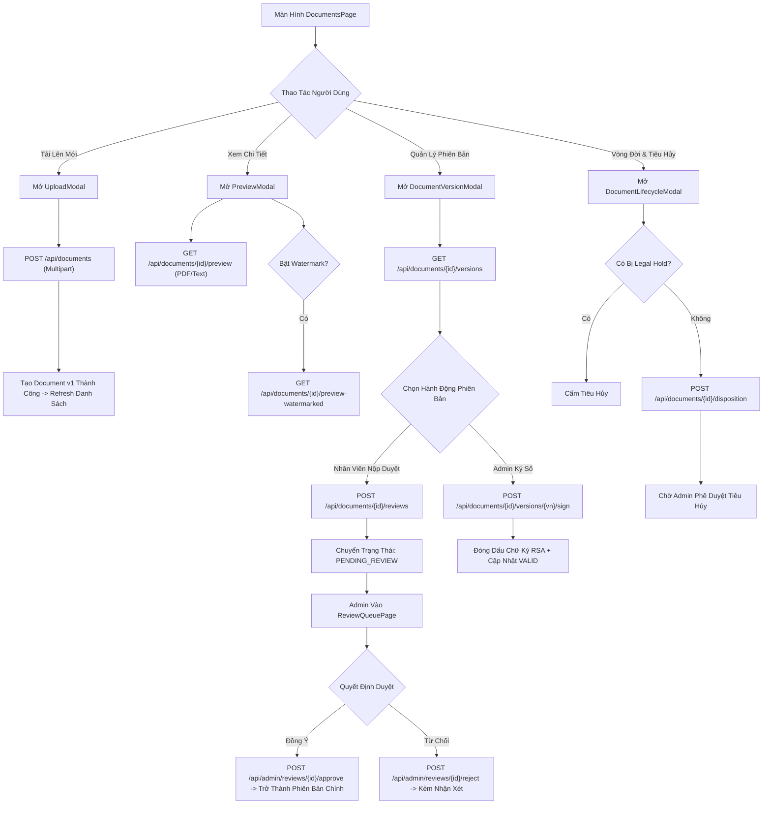
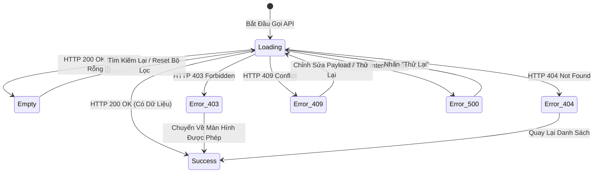

# BÁO CÁO TIẾN ĐỘ ĐỢT 2 (04/10/2026 – 10/10/2026)
## VAI TRÒ: FRONTEND DEVELOPER
**Tập tin**: `BC2_02_Nguyen_Quoc_Huy_Frontend_Design_Contract.md`  
**Thành viên thực hiện**: Nguyễn Quốc Huy  
**Người nhận báo cáo**: Võ Trọng Hiếu (Business Analyst / Project Lead)  
**Mục tiêu đợt 2**: Khóa Frontend Screen & API Integration Contract v1, chuẩn hóa luồng giao diện và xử lý trạng thái  
**Trạng thái đợt 2**: **HOÀN THÀNH — ĐÃ KHÓA FRONTEND CONTRACT BASELINE V1**

---

## A. TỔNG QUAN KIẾN TRÚC FRONTEND (FRONTEND ARCHITECTURE)

Hệ thống giao diện người dùng của EDMS được xây dựng theo kiến trúc Single Page Application (SPA) hiện đại:
- **Nền tảng công nghệ**:
  - **React 18.3.1**: Quản lý vòng đời thành phần và rendering giao diện theo luồng dữ liệu một chiều (Unidirectional Data Flow).
  - **TypeScript 5.5.3**: Đảm bảo an toàn kiểu dữ liệu chặt chẽ (Strict Type Safety), đồng bộ 100% với các DTO của Backend.
  - **Vite 5.4.21**: Hệ thống đóng gói và biên dịch tối ưu hóa mô-đun siêu nhanh (ES Modules).
  - **Axios 1.7.9**: Quản lý toàn bộ HTTP requests thông qua bộ đánh chặn trung tâm [`frontend/src/api/client.ts`](file:///f:/DoAn_CNPMNC/frontend/src/api/client.ts).
- **Quản lý trạng thái & Điều hướng (State & Navigation)**:
  - `AuthContext.tsx`: Quản lý danh tính người dùng toàn cục (`user`), mã truy cập (`token`), vai trò bảo mật (`ROLE_USER`, `ROLE_STAFF`, `ROLE_ADMIN`) và trạng thái phiên làm việc (`isAuthenticated`).
  - Điều hướng nội bộ không tải lại trang dựa trên `activeView` kết hợp cơ chế phát và lắng nghe sự kiện tùy biến (`window.dispatchEvent(new CustomEvent('app-navigate', ...))`).
  - Hỗ trợ đường dẫn trực tiếp (Deep Linking) cho cổng xác minh văn bản công khai: `/verify`.
- **Hệ thống thiết kế (Design System)**:
  - Thiết kế thuần CSS hiện đại (Vanilla CSS) định nghĩa trong [`frontend/src/index.css`](file:///f:/DoAn_CNPMNC/frontend/src/index.css) với hơn 80 biến CSS (Tokens) về màu sắc HSL, bóng đổ (Box Shadows), bo góc (Border Radius), bảng phông chữ (`Inter`, `Outfit`), hiệu ứng chuyển động mượt mà (Micro-interactions) và thanh cuộn tùy biến.

---

## B. DANH MỤC MÀN HÌNH THỰC TẾ (PAGE INVENTORY)

Dựa trên cấu trúc thư mục thực tế [`frontend/src/pages/`](file:///f:/DoAn_CNPMNC/frontend/src/pages/), hệ thống gồm **10 màn hình độc lập**:

| STT | Tên Màn Hình | Tệp Mã Nguồn | Đường Dẫn / Active View | Quyền Hạn (Role Guard) | Mục Đích Nghiệp Vụ | Phụ Thuộc API (API Client) |
| :---: | :--- | :--- | :--- | :---: | :--- | :--- |
| 1 | **Login Page** | [`LoginPage.tsx`](file:///f:/DoAn_CNPMNC/frontend/src/pages/LoginPage.tsx) | Default (Khi chưa đăng nhập) | Public | Đăng nhập tài khoản, nhập username/password, bắt lỗi rate-limit | `authApi.ts` (`POST /api/auth/login`) |
| 2 | **Public Verify** | [`VerifyPage.tsx`](file:///f:/DoAn_CNPMNC/frontend/src/pages/VerifyPage.tsx) | `/verify` (Direct Path) | Public (No Auth) | Tra cứu tính hợp lệ văn bản qua mã QR hoặc tải tệp đối soát | `verificationApi.ts` (`/api/public/verify*`) |
| 3 | **Documents Hub** | [`DocumentsPage.tsx`](file:///f:/DoAn_CNPMNC/frontend/src/pages/DocumentsPage.tsx)| `documents` | Authenticated | Kho tài liệu chính, tìm kiếm, lọc, phân trang, chọn cột hiển thị | `documentApi.ts`, `savedSearchApi.ts` |
| 4 | **Task Center** | [`TaskCenterPage.tsx`](file:///f:/DoAn_CNPMNC/frontend/src/pages/TaskCenterPage.tsx)| `tasks` | Authenticated | Tiếp nhận và xử lý các nhiệm vụ được giao (Duyệt bài, Tiêu hủy) | `taskApi.ts` (`GET /api/tasks`) |
| 5 | **Admin Dashboard** | [`DashboardPage.tsx`](file:///f:/DoAn_CNPMNC/frontend/src/pages/DashboardPage.tsx)| `dashboard` | `ROLE_ADMIN` | Thống kê số lượng hồ sơ, dung lượng đĩa, hoạt động người dùng | `dashboardApi.ts` (`/api/admin/dashboard`, `statistics`) |
| 6 | **Users Management**| [`UsersPage.tsx`](file:///f:/DoAn_CNPMNC/frontend/src/pages/UsersPage.tsx) | `users` | `ROLE_ADMIN` | Quản trị tài khoản người dùng, kích hoạt/khóa, ma trận quyền RBAC | `adminUserApi.ts` (`/api/admin/users`, `roles`) |
| 7 | **Review Queue** | [`ReviewQueuePage.tsx`](file:///f:/DoAn_CNPMNC/frontend/src/pages/ReviewQueuePage.tsx)| `review-queue` | `ROLE_ADMIN` | Hàng đợi xem trước và phê duyệt/từ chối phiên bản tài liệu mới | `documentApi.ts` (`/api/admin/reviews*`) |
| 8 | **Disposition Queue**|[`DispositionQueuePage.tsx`](file:///f:/DoAn_CNPMNC/frontend/src/pages/DispositionQueuePage.tsx)| `disposition-queue` | `ROLE_ADMIN` | Hàng đợi xét duyệt tiêu hủy hoặc gia hạn tài liệu lưu trữ | `documentApi.ts` (`/api/admin/dispositions*`) |
| 9 | **Audit Trail Log** | [`AuditLogPage.tsx`](file:///f:/DoAn_CNPMNC/frontend/src/pages/AuditLogPage.tsx) | `audit` | `ROLE_ADMIN` | Tra cứu nhật ký kiểm toán bất biến, lọc hành động, đối tượng, IP | `auditApi.ts` (`/api/admin/audit-logs`) |
| 10 | **System Status** | [`SystemStatusPage.tsx`](file:///f:/DoAn_CNPMNC/frontend/src/pages/SystemStatusPage.tsx)| `system-status` | `ROLE_ADMIN` | Giám sát độ sẵn sàng thành phần (DB, Storage, OCR, ONNX) | `systemStatusApi.ts` (`/api/admin/system*`) |

---

## C. DANH MỤC THÀNH PHẦN MODAL & PANEL TÁI SỬ DỤNG (MODAL / COMPONENT INVENTORY)

Toàn bộ 13 thành phần giao diện tái sử dụng tại [`frontend/src/components/`](file:///f:/DoAn_CNPMNC/frontend/src/components/):

| STT | Tên Thành Phần | Tệp Mã Nguồn | Trách Nhiệm & Chức Năng | API Tương Tác |
| :---: | :--- | :--- | :--- | :--- |
| 1 | **Navbar** | [`Navbar.tsx`](file:///f:/DoAn_CNPMNC/frontend/src/components/Navbar.tsx) | Thanh điều hướng đầu trang, chuyển màn hình theo vai trò, chuông thông báo, Avatar, Đăng xuất | `authApi.ts`, `notificationApi.ts` |
| 2 | **NotificationPanel** | [`NotificationPanel.tsx`](file:///f:/DoAn_CNPMNC/frontend/src/components/NotificationPanel.tsx) | Hộp thoại thông báo popover, xem danh sách thông báo, đánh dấu đã đọc một / tất cả | `notificationApi.ts` |
| 3 | **UploadModal** | [`UploadModal.tsx`](file:///f:/DoAn_CNPMNC/frontend/src/components/UploadModal.tsx) | Tải lên tài liệu mới: chọn tệp, nhập tiêu đề, mô tả, phân loại, kiểm tra định dạng/dung lượng | `POST /api/documents` |
| 4 | **PreviewModal** | [`PreviewModal.tsx`](file:///f:/DoAn_CNPMNC/frontend/src/components/PreviewModal.tsx) | Khung xem trước tài liệu đa định dạng (PDF Viewer nhúng, Text viewer, Image viewer) | `GET /api/documents/{id}/preview` |
| 5 | **EditModal** | [`EditModal.tsx`](file:///f:/DoAn_CNPMNC/frontend/src/components/EditModal.tsx) | Chỉnh sửa siêu dữ liệu của tài liệu (tiêu đề, mô tả, phân loại) | `PUT /api/documents/{id}` |
| 6 | **DocumentAccessModal**| [`DocumentAccessModal.tsx`](file:///f:/DoAn_CNPMNC/frontend/src/components/DocumentAccessModal.tsx)| Quản lý phân quyền tài liệu chi tiết (ACL): chuyển Public/Restricted, cấp quyền User | `PUT /access-mode`, `POST /permissions` |
| 7 | **DocumentLifecycleModal**|[`DocumentLifecycleModal.tsx`](file:///f:/DoAn_CNPMNC/frontend/src/components/DocumentLifecycleModal.tsx)| Quản lý vòng đời tài liệu: Archive, Unarchive, thiết lập Retention, kích hoạt Legal Hold | `/archive`, `/retention`, `/legal-hold` |
| 8 | **DocumentVersionModal**| [`DocumentVersionModal.tsx`](file:///f:/DoAn_CNPMNC/frontend/src/components/DocumentVersionModal.tsx)| Lịch sử phiên bản: xem lịch sử v1..vn, tải phiên bản cũ, ký số RSA, khôi phục phiên bản | `/versions*`, `/sign`, `/integrity` |
| 9 | **DocumentReviewHistoryModal**|[`DocumentReviewHistoryModal.tsx`](file:///f:/DoAn_CNPMNC/frontend/src/components/DocumentReviewHistoryModal.tsx)| Dòng thời gian xét duyệt tài liệu và nhận xét của cấp quản lý | `GET /api/documents/{id}/reviews` |
| 10 | **CreateUserModal** | [`CreateUserModal.tsx`](file:///f:/DoAn_CNPMNC/frontend/src/components/CreateUserModal.tsx) | Tạo tài khoản người dùng mới: username, password, họ tên, email, vai trò ban đầu | `POST /api/admin/users` |
| 11 | **EditUserModal** | [`EditUserModal.tsx`](file:///f:/DoAn_CNPMNC/frontend/src/components/EditUserModal.tsx) | Cập nhật thông tin tài khoản người dùng, đổi vai trò, mở khóa tài khoản | `PUT /api/admin/users/{id}` |
| 12 | **PrintMetadataModal** | [`PrintMetadataModal.tsx`](file:///f:/DoAn_CNPMNC/frontend/src/components/PrintMetadataModal.tsx)| Hỗ trợ xem và in ấn phiếu siêu dữ liệu (Metadata Card) của tài liệu kèm mã QR | Dữ liệu cục bộ (Print CSS) |
| 13 | **SaveSearchModal** | [`SaveSearchModal.tsx`](file:///f:/DoAn_CNPMNC/frontend/src/components/SaveSearchModal.tsx) | Đặt tên và lưu lại bộ lọc tìm kiếm hiện tại để tái sử dụng nhanh chóng | `POST /api/saved-searches` |

---

## D. MA TRẬN ÁNH XẠ GIAO DIỆN VÀ REST API (SCREEN $\rightarrow$ API MATRIX)

Bảng đối soát chi tiết từng tương tác giao diện với đúng endpoint thực tế của Backend:

| Màn Hình / Modal Phát Sinh | Thao Tác Người Dùng (UI Action) | HTTP Method | Endpoint Thực Tế Backend Gọi Đến | Payload / Params Truyền Đi |
| :--- | :--- | :---: | :--- | :--- |
| `LoginPage.tsx` | Nhấn "Đăng nhập" | `POST` | `/api/auth/login` | `{ username, password }` |
| `Navbar.tsx` | Nhấn "Đăng xuất" | `POST` | `/api/auth/logout` | Header Authorization: `Bearer <token>` |
| `Navbar.tsx` | Tải số thông báo chưa đọc | `GET` | `/api/notifications/unread-count` | Header Authorization |
| `NotificationPanel.tsx` | Tải danh sách thông báo | `GET` | `/api/notifications` | Query params: `page=0`, `size=10` |
| `NotificationPanel.tsx` | Đánh dấu 1 thông báo đã đọc | `PUT` | `/api/notifications/{id}/read` | Path param: `id` |
| `NotificationPanel.tsx` | Đánh dấu tất cả đã đọc | `PUT` | `/api/notifications/read-all` | Không |
| `DocumentsPage.tsx` | Tải danh sách tài liệu chung | `GET` | `/api/documents` | Params: `page`, `size`, `q`, `documentType` |
| `DocumentsPage.tsx` | Tải tab "Tài liệu của tôi" | `GET` | `/api/documents/mine` | Params: `page`, `size`, `q` |
| `DocumentsPage.tsx` | Tải tab "Được chia sẻ với tôi"| `GET` | `/api/documents/shared-with-me` | Params: `page`, `size`, `q` |
| `DocumentsPage.tsx` | Tải tệp gốc | `GET` | `/api/documents/{id}/download` | Path param: `id` |
| `DocumentsPage.tsx` | Tải tệp có Watermark & QR | `GET` | `/api/documents/{id}/download-watermarked` | Path param: `id` |
| `UploadModal.tsx` | Tải lên tài liệu mới | `POST` | `/api/documents` | Multipart FormData: `file`, `title`, `description`, `documentType` |
| `PreviewModal.tsx` | Xem trước tệp gốc | `GET` | `/api/documents/{id}/preview` | Nhận Blob `application/pdf` |
| `PreviewModal.tsx` | Xem trước tệp Watermark | `GET` | `/api/documents/{id}/preview-watermarked` | Nhận Blob `application/pdf` chèn watermark |
| `EditModal.tsx` | Lưu thay đổi metadata | `PUT` | `/api/documents/{id}` | `{ title, description, documentType }` |
| `DocumentAccessModal.tsx` | Đổi chế độ Public / Restricted | `PUT` | `/api/documents/{id}/access-mode` | `{ accessMode: "PUBLIC" \| "RESTRICTED" }` |
| `DocumentAccessModal.tsx` | Cấp quyền cho người dùng | `POST` | `/api/documents/{id}/permissions` | `{ userId, permissionType: "READ" \| "WRITE" }` |
| `DocumentAccessModal.tsx` | Thu hồi quyền truy cập | `DELETE`| `/api/documents/{id}/permissions/{userId}` | Path params: `id`, `userId` |
| `DocumentLifecycleModal.tsx`| Chuyển sang Lưu trữ lâu dài | `POST` | `/api/documents/{id}/archive` | Path param: `id` |
| `DocumentLifecycleModal.tsx`| Mở lại hoạt động (Unarchive) | `POST` | `/api/documents/{id}/unarchive` | Path param: `id` |
| `DocumentLifecycleModal.tsx`| Thiết lập thời hạn lưu trữ | `PUT` | `/api/documents/{id}/retention` | `{ retentionDate: "2028-12-31T23:59:59Z" }` |
| `DocumentLifecycleModal.tsx`| Bật/tắt Giữ pháp lý (Legal Hold)| `PUT` | `/api/documents/{id}/legal-hold` | `{ holdActive: true/false, reason: "..." }` |
| `DocumentVersionModal.tsx` | Lấy danh sách phiên bản | `GET` | `/api/documents/{id}/versions` | Path param: `id` |
| `DocumentVersionModal.tsx` | Tải lên phiên bản mới | `POST` | `/api/documents/{id}/versions` | Multipart: `file` |
| `DocumentVersionModal.tsx` | Ký số phiên bản | `POST` | `/api/documents/{id}/versions/{vn}/sign` | Path params: `id`, `vn` |
| `DocumentVersionModal.tsx` | Xác minh tính toàn vẹn | `GET` | `/api/documents/{id}/versions/{vn}/integrity` | Path params: `id`, `vn` |
| `DocumentVersionModal.tsx` | Khôi phục phiên bản lịch sử | `POST` | `/api/documents/{id}/versions/{vn}/restore` | Path params: `id`, `vn` |
| `DocumentReviewHistoryModal.tsx`| Lấy lịch sử xét duyệt | `GET` | `/api/documents/{id}/reviews` | Path param: `id` |
| `SaveSearchModal.tsx` | Lưu điều kiện tìm kiếm | `POST` | `/api/saved-searches` | `{ name, searchQuery, documentType }` |
| `DocumentsPage.tsx` | Tải danh sách bộ tìm kiếm đã lưu| `GET` | `/api/saved-searches` | Không |
| `TaskCenterPage.tsx` | Tải danh sách nhiệm vụ | `GET` | `/api/tasks` | Không |
| `DashboardPage.tsx` | Tải số liệu tổng quan | `GET` | `/api/admin/dashboard` | Không |
| `DashboardPage.tsx` | Tải thống kê tài liệu | `GET` | `/api/admin/statistics/documents` | Không |
| `DashboardPage.tsx` | Tải thống kê truy cập | `GET` | `/api/admin/statistics/usage` | Không |
| `UsersPage.tsx` | Lấy danh sách người dùng | `GET` | `/api/admin/users` | Params: `page`, `size` |
| `CreateUserModal.tsx` | Tạo người dùng mới | `POST` | `/api/admin/users` | `{ username, password, fullName, email, role }` |
| `EditUserModal.tsx` | Cập nhật thông tin/vai trò | `PUT` | `/api/admin/users/{id}` | `{ fullName, email, role, enabled }` |
| `ReviewQueuePage.tsx` | Lấy hàng đợi xét duyệt | `GET` | `/api/admin/reviews` | Không |
| `ReviewQueuePage.tsx` | Phê duyệt phiên bản | `POST` | `/api/admin/reviews/{id}/approve` | `{ comment: "..." }` |
| `ReviewQueuePage.tsx` | Từ chối phiên bản | `POST` | `/api/admin/reviews/{id}/reject` | `{ comment: "..." }` |
| `DispositionQueuePage.tsx` | Lấy hàng đợi tiêu hủy | `GET` | `/api/admin/dispositions` | Không |
| `DispositionQueuePage.tsx` | Phê duyệt tiêu hủy | `POST` | `/api/admin/dispositions/{id}/approve` | `{ comment: "..." }` |
| `AuditLogPage.tsx` | Truy vấn nhật ký kiểm toán | `GET` | `/api/admin/audit-logs` | Params: `action`, `username`, `page`, `size` |
| `SystemStatusPage.tsx` | Kiểm tra tình trạng kết nối | `GET` | `/api/admin/system/status` | Không |
| `VerifyPage.tsx` | Xác minh qua mã công khai | `GET` | `/api/public/verify` | Params: `docId`, `vn`, `token` |
| `VerifyPage.tsx` | Xác minh qua tệp tải lên | `POST` | `/api/public/verify-file` | Multipart: `file` |

---

## E. MA TRẬN PHÂN QUYỀN GIAO DIỆN (ROLE VISIBILITY MATRIX)

Bảng phân định quyền hiển thị và tương tác của từng vai trò người dùng trên giao diện:

| Thành Phần Giao Diện / Tính Năng | Public (Chưa Login) | Standard User (`ROLE_USER`) | Staff (`ROLE_STAFF`) | Document Owner | Shared `READ` | Shared `WRITE` | Admin (`ROLE_ADMIN`) |
| :--- | :---: | :---: | :---: | :---: | :---: | :---: | :---: |
| Màn hình Login & Đăng nhập | **HIỆN** | Ẩn (Đã login) | Ẩn (Đã login) | Ẩn | Ẩn | Ẩn | Ẩn |
| Cổng tra cứu xác minh `/verify` | **HIỆN** | **HIỆN** | **HIỆN** | **HIỆN** | **HIỆN** | **HIỆN** | **HIỆN** |
| Xem danh sách tài liệu công cộng | Ẩn | **HIỆN** | **HIỆN** | **HIỆN** | **HIỆN** | **HIỆN** | **HIỆN** |
| Xem tệp / Xem trước / Tải về | Ẩn | Nếu Public | Nếu Public | **TOÀN QUYỀN**| **ĐƯỢC XEM** | **ĐƯỢC XEM** | **TOÀN QUYỀN**|
| Tải tệp bản có Watermark & QR | Ẩn | Nếu Public | Nếu Public | **TOÀN QUYỀN**| **ĐƯỢC TẢI** | **ĐƯỢC TẢI** | **TOÀN QUYỀN**|
| Tải lên tài liệu mới | Ẩn | **HIỆN** | **HIỆN** | **HIỆN** | N/A | N/A | **HIỆN** |
| Chỉnh sửa Metadata tài liệu | Ẩn | Ẩn | Ẩn | **HIỆN** | Ẩn | Ẩn | **HIỆN** |
| Phân quyền tài liệu (ACL Modal) | Ẩn | Ẩn | Ẩn | **HIỆN** | Ẩn | Ẩn | **HIỆN** |
| Tải lên phiên bản mới trực tiếp | Ẩn | Ẩn | Ẩn | **HIỆN** | Ẩn | Ẩn | **HIỆN** |
| Nộp phiên bản chờ xét duyệt | Ẩn | **HIỆN** | **HIỆN** | **HIỆN** | Ẩn | **HIỆN** | **HIỆN** |
| Chuyển Archive / Đổi Retention | Ẩn | Ẩn | Ẩn | **HIỆN** | Ẩn | Ẩn | **HIỆN** |
| Kích hoạt / Hủy bỏ Legal Hold | Ẩn | Ẩn | Ẩn | Ẩn | Ẩn | Ẩn | **HIỆN** |
| Ký số điện tử RSA lên phiên bản | Ẩn | Ẩn | Ẩn | Ẩn | Ẩn | Ẩn | **HIỆN** |
| Truy cập Task Center cá nhân | Ẩn | **HIỆN** | **HIỆN** | **HIỆN** | **HIỆN** | **HIỆN** | **HIỆN** |
| Menu Dashboard thống kê | Ẩn | Ẩn | Ẩn | Ẩn | Ẩn | Ẩn | **HIỆN** |
| Menu Quản trị người dùng & RBAC | Ẩn | Ẩn | Ẩn | Ẩn | Ẩn | Ẩn | **HIỆN** |
| Menu Hàng đợi duyệt phiên bản | Ẩn | Ẩn | Ẩn | Ẩn | Ẩn | Ẩn | **HIỆN** |
| Menu Hàng đợi duyệt tiêu hủy | Ẩn | Ẩn | Ẩn | Ẩn | Ẩn | Ẩn | **HIỆN** |
| Menu Nhật ký kiểm toán (Audit) | Ẩn | Ẩn | Ẩn | Ẩn | Ẩn | Ẩn | **HIỆN** |
| Menu Giám sát độ sẵn sàng hạ tầng| Ẩn | Ẩn | Ẩn | Ẩn | Ẩn | Ẩn | **HIỆN** |

---

## F. SƠ ĐỒ LUỒNG NGƯỜI DÙNG CHÍNH (USER FLOWS - MERMAID)

### 1. Luồng Xác Thực, Đánh Giá Quyền & Điều Hướng


### 2. Luồng Quản Lý Tài Liệu, Phiên Bản, Xét Duyệt & Tiêu Hủy


---

## G. MÔ HÌNH TRẠNG THÁI GIAO DIỆN (UI STATE MODEL)

Tất cả các màn hình đều tuân thủ mô hình 5 trạng thái chuẩn:



1. **`Loading`**: Hiển thị khung xương (Skeleton Placeholders) hoặc biểu tượng xoay (Spinner) nhẹ nhàng, khóa các nút gửi biểu mẫu tránh nhấp đúp (Double-submit).
2. **`Success`**: Hiển thị bảng dữ liệu, các thẻ chỉ số (Cards) và đồ thị trực quan.
3. **`Empty`**: Khi danh sách trả về rỗng, hiển thị hình vẽ minh họa thân thiện kèm gợi ý hành động ("Chưa có tài liệu nào, nhấn 'Tải lên' để thêm mới").
4. **`Error States (403, 404, 409, 500)`**: Hiển thị khung cảnh báo màu đỏ/vàng kèm thông điệp rõ ràng và nút "Quay lại" hoặc "Thử lại".

---

## H. HỢP ĐỒNG XỬ LÝ LỖI API PHÍA CLIENT (ERROR HANDLING CONTRACT)

Cấu hình bộ đánh chặn Axios (`response interceptor`) tại [`frontend/src/api/client.ts`](file:///f:/DoAn_CNPMNC/frontend/src/api/client.ts):

| Mã HTTP | Hành Vi Xử Lý Tự Động Phía Frontend (Frontend UX Handling) |
| :---: | :--- |
| **401** | Phiên đăng nhập hết hạn hoặc không hợp lệ: Tự động xóa `edms_token` trong `localStorage`, đưa `isAuthenticated = false` và chuyển hướng mượt mà về `LoginPage`. |
| **403** | Không đủ thẩm quyền: Hiển thị Banner đỏ "Bạn không có quyền thực hiện thao tác này", giữ nguyên màn hình hiện tại, không crash ứng dụng. |
| **404** | Tài nguyên không tồn tại: Hiển thị Toast thông báo "Không tìm thấy tài nguyên yêu cầu" và đóng modal tương ứng. |
| **409** | Xung đột nghiệp vụ: Hiển thị cảnh báo trực tiếp trên Form (ví dụ: "Tên đăng nhập đã tồn tại", "Tài liệu đang bị Giữ pháp lý"). |
| **413** | Tệp quá lớn: Chặn ngay trên giao diện hoặc bắt lỗi 413 hiển thị Toast "Kích thước tệp vượt quá giới hạn tối đa cho phép (20MB)". |
| **429** | Giới hạn tần suất: Đọc header `Retry-After` (hoặc trường `retryAfter`), hiển thị đồng hồ đếm ngược giây trên nút đăng nhập và khóa nút. |
| **500** | Lỗi máy chủ: Hiển thị thông báo "Đã xảy ra lỗi máy chủ. Mã truy vết: `<correlationId>`" để người dùng cung cấp cho quản trị viên khi cần hỗ trợ. |

---

## I. BẰNG CHỨNG BIÊN DỊCH SẢN XUẤT (BUILD EVIDENCE)

Thực thi lệnh kiểm tra biên dịch sản xuất thực tế trên thư mục [`frontend/`](file:///f:/DoAn_CNPMNC/frontend):

```bash
npm run build
```

**Kết quả ghi nhận**:
- **Lệnh thực thi**: `tsc && vite build`
- **Mã kết thúc (Exit Status)**: `0 (Thành công)`
- **Thời gian biên dịch**: `6.12 giây`
- **Số lượng modules đã chuyển đổi**: `1655 modules`
- **Sản phẩm đầu ra (Dist Assets)**:
  - `dist/index.html`: `0.98 kB` (Gzip: `0.60 kB`)
  - `dist/assets/index-CbKIshgg.css`: `24.15 kB` (Gzip: `5.03 kB`)
  - `dist/assets/index-BFhnt6iA.js`: `444.64 kB` (Gzip: `118.39 kB`)
- **Đánh giá chất lượng**: `0 lỗi TypeScript (Zero Type Errors)`, không có cảnh báo nghiêm trọng, cấu trúc gói nén tối ưu.

---

## J. ĐÓNG BĂNG HỢP ĐỒNG GIAO DIỆN (FRONTEND CONTRACT FREEZE RESULT)

Dựa trên kết quả rà soát thực tế, Frontend Design Contract Baseline v1 được đóng băng:
1. **STABLE**: Toàn bộ 10 Màn hình chính, 13 Thành phần Modal/Panel, Ma trận ánh xạ Screen $\rightarrow$ API, Cấu trúc định tuyến và Cơ chế kiểm soát quyền truy cập RBAC trên giao diện.
2. **GAPS & OWNER-OPEN**:
   - Tối ưu hóa hiển thị trên màn hình di động rất nhỏ (< 480px) đối với bảng tài liệu có nhiều cột.
   - Thống nhất với BA về việc hiển thị tiến trình quét OCR thời gian thực qua thanh Progress Bar khi Backend hỗ trợ WebSocket.

---
*Xác nhận của thành viên thực hiện:*  
**Nguyễn Quốc Huy** (Frontend Developer) — *Đã ký và khóa hợp đồng giao diện Đợt 2.*
