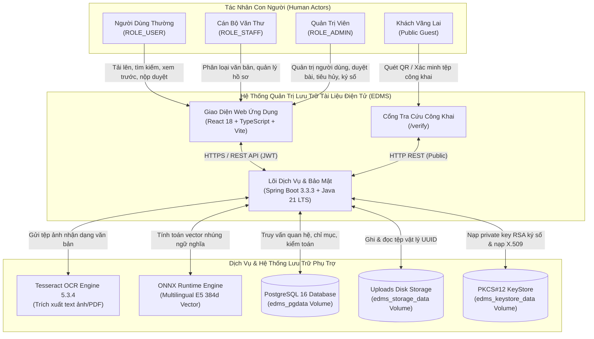
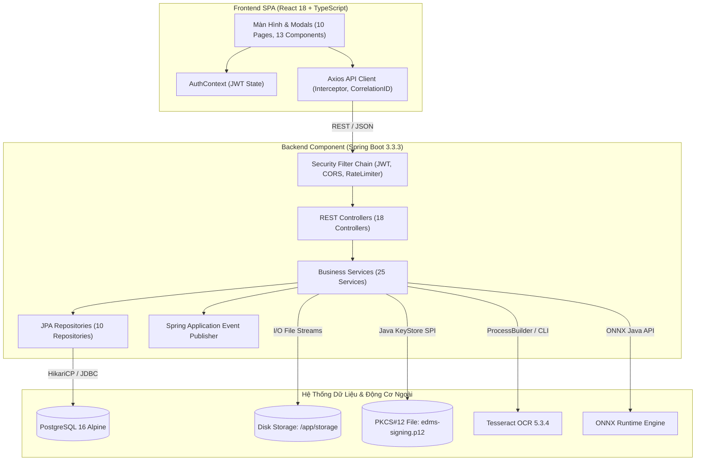
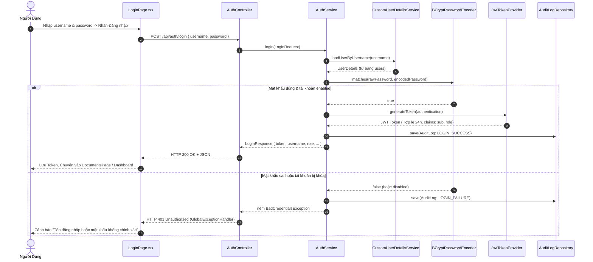
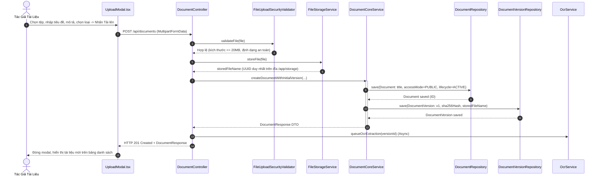
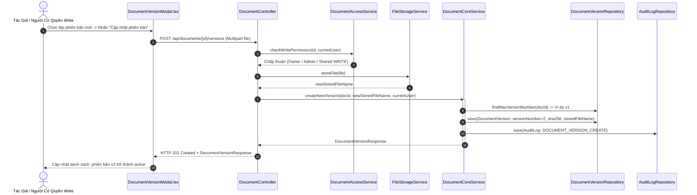
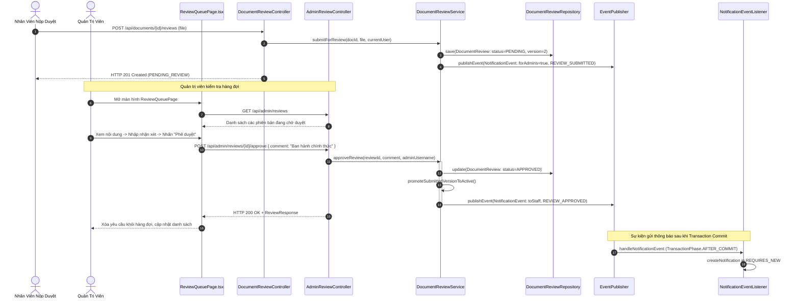
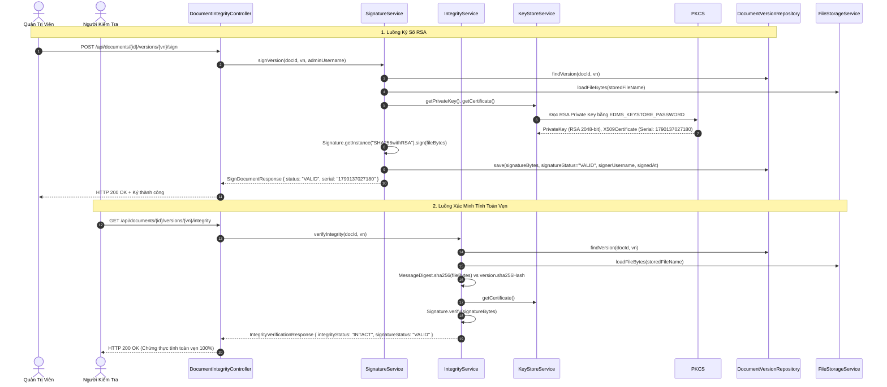
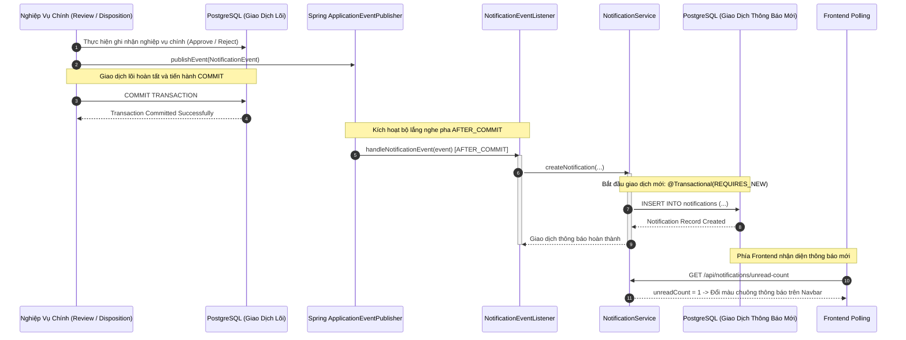
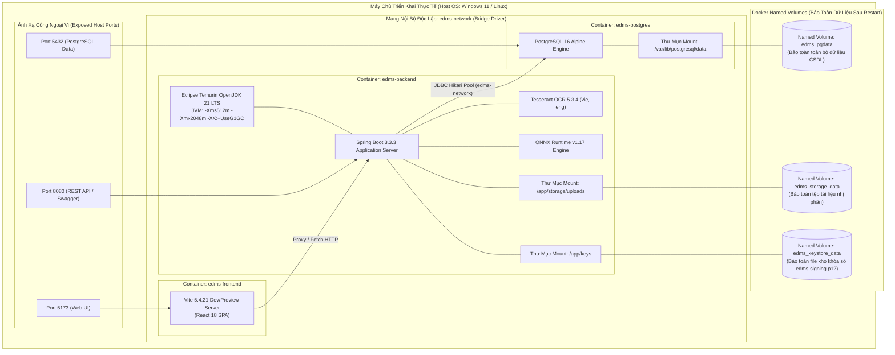

# BÁO CÁO TIẾN ĐỘ ĐỢT 2 (04/10/2026 – 10/10/2026)
## VAI TRÒ: SYSTEM ANALYST / UML & MODELING
**Tập tin**: `BC2_03_Vien_Bao_Duc_System_Design_UML.md`  
**Thành viên thực hiện**: Viên Bảo Đức  
**Người nhận báo cáo**: Võ Trọng Hiếu (Business Analyst / Project Lead)  
**Mục tiêu đợt 2**: Chuẩn hóa chi tiết 12 sơ đồ UML Baseline v2 khớp 100% mã nguồn thực tế  
**Trạng thái đợt 2**: **HOÀN THÀNH — ĐÃ KHÓA THIẾT KẾ UML BASELINE V2**

---

## A. NGUYÊN TẮC THIẾT KẾ & ĐỐI CHIẾU MÃ NGUỒN (MODELING PRINCIPLES)

1. **Nguyên tắc Reverse-Mapping từ thực tế**: Toàn bộ các sơ đồ UML (Use Case, Component, Sequence, Package, Deployment) trong báo cáo Đợt 2 được trích xuất và đối soát trực tiếp từ mã nguồn Java Spring Boot, React TypeScript và cấu hình Docker Compose thực tế. Tuyệt đối không vẽ các lớp, thực thể hoặc luồng tương tác giả định không có trong code.
2. **Ký pháp chuẩn mực UML 2.5**: Sử dụng cú pháp Mermaid chuẩn, thể hiện rõ ràng các quan hệ `<<include>>`, `<<extend>>`, kế thừa (generalization), phụ thuộc (dependency) và phân rã các gói nghiệp vụ (packages).
3. **Tính truy vết đa chiều (Traceability)**: Mỗi sơ đồ thiết kế đều được gắn kèm bảng đối chiếu chỉ rõ: Mã User Story (hoặc Extension), REST Endpoint tương ứng, Các lớp Java xử lý, Thành phần React giao diện và Bảng CSDL lưu trữ.

---

## B. RÀ SOÁT VÀ PHÂN ĐỊNH TÁC NHÂN HỆ THỐNG (ACTOR VALIDATION)

Rút kinh nghiệm từ báo cáo Đợt 1, hệ thống phân định rõ ranh giới giữa **Tác nhân con người (Human Actors)** và **Hệ thống / Dịch vụ phụ trợ ngoại vi (External Supporting Services)**:

### 1. Tác Nhân Con Người (Human Actors — 4 Actors):
- **Khách Vãng Lai (`Public Guest`)**: Người dùng công cộng ngoài internet, không cần tài khoản; truy cập cổng tra cứu `/verify` để quét mã QR hoặc tải tệp lên kiểm tra chữ ký số.
- **Người Dùng Thường (`Normal User / ROLE_USER`)**: Nhân viên doanh nghiệp; đăng nhập, quản lý tài liệu cá nhân, tra cứu tài liệu được chia sẻ, xem trước, tải về, phân quyền riêng (ACL) và nộp phiên bản tài liệu mới.
- **Cán Bộ Văn Thư (`Staff / ROLE_STAFF`)**: Nhân viên nghiệp vụ văn thư; kế thừa toàn bộ quyền của User, có thẩm quyền bổ sung trong việc phân loại tài liệu nghiệp vụ và xử lý hồ sơ.
- **Quản Trị Viên (`Admin / ROLE_ADMIN`)**: Người quản trị hệ thống; quản lý tài khoản người dùng, ma trận quyền RBAC, phê duyệt phiên bản tài liệu, phê duyệt tiêu hủy, ký số điện tử RSA, xem Dashboard, tra cứu Audit Log và giám sát hệ thống.

### 2. Dịch Vụ & Hệ Thống Phụ Trợ (Supporting Systems — KHÔNG gọi là User):
- **Hệ thống nhận dạng ký tự quang học (`Tesseract OCR Engine 5.3.4`)**: Dịch vụ nền trích xuất nội dung văn bản từ tệp ảnh và PDF scan.
- **Mô hình nhúng trí tuệ nhân tạo (`ONNX Runtime Multilingual E5`)**: Mô hình tính toán vector ngữ nghĩa 384 chiều cục bộ phục vụ tìm kiếm thông minh.
- **Hệ quản trị CSDL quan hệ (`PostgreSQL 16 Alpine`)**: Lưu trữ bảng dữ liệu, ràng buộc toàn vẹn và chỉ mục tìm kiếm GIN Trigram.
- **Hệ thống lưu trữ đĩa vật lý (`Persistent Disk Storage Volume`)**: Lưu trữ tệp nhị phân tải lên theo cơ chế UUID.
- **Kho khóa mật mã an toàn (`PKCS#12 KeyStore`)**: Lưu trữ cặp khóa RSA 2048-bit và chứng chỉ số X.509 v3.

---

## C. HỆ THỐNG 12 SƠ ĐỒ UML BASELINE V2 BẮT BUỘC (MERMAID)

---

### DIAGRAM 1: System Context Diagram v2 (Sơ Đồ Bối Cảnh Hệ Thống)



---

### DIAGRAM 2: Overall Use Case Diagram v2 (Sơ Đồ Ca Sử Dụng Tổng Thể)

```mermaid
graph LR
    User((Người Dùng Thường))
    Admin((Quản Trị Viên))
    Staff((Cán Bộ Văn Thư))
    Guest((Khách Vãng Lai))

    Staff --|> User

    subgraph PKG_Auth["Package 1: Xác Thực & Quản Trị Tài Khoản"]
        UC_Login["UC-01: Đăng nhập"]
        UC_Logout["UC-02: Đăng xuất"]
        UC_Users["UC-21..25: Quản lý người dùng & Vai trò"]
        UC_Matrix["UC-26: Quản lý ma trận quyền hạn"]
    end

    subgraph PKG_Doc["Package 2: Quản Lý Hồ Sơ & Tài Liệu Cốt Lõi"]
        UC_Upload["UC-10: Tải lên tài liệu mới"]
        UC_ViewDocs["UC-03..05: Xem, Tìm kiếm & Lọc"]
        UC_Preview["UC-08: Xem chi tiết & Xem trước"]
        UC_Download["UC-09: Tải tài liệu về"]
        UC_Metadata["UC-12..14: Quản lý Metadata & Phân loại"]
        UC_ACL["EXT-01: Phân quyền tài liệu riêng (ACL)"]
    end

    subgraph PKG_Review["Package 3: Quản Lý Phiên Bản & Xét Duyệt"]
        UC_Versions["EXT-02: Xem & Quản lý phiên bản"]
        UC_SubmitRev["EXT-03: Nộp phiên bản chờ duyệt"]
        UC_ApproveRev["EXT-03: Phê duyệt / Từ chối phiên bản"]
    end

    subgraph PKG_Lifecycle["Package 4: Vòng Đời & Tiêu Hủy An Toàn"]
        UC_Archive["EXT-04: Lưu trữ lâu dài (Archive)"]
        UC_LegalHold["EXT-04: Kích hoạt Giữ pháp lý"]
        UC_Disp["EXT-05: Đề xuất & Phê duyệt tiêu hủy"]
    end

    subgraph PKG_Integrity["Package 5: Chữ Ký Số, Thủy Ấn & Xác Minh"]
        UC_Sign["EXT-06: Ký số điện tử RSA"]
        UC_Verify["EXT-06: Xác minh toàn vẹn SHA-256"]
        UC_Watermark["EXT-07: Tải/Xem trước bản Watermark"]
        UC_PubVerify["EXT-07: Xác minh công khai qua QR"]
    end

    subgraph PKG_System["Package 6: Giám Sát, Nhiệm Vụ & Thông Báo"]
        UC_Tasks["EXT-10: Xử lý nhiệm vụ Task Center"]
        UC_Notifs["EXT-10: Nhận thông báo hệ thống"]
        UC_Audit["UC-19..20: Xem nhật ký kiểm toán"]
        UC_Dash["UC-16..18: Xem Dashboard thống kê"]
        UC_Health["EXT-10: Giám sát độ sẵn sàng hạ tầng"]
    end

    Guest --> UC_PubVerify
    User --> UC_Login
    User --> UC_Logout
    User --> UC_Upload
    User --> UC_ViewDocs
    User --> UC_Preview
    User --> UC_Download
    User --> UC_Metadata
    User --> UC_ACL
    User --> UC_Versions
    User --> UC_SubmitRev
    User --> UC_Tasks
    User --> UC_Notifs
    User --> UC_Watermark
    User --> UC_Verify

    Staff --> UC_Archive
    Staff --> UC_Disp

    Admin --> UC_Users
    Admin --> UC_Matrix
    Admin --> UC_ApproveRev
    Admin --> UC_LegalHold
    Admin --> UC_Disp
    Admin --> UC_Sign
    Admin --> UC_Audit
    Admin --> UC_Dash
    Admin --> UC_Health
```

---

### DIAGRAM 3: Component Diagram (Sơ Đồ Thành Phần Hệ Thống)



---

### DIAGRAM 4: Backend Layer & Package Diagram (Sơ Đồ Gói Phân Tầng Backend)

```mermaid
graph TB
    subgraph com_edms["Package com.edms (131 Java Classes)"]
        subgraph controller["com.edms.controller (18 classes)"]
            AuthController
            DocumentController
            ReviewControllers
            DispositionControllers
            IntegrityControllers
            AdminControllers
        end

        subgraph security["com.edms.security (8 classes)"]
            SecurityConfig
            JwtTokenProvider
            JwtAuthenticationFilter
            CorrelationIdFilter
            FileUploadSecurityValidator
        end

        subgraph service["com.edms.service (25 classes)"]
            AuthService
            DocumentService
            DocumentAccessService
            SignatureService
            OcrService
            NotificationService
            TaskCenterService
        end

        subgraph repository["com.edms.repository (10 classes)"]
            UserRepository
            DocumentRepository
            DocumentVersionRepository
            AuditLogRepository
            ReviewRepository
        end

        subgraph entity["com.edms.entity (17 classes: 10 Entities, 7 Enums)"]
            User
            Document
            DocumentVersion
            DocumentPermission
            AuditLog
        end

        subgraph dto["com.edms.dto (37 classes)"]
            LoginRequest
            DocumentResponse
            TaskDto
            PublicVerificationResponse
        end

        subgraph config["com.edms.config (3 classes)"]
            GlobalExceptionHandler
            DataInitializer
            SemanticConfig
        end

        subgraph event["com.edms.event (2 classes)"]
            NotificationEvent
            NotificationEventListener
        end
    end

    controller --> security
    controller --> service
    controller --> dto
    service --> repository
    service --> entity
    service --> event
    repository --> entity
    config -.->|Advice| controller
```



---

### DIAGRAM 5: Sequence Diagram — Login & JWT Authentication



---

### DIAGRAM 6: Sequence Diagram — Document Upload & Validation



---

### DIAGRAM 7: Sequence Diagram — Search, Preview & Download (Watermark & QR)

```mermaid
sequenceDiagram
    autonumber
    actor User as Người Dùng
    participant FE as DocumentsPage / PreviewModal
    participant DC as DocumentController
    participant DIC as DocumentIntegrityController
    participant DAS as DocumentAccessService
    participant FS as FileStorageService
    participant WS as WatermarkService

    Note over User,WS: 1. Luồng Tìm Kiếm & Xem Danh Sách
    User->>FE: Nhập từ khóa tìm kiếm "Hợp đồng"
    FE->>DC: GET /api/documents?q=Hợp đồng&page=0&size=10
    DC->>DAS: getAccessibleDocuments(currentUser, pageable)
    DAS-->>DC: Page<DocumentResponse>
    DC-->>FE: HTTP 200 OK + Danh sách tài liệu

    Note over User,WS: 2. Luồng Xem Trước Tệp Gốc
    User->>FE: Nhấn nút "Xem trước" (Preview)
    FE->>DC: GET /api/documents/{id}/preview
    DC->>DAS: checkReadPermission(id, currentUser)
    DC->>FS: loadFileAsResource(storedFileName)
    FS-->>DC: Resource (ByteArray)
    DC-->>FE: HTTP 200 OK + Blob (Content-Type: application/pdf)
    FE-->>User: Render PDF trực tiếp trên trình duyệt

    Note over User,WS: 3. Luồng Tải Về Bản Đóng Dấu Thủy Ấn & Mã QR
    User->>FE: Nhấn "Tải về bản đóng dấu" (Watermarked Download)
    FE->>DIC: GET /api/documents/{id}/download-watermarked
    DIC->>DAS: checkReadPermission(id, currentUser)
    DIC->>FS: loadFileAsResource(storedFileName)
    DIC->>WS: applyWatermarkAndQr(originalPdfBytes, docId, vn, currentUser)
    WS-->>DIC: WatermarkedPdfBytes (Đóng dấu ngày giờ + QR tra cứu)
    DIC-->>FE: HTTP 200 OK (Content-Disposition: attachment; filename="*_watermarked.pdf")
    FE-->>User: Tải tệp PDF chính thức có dấu bản quyền về máy
```

---

### DIAGRAM 8: Sequence Diagram — Document Version Creation



---

### DIAGRAM 9: Sequence Diagram — Review & Approval Workflow



---

### DIAGRAM 10: Sequence Diagram — Signing & Integrity Verification



---

### DIAGRAM 11: Sequence Diagram — Notification AFTER_COMMIT (Giao Dịch Độc Lập)



---

### DIAGRAM 12: Deployment Diagram (Sơ Đồ Triển Khai Hạ Tầng)



---

## D. MA TRẬN TRUY VẾT MÔ HÌNH UML (DIAGRAM TRACEABILITY MATRIX)

| Sơ Đồ UML | Mã Yêu Cầu (Requirement) | REST API Liên Quan | Lớp Java Backend Xử Lý | Thành Phần React Frontend | Bảng CSDL Lưu Trữ |
| :--- | :--- | :--- | :--- | :--- | :--- |
| **Diagram 1: Context** | Toàn bộ hệ thống EDMS | Tất cả 75 Endpoints | Toàn bộ `com.edms.*` | Toàn bộ `frontend/src/*` | Toàn bộ 10 Bảng CSDL |
| **Diagram 2: Use Case**| US-01..26 + EXT-01..10 | 75 Endpoints | 18 Controllers | 10 Pages, 13 Components | Toàn bộ 10 Bảng CSDL |
| **Diagram 3: Component**| Kiến trúc 3-tier | REST Contracts | Spring Boot Core | React 18 SPA | PostgreSQL & Volumes |
| **Diagram 4: Package** | Modular Monolith | Internal Invocation | 11 Java Packages | N/A (Backend Only) | Entity Mapping |
| **Diagram 5: Seq Login**| US-01, US-02 | `/api/auth/login`, `logout` | `AuthController`, `AuthService`, `JwtTokenProvider` | `LoginPage.tsx`, `Navbar.tsx` | `users`, `audit_logs` |
| **Diagram 6: Seq Upload**| US-10, US-11, US-12 | `POST /api/documents` | `DocumentController`, `FileUploadSecurityValidator`, `FileStorageService` | `UploadModal.tsx`, `DocumentsPage.tsx` | `documents`, `document_versions` |
| **Diagram 7: Seq Search**| US-04, 05, 08, 09, EXT-07 | `/api/documents`, `preview`, `download-watermarked` | `DocumentController`, `DocumentAccessService`, `WatermarkService` | `DocumentsPage.tsx`, `PreviewModal.tsx` | `documents`, `document_permissions` |
| **Diagram 8: Seq Version**| EXT-02 | `/api/documents/{id}/versions` | `DocumentController`, `DocumentCoreService` | `DocumentVersionModal.tsx` | `document_versions`, `audit_logs` |
| **Diagram 9: Seq Review** | EXT-03 | `/api/documents/{id}/reviews`, `/api/admin/reviews/*` | `DocumentReviewController`, `AdminReviewController`, `DocumentReviewService` | `ReviewQueuePage.tsx` | `document_reviews`, `notifications` |
| **Diagram 10: Seq Sign** | EXT-06 | `/api/documents/{id}/versions/{vn}/sign`, `integrity`| `DocumentIntegrityController`, `SignatureService`, `KeyStoreService` | `DocumentVersionModal.tsx` | `document_versions` (signature columns) |
| **Diagram 11: Seq Notif** | EXT-10 | Event-Driven AFTER_COMMIT | `NotificationEventListener`, `NotificationService` | `NotificationPanel.tsx`, `Navbar.tsx` | `notifications` |
| **Diagram 12: Deployment**| Hạ tầng DevOps | Docker Ports 5173, 8080, 5432| `Dockerfile`, `docker-compose.yml` | `dist/`, `Nginx/Vite` | Docker Named Volumes |

---

## E. PHÁN QUYẾT MÔ HÌNH THIẾT KẾ (UML BASELINE V2 VERDICT)

- **Độ chính xác và trung thực**: 12 sơ đồ UML Baseline v2 hoàn toàn trung thực với mã nguồn thực tế; không có lớp giả định, không có quan hệ ảo.
- **Tính đồng nhất**: Tên tác nhân, mã Use Case, tên endpoint và tên bảng hoàn toàn trùng khớp với báo cáo Backend (Trần Quyền Minh), Frontend (Nguyễn Quốc Huy) và CSDL (Đinh Thanh Tùng).
- **Phán quyết chính thức**: **UML_DESIGN_BASELINE_V2_PASS**.

---
*Xác nhận của thành viên thực hiện:*  
**Viên Bảo Đức** (System Analyst / UML & Modeling) — *Đã ký và khóa thiết kế UML Đợt 2.*
