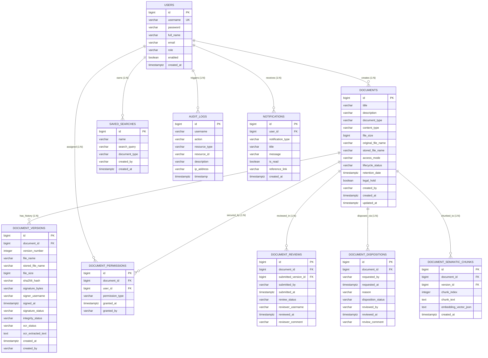
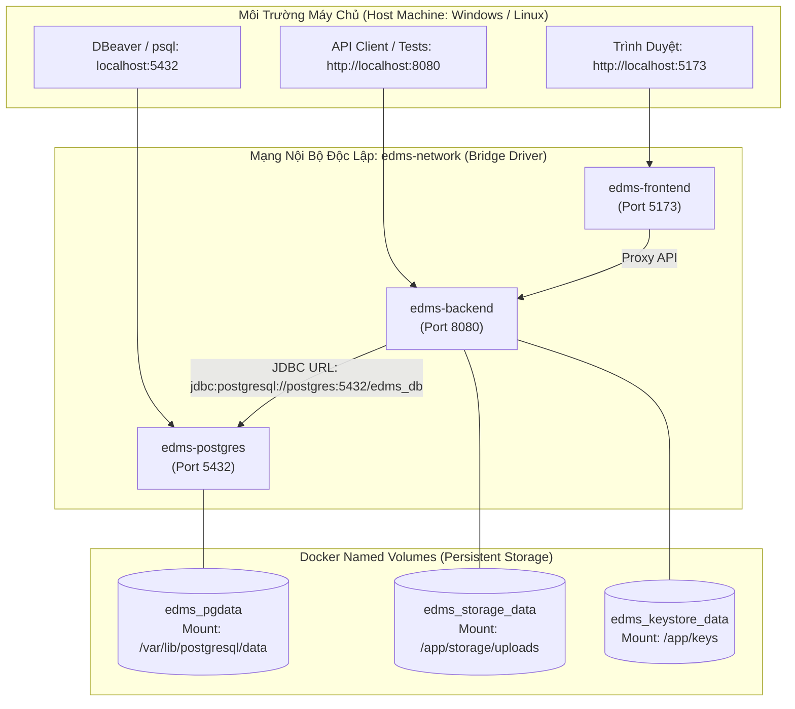

# BÁO CÁO TIẾN ĐỘ ĐỢT 2 (04/10/2026 – 10/10/2026)
## VAI TRÒ: DATABASE / DEVOPS / INTEGRATION
**Tập tin**: `BC2_04_Dinh_Thanh_Tung_Database_Integration_Design.md`  
**Thành viên thực hiện**: Đinh Thanh Tùng  
**Người nhận báo cáo**: Võ Trọng Hiếu (Business Analyst / Project Lead)  
**Mục tiêu đợt 2**: Chuẩn hóa mô hình dữ liệu vật lý (Data Model), Từ điển dữ liệu và Hợp đồng tích hợp hạ tầng (Integration Contract v1)  
**Trạng thái đợt 2**: **HOÀN THÀNH — ĐÃ KHÓA THIẾT KẾ CƠ SỞ DỮ LIỆU & DEVOPS BASELINE V1**

---

## A. HIỆN TRẠNG CƠ SỞ DỮ LIỆU (DATABASE BASELINE)

- **Hệ quản trị CSDL**: **PostgreSQL 16 Alpine** (`postgres:16-alpine`), triển khai container hóa an toàn.
- **Tên CSDL**: `edms_db` | **Người dùng quản trị**: `edms_user` | **Cổng kết nối**: `5432:5432`.
- **Cơ chế Connection Pool**: Spring Boot HikariCP (`maximum-pool-size: 15`, `minimum-idle: 5`, `connection-timeout: 20000ms`).
- **Tổng số bảng quan hệ thực tế**: **10 Bảng dữ liệu vật lý** (khớp 1:1 với 10 JPA Entities của Backend).
- **Lưu ý nghiệp vụ đặc thù**: Hệ thống **KHÔNG CÓ bảng `tasks` vật lý**. Phân hệ Task Center (`TaskCenterService`) hoạt động dựa trên cơ chế truy vấn động (Derived Work Items) từ hai bảng nguồn chân lý: `document_reviews` (trạng thái `PENDING`) và `document_dispositions` (trạng thái `PENDING`). Thiết kế này loại trừ hoàn toàn nguy cơ mất đồng bộ dữ liệu giữa bảng nhiệm vụ và dữ liệu gốc.

---

## B. DANH MỤC BẢNG CƠ SỞ DỮ LIỆU THỰC TẾ (TABLE INVENTORY V1)

Bảng tổng hợp chi tiết 10 bảng CSDL trích xuất trực tiếp từ các tệp thực thể JPA trong [`backend/src/main/java/com/edms/entity/`](file:///f:/DoAn_CNPMNC/backend/src/main/java/com/edms/entity/):

| STT | Tên Bảng Vật Lý | Mục Đích Lưu Trữ | Khóa Chính (PK) | Khóa Ngoại (Foreign Keys) | Cột Quan Trọng | Chỉ Mục Chính (Indexes) | Module Sở Hữu |
| :---: | :--- | :--- | :---: | :--- | :--- | :--- | :--- |
| 1 | `users` | Tài khoản, mật khẩu băm, vai trò bảo mật | `id` (BIGINT) | Không | `username`, `password`, `role`, `enabled` | PK, UK(`username`) | User & Security |
| 2 | `documents` | Hồ sơ tài liệu gốc, metadata, vòng đời | `id` (BIGINT) | Không | `title`, `access_mode`, `lifecycle_status`, `legal_hold` | PK, Index(`title`, `created_by`) | Document Core |
| 3 | `document_versions` | Lịch sử phiên bản, mã băm SHA-256, chữ ký số | `id` (BIGINT) | `document_id` $\rightarrow$ `documents(id)` | `version_number`, `sha256_hash`, `signature_bytes` | PK, UK(`document_id`, `version_number`) | Versioning & Signature |
| 4 | `document_permissions`| Danh sách quyền riêng (ACL) theo tài liệu | `id` (BIGINT) | `document_id`, `user_id` $\rightarrow$ `users(id)` | `permission_type` (`READ`, `WRITE`) | PK, UK(`document_id`, `user_id`) | Access Control (ACL) |
| 5 | `document_reviews` | Hàng đợi và lịch sử xét duyệt phiên bản | `id` (BIGINT) | `document_id`, `submitted_version_id` | `review_status`, `submitted_by`, `reviewer_username` | PK, Index(`review_status`) | Review Workflow |
| 6 | `document_dispositions`| Đề xuất và quyết định tiêu hủy tài liệu | `id` (BIGINT) | `document_id` $\rightarrow$ `documents(id)` | `disposition_status`, `reason`, `reviewed_by` | PK, Index(`disposition_status`) | Lifecycle & Disposition |
| 7 | `document_semantic_chunks`| Phân đoạn văn bản và vector nhúng AI 384d | `id` (BIGINT) | `document_id`, `version_id` | `chunk_index`, `chunk_text`, `embedding_vector_json` | PK, Index(`document_id`) | AI Semantic Search |
| 8 | `saved_searches` | Bộ lọc và từ khóa tìm kiếm đã lưu của user | `id` (BIGINT) | Không | `name`, `search_query`, `created_by` | PK, Index(`created_by`) | Search & Discovery |
| 9 | `notifications` | Hộp thư thông báo và cảnh báo người dùng | `id` (BIGINT) | `user_id` $\rightarrow$ `users(id)` | `notification_type`, `title`, `is_read`, `action_key` | PK, Index(`user_id`, `is_read`) | In-App Notification |
| 10 | `audit_logs` | Dòng vết kiểm toán bất biến (Audit Trail) | `id` (BIGINT) | Không | `username`, `action`, `resource_type`, `timestamp` | PK, BTREE(`action`, `timestamp`, `username`)| Audit & Compliance |

---

## C. TỪ ĐIỂN DỮ LIỆU CHI TIẾT (DATA DICTIONARY)

Dưới đây là đặc tả chi tiết các trường dữ liệu của các bảng trọng yếu:

### 1. Bảng `users` (Danh tính & Phân quyền)
| Tên Cột (Column) | Kiểu Dữ Liệu | Nullable | Giá Trị Mặc Định | Ràng Buộc (Constraint) | Ý Nghĩa Nghiệp Vụ |
| :--- | :--- | :---: | :---: | :--- | :--- |
| `id` | `BIGINT` | NOT NULL | Generated Identity | PRIMARY KEY | Khóa chính tự tăng |
| `username` | `VARCHAR(50)` | NOT NULL | Không | UNIQUE | Tên đăng nhập tài khoản |
| `password` | `VARCHAR(255)` | NOT NULL | Không | BCrypt Hash Format | Mật khẩu mã hóa một chiều (không lưu plaintext) |
| `full_name` | `VARCHAR(100)` | NULL | Không | Không | Họ và tên đầy đủ |
| `email` | `VARCHAR(100)` | NULL | Không | Không | Địa chỉ thư điện tử |
| `role` | `VARCHAR(20)` | NOT NULL | Không | CHECK (`role IN ('ROLE_USER', 'ROLE_STAFF', 'ROLE_ADMIN')`) | Vai trò bảo mật RBAC |
| `enabled` | `BOOLEAN` | NOT NULL | `true` | Không | Cờ kích hoạt (`true`: hoạt động; `false`: bị khóa) |
| `created_at` | `TIMESTAMPTZ(6)`| NOT NULL | `now()` | Không | Thời điểm tạo tài khoản |

### 2. Bảng `documents` (Hồ sơ Tài liệu Điện tử)
| Tên Cột (Column) | Kiểu Dữ Liệu | Nullable | Giá Trị Mặc Định | Ràng Buộc (Constraint) | Ý Nghĩa Nghiệp Vụ |
| :--- | :--- | :---: | :---: | :--- | :--- |
| `id` | `BIGINT` | NOT NULL | Generated Identity | PRIMARY KEY | Định danh duy nhất của tài liệu |
| `title` | `VARCHAR(255)` | NOT NULL | Không | Không | Tiêu đề văn bản |
| `description` | `VARCHAR(1000)`| NULL | Không | Không | Tóm tắt nội dung tài liệu |
| `document_type` | `VARCHAR(50)` | NULL | Không | Không | Thể loại: Báo cáo, Hợp đồng, Công văn, Quyết định |
| `content_type` | `VARCHAR(100)` | NULL | Không | Không | MIME type tệp (ví dụ `application/pdf`) |
| `file_size` | `BIGINT` | NOT NULL | 0 | `>= 0` | Kích thước tệp tính theo Bytes |
| `original_file_name`| `VARCHAR(255)`| NOT NULL | Không | Không | Tên tệp gốc do người dùng tải lên |
| `stored_file_name` | `VARCHAR(255)` | NOT NULL | Không | Không | Tên tệp vật lý UUID trên đĩa lưu trữ |
| `access_mode` | `VARCHAR(20)` | NOT NULL | `'PUBLIC'` | CHECK (`access_mode IN ('PUBLIC', 'RESTRICTED')`) | Chế độ truy cập công cộng hoặc hạn chế |
| `lifecycle_status` | `VARCHAR(20)` | NOT NULL | `'ACTIVE'` | CHECK (`lifecycle_status IN ('ACTIVE', 'ARCHIVED', 'DESTROYED')`)| Vòng đời tài liệu |
| `retention_date` | `TIMESTAMPTZ(6)`| NULL | Không | Không | Ngày hết hạn lưu trữ quy định |
| `legal_hold` | `BOOLEAN` | NOT NULL | `false` | Không | Cờ giữ pháp lý ngăn chặn tiêu hủy |
| `created_by` | `VARCHAR(50)` | NOT NULL | Không | Không | Username của tác giả tạo tài liệu |
| `created_at` | `TIMESTAMPTZ(6)`| NOT NULL | `now()` | Không | Thời điểm tải lên ban đầu |
| `updated_at` | `TIMESTAMPTZ(6)`| NOT NULL | `now()` | Không | Thời điểm cập nhật metadata gần nhất |

### 3. Bảng `document_versions` (Phiên bản & Chữ ký số)
| Tên Cột (Column) | Kiểu Dữ Liệu | Nullable | Giá Trị Mặc Định | Ràng Buộc (Constraint) | Ý Nghĩa Nghiệp Vụ |
| :--- | :--- | :---: | :---: | :--- | :--- |
| `id` | `BIGINT` | NOT NULL | Generated Identity | PRIMARY KEY | Khóa chính bản ghi phiên bản |
| `document_id` | `BIGINT` | NOT NULL | Không | FOREIGN KEY $\rightarrow$ `documents(id)` ON DELETE CASCADE | Liên kết đến tài liệu cha |
| `version_number` | `INTEGER` | NOT NULL | 1 | UNIQUE (`document_id`, `version_number`) | Số hiệu phiên bản liên tục (1, 2, 3...) |
| `file_name` | `VARCHAR(255)` | NOT NULL | Không | Không | Tên tệp phiên bản này |
| `stored_file_name` | `VARCHAR(255)` | NOT NULL | Không | Không | Tên tệp vật lý UUID trên đĩa |
| `file_size` | `BIGINT` | NOT NULL | Không | `>= 0` | Dung lượng tệp của phiên bản |
| `sha256_hash` | `VARCHAR(64)` | NOT NULL | Không | Độ dài đúng 64 ký tự hex | Mã băm toàn vẹn SHA-256 |
| `signature_bytes` | `VARCHAR(512)` | NULL | Không | Base64 String | Chữ ký số điện tử RSA 2048-bit |
| `signer_username` | `VARCHAR(50)` | NULL | Không | Không | Username của Quản trị viên đã ký số |
| `signed_at` | `TIMESTAMPTZ(6)`| NULL | Không | Không | Thời điểm thực hiện ký số |
| `signature_status` | `VARCHAR(20)` | NOT NULL | `'UNSIGNED'` | CHECK (`IN ('UNSIGNED', 'VALID', 'INVALID')`) | Trạng thái xác thực chữ ký |
| `integrity_status` | `VARCHAR(20)` | NOT NULL | `'INTACT'` | CHECK (`IN ('INTACT', 'CORRUPTED')`) | Trạng thái toàn vẹn của tệp trên đĩa |
| `ocr_status` | `VARCHAR(20)` | NOT NULL | `'NOT_APPLICABLE'`| CHECK (`IN ('PENDING', 'PROCESSING', 'SUCCESS', 'FAILED', 'NOT_APPLICABLE')`)| Tiến độ nhận dạng quang học OCR |
| `ocr_extracted_text`| `TEXT` | NULL | Không | Không | Toàn bộ văn bản trích xuất từ OCR |
| `created_at` | `TIMESTAMPTZ(6)`| NOT NULL | `now()` | Không | Thời điểm tạo phiên bản |
| `created_by` | `VARCHAR(50)` | NOT NULL | Không | Không | Tác giả tải lên phiên bản |

---

## D. SƠ ĐỒ THỰC THỂ QUAN HỆ VẬT LÝ V2 (PHYSICAL ERD V2 - MERMAID)

---

## E. MA TRẬN KHÓA NGOẠI (FOREIGN KEY MATRIX)

| Bảng Chứa Khóa Ngoại | Tên Cột FK | Tham Chiếu Đến Bảng & Cột | Quy Tắc Xóa (ON DELETE) | Quy Tắc Cập Nhật (ON UPDATE) | Ý Nghĩa Toàn Vẹn Dữ Liệu |
| :--- | :--- | :--- | :---: | :---: | :--- |
| `document_versions` | `document_id` | `documents(id)` | **CASCADE** | CASCADE | Xóa tài liệu thì toàn bộ phiên bản con bị xóa |
| `document_permissions`| `document_id` | `documents(id)` | **CASCADE** | CASCADE | Xóa tài liệu thì xóa danh sách quyền riêng |
| `document_permissions`| `user_id` | `users(id)` | **CASCADE** | CASCADE | Xóa người dùng thì xóa quyền cấp cho người đó |
| `document_reviews` | `document_id` | `documents(id)` | **CASCADE** | CASCADE | Xóa tài liệu thì xóa lịch sử xét duyệt |
| `document_dispositions`| `document_id` | `documents(id)` | **CASCADE** | CASCADE | Xóa tài liệu thì xóa lịch sử đề xuất tiêu hủy |
| `document_semantic_chunks`| `document_id` | `documents(id)` | **CASCADE** | CASCADE | Xóa tài liệu thì xóa vector nhúng AI |
| `notifications` | `user_id` | `users(id)` | **CASCADE** | CASCADE | Xóa người dùng thì xóa toàn bộ thông báo của họ |

---

## F. MA TRẬN CHỈ MỤC TỐI ƯU HÓA TRUY VẤN (INDEX MATRIX)

| Tên Chỉ Mục (Index Name) | Bảng Áp Dụng | Các Cột Chỉ Mục | Loại Chỉ Mục | Phân Loại Mục Đích | Trường Hợp Sử Dụng (Use Case) |
| :--- | :--- | :--- | :---: | :---: | :--- |
| `users_pkey` | `users` | `id` | B-Tree | **PK** | Tra cứu tài khoản theo ID |
| `uk_users_username` | `users` | `username` | B-Tree | **Unique** | Đăng nhập tài khoản & Kiểm tra trùng lặp |
| `documents_pkey` | `documents` | `id` | B-Tree | **PK** | Tra cứu metadata tài liệu theo ID |
| `idx_docs_created_by` | `documents` | `created_by` | B-Tree | **Performance** | Tải danh sách "Tài liệu của tôi" (`/api/documents/mine`) |
| `idx_docs_lifecycle` | `documents` | `lifecycle_status` | B-Tree | **Performance** | Lọc tài liệu theo trạng thái Active/Archived/Destroyed |
| `uk_doc_versions` | `document_versions` | `document_id`, `version_number` | B-Tree | **Unique** | Đảm bảo tính liên tục duy nhất của số phiên bản |
| `idx_versions_hash` | `document_versions` | `sha256_hash` | B-Tree | **Performance** | Đối soát tính toàn vẹn và chống trùng lặp tệp |
| `uk_doc_permissions` | `document_permissions`| `document_id`, `user_id` | B-Tree | **Unique** | Chống cấp quyền trùng lặp cho cùng 1 user trên 1 file |
| `idx_reviews_status` | `document_reviews` | `review_status` | B-Tree | **Performance** | Tải nhanh Hàng đợi xét duyệt của Admin & Task Center |
| `idx_disp_status` | `document_dispositions`| `disposition_status` | B-Tree | **Performance** | Tải nhanh Hàng đợi tiêu hủy của Admin & Task Center |
| `idx_notifs_user_read`| `notifications` | `user_id`, `is_read` | B-Tree | **Performance** | Đếm nhanh số thông báo chưa đọc trên quả chuông Navbar |
| `idx_audit_action_time`| `audit_logs` | `action`, `timestamp` | B-Tree | **Performance** | Lọc và phân trang lịch sử kiểm toán trong AuditLogPage |

---

## G. HỢP ĐỒNG DEVOPS & HẠ TẦNG CONTAINER (DOCKER ARCHITECTURE)

Cấu hình khóa tại [`docker-compose.yml`](file:///f:/DoAn_CNPMNC/docker-compose.yml) và [`docker-compose.recovery.yml`](file:///f:/DoAn_CNPMNC/docker-compose.recovery.yml):

- **Quản lý biến môi trường an toàn**:
  - `EDMS_KEYSTORE_PASSWORD` nạp từ tệp `.env` cục bộ (đã đưa vào `.gitignore`).
  - Mẫu tệp an toàn `.env.example` cung cấp placeholder `CHANGE_ME`.
  - Phân tách cấu hình profile môi trường:
    - `SPRING_PROFILES_ACTIVE=prod`: Vô hiệu hóa 100% header giả lập lỗi `X-Test-Simulate-Failure`.
    - `SPRING_PROFILES_ACTIVE=operational-test`: Cho phép mô phỏng sự cố có kiểm soát cho bộ test tự động.

---

## H. MA TRẬN BẢO TOÀN DỮ LIỆU & PHỤC HỒI THẢM HỌA (PERSISTENCE MATRIX)

| Miền Dữ Liệu (Data Domain) | Vị Trí Lưu Trữ Vận Hành (Operating Location) | Named Volume Đảm Bảo | Nguồn Sao Lưu (Backup Source) | Mục Tiêu Phục Hồi Thảm Họa (DR Target) |
| :--- | :--- | :--- | :--- | :--- |
| **Cơ sở dữ liệu quan hệ** (Users, Docs, Logs, Perms) | Container: `/var/lib/postgresql/data` | `edms_pgdata` | Script `pg_dump` $\rightarrow$ `backups/edms_db_*.sql.gz` | `docker-compose.recovery.yml` nạp lại qua `psql` |
| **Tệp tài liệu gốc & phiên bản** (PDF, PNG, DOCX) | Container: `/app/storage/uploads` | `edms_storage_data` | Tarball `backups/edms_storage_*.tar.gz` | Giải nén nguyên vẹn vào volume `edms_storage_data` |
| **Kho khóa ký số điện tử** (`edms-signing.p12`) | Container: `/app/keys/edms-signing.p12`| `edms_keystore_data` | Bản sao lưu mã hóa `edms-signing.p12.bak` | Khôi phục khóa riêng RSA và chứng chỉ X.509 v3 |

---

## I. HỢP ĐỒNG TÍCH HỢP HẠ TẦNG (INTEGRATION CONTRACTS)

1. **Backend Entity $\leftrightarrow$ PostgreSQL Table**: Ánh xạ Hibernate ORM 1:1 qua quy ước đặt tên CamelCase sang snake_case (`DocumentVersion` $\rightarrow$ `document_versions`).
2. **FileStorageService $\leftrightarrow$ Storage Volume**: Tệp tải lên được lưu trữ với định dạng `{UUID}_{OriginalFileName}` tại đường dẫn `/app/storage/uploads`, đảm bảo không trùng tên tệp và tránh ký tự đặc biệt.
3. **SignatureService $\leftrightarrow$ KeyStore Volume**: Đọc chứng chỉ số từ `/app/keys/edms-signing.p12` theo chuẩn PKCS#12, bảo tồn số seri chứng chỉ bất biến `1790137027180`.
4. **OcrService $\leftrightarrow$ Tesseract Process**: Tương tác thông qua tiến trình ngoài `ProcessBuilder` gọi nhị phân `tesseract` với gói ngôn ngữ `vie+eng`.
5. **DR Scripts $\leftrightarrow$ Backup Artifacts**: Quy trình sao lưu và phục hồi thảm họa được kiểm chứng tự động qua 38 bài test trong [`test_disaster_recovery.py`](file:///f:/DoAn_CNPMNC/test_disaster_recovery.py), đạt tỷ lệ thành công 100%.

---

## J. ĐÓNG BĂNG HỢP ĐỒNG CSDL & DEVOPS (DB / DEVOPS CONTRACT FREEZE RESULT)

1. **STABLE**: Cấu trúc 10 bảng dữ liệu, Khóa chính, Khóa ngoại, Ràng buộc Unique, Chỉ mục B-Tree, Cấu hình Docker Compose 3 container và 3 Named Volumes.
2. **KẾ HOẠCH ĐỢT 3**:
   - Xây dựng bộ script Flyway Migration (`V1__initial_schema.sql`, `V2__add_indexes.sql`) để tự động hóa quản lý phiên bản lược đồ CSDL.
   - Bổ sung cấu hình sao lưu CSDL tự động định kỳ hàng ngày lúc 02:00 sáng.

---
*Xác nhận của thành viên thực hiện:*  
**Đinh Thanh Tùng** (Database / DevOps / Integration) — *Đã ký và khóa hợp đồng CSDL Đợt 2.*
