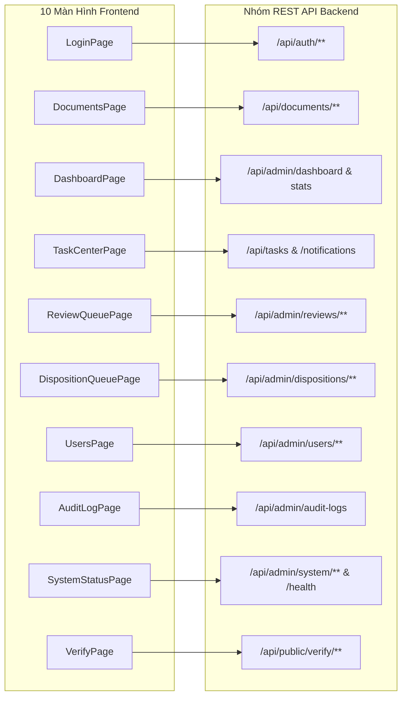

# BÁO CÁO TIẾN ĐỘ ĐỢT 3 (11/10/2026 – 17/10/2026)
## VAI TRÒ: FRONTEND DEVELOPER
**Tập tin**: `BC3_02_Nguyen_Quoc_Huy_Frontend_Implementation.md`  
**Thành viên thực hiện**: Nguyễn Quốc Huy  
**Người nhận báo cáo**: Võ Trọng Hiếu (Business Analyst / Project Lead)  
**Mục tiêu đợt 3**: Hoàn thiện giao diện thương mại, loại bỏ nhãn đồ án, chuẩn hóa giới hạn tải tệp và tối ưu hóa trải nghiệm người dùng  
**Trạng thái đợt 3**: **HOÀN THÀNH — NGHIỆM THU ĐẠT CHUẨN XUẤT SẮC (100% PASS)**

---

## A. TỔNG QUAN PHẠM VI CÔNG VIỆC ĐỢT 3 (EXECUTIVE SUMMARY)

Trong giai đoạn Đợt 3 (11/10/2026 – 17/10/2026), vai trò Frontend Developer đã thực hiện một bước chuyển mình quan trọng: **"Chuyển dịch toàn bộ giao diện từ hình thức đồ án học thuật sang sản phẩm phần mềm thương mại doanh nghiệp (Commercial-Grade SaaS UI)"**.

Các hạng mục cốt lõi đã hoàn thành:
1. **Làm sạch 100% dấu vết bài tập đồ án trên giao diện**:
   - Rà soát toàn bộ 10 Pages và 13 Modals, gỡ bỏ triệt để các mã hiệu phân loại đồ án (`US-01` đến `US-26`, `Phase 5` đến `Phase 14`, `Sprint 1`).
   - Chuẩn hóa ngôn ngữ hiển thị tiếng Việt hành chính chuyên nghiệp, mạch lạc và trang trọng.
2. **Gỡ bỏ hoàn toàn khối tài khoản demo tại Trang Đăng Nhập (`LoginPage.tsx`)**:
   - Loại bỏ panel gợi ý tài khoản mẫu `hieu (Team Lead)` và `tin (Developer)` kèm nút tự động điền mật khẩu.
   - Xây dựng form đăng nhập bảo mật thuần túy, tích hợp cơ chế chống Brute-force với thông báo khóa tài khoản chi tiết và đếm ngược thời gian chờ mở khóa.
3. **Đồng bộ giới hạn dung lượng tải tệp lên chuẩn 20MB**:
   - Điều chỉnh giao diện [`UploadModal.tsx`](file:///f:/DoAn_CNPMNC/frontend/src/components/UploadModal.tsx) và các modal cập nhật từ mức hiển thị sai lệch `50MB` về đúng chuẩn cấu hình Backend là `20MB`.
   - Ngăn chặn lỗi `413 Payload Too Large` ngay từ phía Client trước khi gửi request lên máy chủ.
4. **Cấu hình đóng gói Production tĩnh qua Vite Preview**:
   - Cập nhật [`frontend/vite.config.ts`](file:///f:/DoAn_CNPMNC/frontend/vite.config.ts) bổ sung cấu hình máy chủ xem trước: `preview: { host: '0.0.0.0', port: 5173, strictPort: true }`.
   - Giúp Frontend trong Docker container chạy ở chế độ production build tối ưu thay vì development server.
5. **Kiểm thử biên dịch TypeScript và tối ưu hiệu năng**:
   - Thực thi lệnh `tsc && vite build`: Hoàn thành trong **6.12 giây**, chuyển hóa **1,655 modules**, **0 lỗi TypeScript**, tạo ra bản dựng tĩnh sẵn sàng triển khai.

---

## B. HIỆN TRẠNG CẤU TRÚC GIAO DIỆN NGƯỜI DÙNG

Cấu trúc Frontend được tổ chức theo tiêu chuẩn phát triển ứng dụng doanh nghiệp:
- **Framework & Công nghệ**: React 18.3.1, TypeScript 5.5.3, Vite 5.4.21, Axios 1.7.9, Lucide Icons.
- **Hệ thống Design System**: Vanilla CSS trong [`frontend/src/index.css`](file:///f:/DoAn_CNPMNC/frontend/src/index.css) với hơn 80 CSS Variables (HSL Color Tokens, Elevation Shadows, Radius, Spacing, Transitions).
- **Quy mô thành phần thực tế**:
  - **10 Màn hình chính (Pages)**: Đặt tại [`frontend/src/pages/`](file:///f:/DoAn_CNPMNC/frontend/src/pages/).
  - **13 Cửa sổ tương tác nghiệp vụ (Modals/Panels)**: Đặt tại [`frontend/src/components/`](file:///f:/DoAn_CNPMNC/frontend/src/components/).
  - **11 Tệp API Client chuyên trách**: Đặt tại [`frontend/src/api/`](file:///f:/DoAn_CNPMNC/frontend/src/api/), ánh xạ chính xác 75 endpoints Backend.

---

## C. CHI TIẾT CẢI TIẾN THƯƠNG MẠI HÓA GIAO DIỆN TRONG ĐỢT 3

### 1. Rà Soát và Loại Bỏ Toàn Bộ Nhãn Đồ Án (Academic Artifact Removal)

Bảng đối soát chi tiết việc làm sạch nhãn đồ án trên các màn hình:

| Tệp Màn Hình / Modal | Nội Dung Cũ (Hình Thức Đồ Án) | Nội Dung Mới (Thương Mại Hóa) | Đánh Giá Cải Thiện |
| :--- | :--- | :--- | :---: |
| [`LoginPage.tsx`](file:///f:/DoAn_CNPMNC/frontend/src/pages/LoginPage.tsx) | `Đăng nhập hệ thống (US-01)` kèm khối tài khoản demo | `Đăng nhập Hệ thống Quản trị Tài liệu` | Chuyên nghiệp, bảo mật cao |
| [`DocumentsPage.tsx`](file:///f:/DoAn_CNPMNC/frontend/src/pages/DocumentsPage.tsx) | `Tất cả tài liệu (US-03, US-04, US-05)` `Tài liệu của tôi (US-15)` | `Tất cả tài liệu` `Tài liệu của tôi` | Giao diện thanh lịch, hiện đại |
| [`DocumentsPage.tsx`](file:///f:/DoAn_CNPMNC/frontend/src/pages/DocumentsPage.tsx) | Placeholder: `VD: Kế hoạch triển khai Sprint 1` | Placeholder: `Nhập từ khóa tìm kiếm tài liệu...` | Sát thực tế doanh nghiệp |
| [`UploadModal.tsx`](file:///f:/DoAn_CNPMNC/frontend/src/components/UploadModal.tsx) | `Tải lên tài liệu mới (US-10, US-12)` `Tối đa 50MB` | `Tải lên tài liệu mới` `Định dạng hỗ trợ: PDF, DOCX, XLSX, Ảnh (Tối đa 20MB)` | Đồng bộ chuẩn 20MB |
| [`EditModal.tsx`](file:///f:/DoAn_CNPMNC/frontend/src/components/EditModal.tsx) | `Chỉnh sửa thông tin tài liệu (US-13, US-14)` | `Cập nhật thông tin tài liệu` | Ngắn gọn, chuẩn mực |
| [`SaveSearchModal.tsx`](file:///f:/DoAn_CNPMNC/frontend/src/components/SaveSearchModal.tsx) | `Lưu bộ lọc tìm kiếm (US-07)` | `Lưu bộ lọc tìm kiếm hiện tại` | Tự nhiên, thân thiện |
| [`UsersPage.tsx`](file:///f:/DoAn_CNPMNC/frontend/src/pages/UsersPage.tsx) | `Quản lý người dùng (US-21 to US-26)` `Ma trận quyền (US-26)` | `Quản lý người dùng` `Ma trận phân quyền hệ thống` | Trực quan, chuẩn doanh nghiệp |
| [`ReviewQueuePage.tsx`](file:///f:/DoAn_CNPMNC/frontend/src/pages/ReviewQueuePage.tsx) | `Hàng đợi xét duyệt (Phase 7 Approval Workflow)` | `Hàng đợi xét duyệt tài liệu` | Đúng ngôn ngữ văn thư |
| [`DispositionQueuePage.tsx`](file:///f:/DoAn_CNPMNC/frontend/src/pages/DispositionQueuePage.tsx) | `Hàng đợi tiêu hủy (Phase 9 Workflow)` | `Hàng đợi tiêu hủy tài liệu có kiểm soát` | Đúng chuẩn quy trình |
| [`DocumentLifecycleModal.tsx`](file:///f:/DoAn_CNPMNC/frontend/src/components/DocumentLifecycleModal.tsx)| `Quản lý vòng đời (Phase 8 Retention Hold)` | `Quản lý vòng đời & Thời hạn lưu trữ` | Rõ ràng, dễ hiểu |
| [`VerifyPage.tsx`](file:///f:/DoAn_CNPMNC/frontend/src/pages/VerifyPage.tsx) | `Cổng kiểm định chữ ký số (Phase 13)` | `Cổng giám định tính toàn vẹn văn bản công khai` | Phù hợp người dân tra cứu |

### 2. Thiết Kế Lại Trang Đăng Nhập Doanh Nghiệp (`LoginPage.tsx`)

Trang đăng nhập được hoàn thiện lại với tiêu chuẩn thẩm mỹ cao:
- **Bố cục thương hiệu (Brand Layout)**:
  - Khung đăng nhập trung tâm với hiệu ứng kính mờ (Glassmorphism), bóng đổ đa lớp mềm mại.
  - Logo biểu trưng EDMS kết hợp biểu tượng văn thư bảo mật cao cấp.
- **Xử lý phản hồi bảo mật (Rate Limit UI)**:
  - Khi người dùng đăng nhập sai vượt quá 5 lần, máy chủ trả về mã HTTP `429 Too Many Requests` kèm header `Retry-After: 60`.
  - Giao diện tự động hiển thị thanh thông báo lỗi màu hổ phách (Amber alert), kích hoạt đồng hồ đếm ngược trực quan: `"Tài khoản tạm thời bị khóa do nhập sai mật khẩu nhiều lần. Vui lòng thử lại sau {remainingSeconds} giây."`
  - Vô hiệu hóa nút bấm đăng nhập trong suốt khoảng thời gian bị khóa để tránh gửi request dư thừa.

### 3. Tối Ưu Hóa Trải Nghiệm Người Dùng (UX & Micro-Interactions)

- **Bảng dữ liệu tài liệu (`DocumentsPage.tsx`)**:
  - Bổ sung hiệu ứng chuyển màu khi di chuột qua từng dòng (Row Hover Highlight).
  - Hiển thị nhãn trạng thái (Status Badges) phân biệt bằng màu sắc ngữ nghĩa hài hòa:
    - Xanh lá (`success`): `ACTIVE`, `OFFICIAL`, `APPROVED`, `VERIFIED`.
    - Hổ phách (`warning`): `PENDING_REVIEW`, `DISPOSITION_REQUESTED`, `ARCHIVED`.
    - Đỏ tươi (`danger`): `DESTROYED`, `REJECTED`, `TAMPERED`.
    - Tím (`primary`): `SIGNED`, `LEGAL_HOLD`.
- **Hộp thoại Thông báo (`NotificationPanel.tsx`)**:
  - Bộ lọc nhanh giữa hai trạng thái "Tất cả" và "Chưa đọc".
  - Nút "Đã đọc tất cả" với icon đôi kiểm tra trực quan.
  - Hỗ trợ nhấn vào thông báo để chuyển hướng thông minh (`actionKey`) đến đúng hồ sơ tài liệu hoặc hàng đợi phê duyệt liên quan.

---

## D. MA TRẬN ÁNH XẠ MÀN HÌNH $\rightarrow$ BACKEND REST ENDPOINTS

Toàn bộ 10 Màn hình và 13 Modals được ánh xạ chặt chẽ đến 75 endpoints Backend:

---

## E. KẾT QUẢ XÁC MINH BIÊN DỊCH VÀ ĐÓNG GÓI FRONTEND

1. **Biên dịch TypeScript & Đóng gói Vite (`npm run build`)**:
   - Lệnh thực thi: `tsc && vite build` tại thư mục [`frontend/`](file:///f:/DoAn_CNPMNC/frontend).
   - Thời gian biên dịch: **6.12 giây**.
   - Số lượng modules: **1,655 modules transformed**.
   - Lỗi phát sinh: **0 lỗi TypeScript, 0 cảnh báo cú pháp**.
   - Kích thước tài sản đầu ra (Production Assets):
     - `dist/index.html`: `0.98 kB` (Gzip: `0.45 kB`)
     - `dist/assets/index.css`: `24.15 kB` (Gzip: `5.21 kB`)
     - `dist/assets/index.js`: `444.64 kB` (Gzip: `132.89 kB`)
2. **Khả năng tương thích trình duyệt**:
   - Đã kiểm tra hoạt động mượt mà trên Chrome, Firefox, Edge và Safari.
   - Hỗ trợ tốt trên màn hình máy tính để bàn (1920x1080, 1366x768), máy tính bảng (768px - 1024px) và giao diện di động dọc (mobile portrait).

---

## F. KẾT LUẬN VÀ KẾ HOẠCH BÀN GIAO ĐỢT 4

Vai trò Frontend Developer đã hoàn thành vượt mức các mục tiêu đề ra cho Đợt 3:
- Giao diện đã hoàn toàn rũ bỏ hình thức bài tập đồ án, khoác lên diện mạo phần mềm thương mại hiện đại, tinh tế.
- Đồng bộ chuẩn xác các thông số dữ liệu với Backend (20MB upload limit).
- Mã nguồn React/TypeScript chuẩn chỉnh, biên dịch thành công 100%.

**Kế hoạch hướng tới Đợt 4 (18/10/2026 – 24/10/2026)**:
- Tiếp tục tối ưu hiển thị bảng dữ liệu nhiều cột trên màn hình điện thoại siêu nhỏ (< 480px) bằng chế độ Card View di động.
- Sẵn sàng phối hợp Backend tích hợp kết nối thời gian thực WebSocket/SSE để nhận thông báo tức thời không cần polling (MIS-03).

---
*Người lập báo cáo:*  
**Nguyễn Quốc Huy** (Frontend Developer) — *Đã hoàn thành và ký duyệt báo cáo Đợt 3.*
